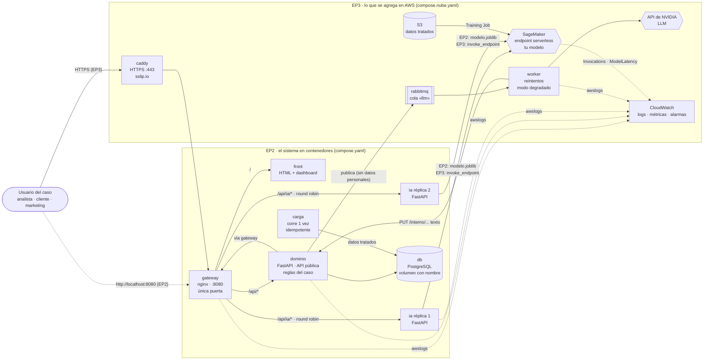
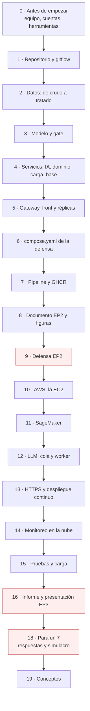

# ITY1102 · Guía y plantilla del proyecto · EP2 y EP3

Esta es una **plantilla completa y probada** del sistema que piden la Evaluación Parcial 2 y la
Evaluación Parcial 3 de *Arquitectura de Sistemas de IA*, más una **guía paso a paso** para llegar desde
cero —datos crudos y sucios— hasta un sistema corriendo en AWS, con HTTPS, su modelo en SageMaker, un
LLM por la API de NVIDIA, pruebas, pipeline y monitoreo.

Sirve para **los tres casos** (recomendación e-commerce, chatbot telco y detección de fraude). Todo lo
que no depende del caso ya funciona. Lo que sí depende del caso viene resuelto con una primera decisión
razonable y marcado como **DESAFÍO**: tu equipo tiene que revisarlo, entenderlo, cambiarlo si no está de
acuerdo y defenderlo con sus números. La nota de EP2 y EP3 está casi toda en la defensa (70% y 80%):
**lo que no entiendas de esta plantilla te lo van a preguntar con el teclado.**

> **Antes de seguir:** usar esta plantilla no te exime de nada. El informe es tuyo, los números son los
> de tu sistema y la declaración de uso de IA (anexo B) tiene que mencionar que partieron de ella.

---

## Todo lo que tienes que tener al final

Este es el sistema completo. Lo de la izquierda del borde punteado es EP2 (corre en cualquier computador
con Docker); lo que se agrega a la derecha es EP3 (corre en una EC2 del Learner Lab).



| Pieza | Dónde está en la plantilla | Evaluación |
|---|---|---|
| Tratamiento de datos (`preparar.py`) con perfilado, limpieza, integración, variables y separación | `datos/` | EP2 §2.2 |
| Modelo propio, con métrica, línea base y gate de calidad | `modelo/` | EP2 §2.2, EP3 §3 |
| Front, gateway, dominio, IA ×2, base, carga | `servicios/`, `compose.yaml` | EP2 §2.1, §2.3 |
| Gitflow `feat/ → dev → main → tag` y pipeline que prueba y publica en GHCR | `.github/workflows/ci.yml` | EP2 §2.4, §2.5 |
| Modelo en SageMaker serverless, entrenado con tus datos tratados | `sagemaker/` | EP3 §2.2 |
| Worker LLM por cola, reintentos, modo degradado, anonimización | `servicios/worker/`, `comun/anonimizar.py` | EP3 §2.3 |
| HTTPS, API con clave, 422, 429, `/docs` | `Caddyfile`, `servicios/dominio/` | EP3 §2.4, §2.5 |
| Despliegue continuo a la EC2 por SSH | `ci.yml` (job `desplegar`) | EP3 §2.6 |
| Logs, métricas, dashboard y alarmas en CloudWatch; Prometheus y Grafana | `compose.cloudwatch.yaml`, `herramientas/cloudwatch.py`, `monitoreo/` | EP2 §1.5, EP3 §4.2 |
| 10+ pruebas automatizadas (las 6 obligatorias) y prueba de carga con Locust | `tests/`, `servicios/*/tests/`, `pruebas/` | EP3 §4.3 |

---

## La guía, en orden

Cada capítulo dice qué vas a lograr, los comandos exactos, qué deberías ver, y qué va al informe y a la
defensa. Si tu equipo **no ha hecho nada**, empieza en el 0 y sigue en orden; si llegan a EP3 sin
sistema, la **[ruta exprés](guia/00b-ruta-express-ep3.md)** lo ordena en cinco días. Si ya tienen parte,
cada capítulo empieza con una lista «ya lo tengo si...» para saltarlo con seguridad.



| # | Capítulo | Para |
|---|---|---|
| 0 | [Antes de empezar](guia/00-antes-de-empezar.md) | Repartir el trabajo, crear cuentas, instalar lo necesario |
| 0b | [Ruta exprés de EP3](guia/00b-ruta-express-ep3.md) | EP3 en cinco días partiendo de cero, con quién hace qué |
| 1 | [Repositorio y gitflow](guia/01-repositorio-y-gitflow.md) | Tu copia de la plantilla, ramas, pull requests por integrante |
| 2 | [Datos: de crudo a tratado](guia/02-datos.md) | `preparar.py`: los seis pasos que exige EP2 §2.2 |
| 3 | [El modelo y su gate](guia/03-modelo.md) | Entrenar, medir contra la línea base, decidir si se publica |
| 4 | [Los servicios](guia/04-servicios.md) | IA, dominio, carga y base: qué hace cada uno y cómo se hablan |
| 5 | [Gateway, front y réplicas](guia/05-gateway-front-replicas.md) | Balanceo, failover y la pregunta del IE4 |
| 6 | [El compose de la defensa](guia/06-compose-defensa.md) | Las nueve reglas, probadas |
| 7 | [Pipeline y GHCR](guia/07-pipeline.md) | Pruebas, imágenes `linux/amd64`, tags `sha-`, `latest`, `ep2`, `ep3` |
| 8 | [El documento de EP2](guia/08-documento-ep2.md) | arc42, las 8 figuras, dimensionamiento, costos, alta disponibilidad |
| 9 | [La defensa de EP2](guia/09-defensa-ep2.md) | Cada pregunta, con los comandos para responderla |
| 10 | [AWS: la EC2](guia/10-aws-ec2.md) | Learner Lab, IP elástica, rol sin claves, Docker |
| 11 | [SageMaker](guia/11-sagemaker.md) | Tu modelo en un endpoint serverless, con tus datos |
| 12 | [LLM, cola y worker](guia/12-llm-cola.md) | NVIDIA, anonimización, reintentos, modo degradado |
| 13 | [HTTPS y despliegue continuo](guia/13-https-despliegue.md) | Caddy, sslip.io, secretos, CD por SSH, tag `ep3` |
| 14 | [Monitoreo en la nube](guia/14-monitoreo.md) | CloudWatch Logs, métricas, dashboard, alarmas; Grafana |
| 15 | [Pruebas y carga](guia/15-pruebas-carga.md) | Las 10+ pruebas, Locust, cold start, latencia del LLM |
| 16 | [Informe y presentación EP3](guia/16-informe-presentacion-ep3.md) | Los 5 apartados, costos, láminas, demo y preguntas |
| 17 | [Problemas frecuentes](guia/17-problemas-frecuentes.md) | Síntoma → causa → qué hacer (incluye lo encontrado en el Learner Lab) |
| 18 | [Para un 7](guia/18-respuestas-de-7.md) | Qué exige el 100% de cada indicador, respuestas modelo con números reales, repreguntas, simulacro |
| 19 | [Conceptos](guia/19-conceptos.md) | El lenguaje del IE12: qué es, dónde está en tu sistema, el error típico |

Y una ficha por caso, con sus datos, sus reglas, su LLM y **sus desafíos**:
[Caso 1 · recomendación](casos/recomendacion.md) ·
[Caso 2 · chatbot](casos/chatbot.md) ·
[Caso 3 · fraude](casos/fraude.md).
Para la entrega de EP3: [plantilla del informe](entrega/informe-ep3.md) ·
[las 6 láminas por caso](entrega/laminas-ep3.md).

---

## Arranque en cinco comandos

Con Docker Desktop corriendo y tu repositorio ya creado desde esta plantilla (capítulo 1):

```bash
git clone https://github.com/<tu-usuario>/<tu-repo>.git && cd <tu-repo>
herramientas/iniciar.sh fraude          # o recomendacion, o chatbot
herramientas/levantar-local.sh          # trata los datos, entrena, construye y levanta
open http://localhost:8080              # en Windows: start http://localhost:8080
herramientas/verificar-defensa.sh       # las nueve reglas del compose de EP2
```

En Windows, corre los `.sh` desde **Git Bash** (viene con Git for Windows) o desde WSL.

---

## Cómo está organizada la plantilla

```text
.
├── CASO                      ← tu caso: recomendacion | chatbot | fraude (lo escribe iniciar.sh)
├── comun/                    ← lo que usan el entrenamiento Y los servicios (variables del modelo, anonimizar)
├── datos/
│   ├── crudos/<caso>/        ← los CSV sucios del caso, tal cual
│   ├── casos/<caso>.py       ← el tratamiento de TU caso (DESAFÍOS)
│   ├── limpieza.py           ← herramientas de limpieza para los tres casos
│   └── preparar.py           ← lo que corre el pipeline: crudos → datos/tratados/
├── modelo/                   ← entrenar.py (con gate) y config.json (la métrica mínima)
├── servicios/
│   ├── gateway/  front/      ← nginx: la puerta y la página
│   ├── dominio/              ← la API pública y las reglas del caso (app/casos/<caso>.py)
│   ├── ia/                   ← el modelo: local (EP2) o SageMaker (EP3)
│   ├── carga/                ← llena la base una vez, sin duplicar
│   └── worker/               ← EP3: la cola y el LLM
├── sagemaker/                ← EP3: subir datos, entrenar, endpoint, probar, borrar
├── compose.yaml              ← EP2: el de la defensa (solo imágenes de GHCR)
├── compose.dev.yaml          ← para construir en tu computador
├── compose.nube.yaml         ← EP3: Caddy, RabbitMQ, worker
├── compose.cloudwatch.yaml   ← EP3: logs a CloudWatch
├── compose.ensayo.yaml       ← EP3 en tu computador, con SageMaker y NVIDIA simulados
├── compose.monitoreo.yaml    ← Prometheus y Grafana (opcional)
├── herramientas/             ← iniciar, levantar, probar, ensayar, medir, verificar, cloudwatch, costos, evidencias
├── pruebas/                  ← Locust y los dobles del ensayo
├── tests/                    ← pruebas del tratamiento de datos
├── entrega/                  ← plantillas del informe y de las láminas de EP3
└── guia/  casos/             ← esta guía (guia/img: capturas de la consola de AWS)
```

## Los desafíos

En el código vas a encontrar comentarios como este:

```python
# DESAFÍO F1 · tasa fija para convertir USD a CLP. ¿De dónde sale? ¿La actualizarías? Defiéndela.
TASA_USD_CLP = 950
```

Son las decisiones que **no tienen una única respuesta correcta** y que el docente va a preguntar. La
plantilla trae una respuesta que funciona; tu trabajo es decidir si es la tuya. Para listarlos todos:

```bash
grep -rn "DESAFÍO" --include=*.py --include=*.yaml --include=*.yml --include=*.json .
```

La ficha de tu caso (`casos/<caso>.md`) explica cada uno: qué decidir, cómo comprobarlo, qué escribir
en el informe y qué te pueden preguntar.

## Lo que se verificó

**En un computador** (Mac, Docker 29, Python 3.12), con los datos reales de **los tres casos**, uno por
uno: tratamiento (también en Python 3.9, el de CloudShell, con el mismo resultado byte a byte),
entrenamiento con gate, las pruebas de todos los servicios (10 de datos, 8 de IA, 17 a 20 del dominio
contra PostgreSQL y 6 del worker, con `herramientas/probar.sh`), el sistema completo con `compose.yaml`
(salud, front, predicción, carga idempotente), el balanceo y la caída de una réplica, la medición con
`medir.sh`, el ensayo de EP3 con dobles de SageMaker y NVIDIA, Prometheus y Grafana con sus alertas, y la
prueba del 422 escrita en vivo para los tres casos. Los diagramas se renderizaron con Mermaid 11.

**En AWS Academy Learner Lab** (cuenta de alumno, us-east-1, 17-11-2026), con capturas en los capítulos
10 a 14: los scripts de `sagemaker/` para los tres casos (Training Jobs, endpoints serverless
`InService`, métricas de prueba, incluido el `multi:softprob` del chatbot), la EC2 `t3.medium` con
`LabInstanceProfile` y hop limit 2, el sistema completo del caso 3 con Caddy y Let's Encrypt sobre
sslip.io, SageMaker invocado con el rol, la API de NVIDIA real y su modo degradado, `awslogs` con
`LabRole`, `herramientas/cloudwatch.py`, el cold start (`ModelSetupTime` 6,2 s), el throttling con
concurrencia 2 y una prueba de Locust contra la URL HTTPS. Los hallazgos están en 11.6, 12.2, 15.4 y el
capítulo 17.

**El pipeline completo con despliegue continuo**, en un repositorio público de equipo simulado
([`Umbingelelo/ity1102-prueba-equipo`](https://github.com/Umbingelelo/ity1102-prueba-equipo)):
`iniciar.sh`, PR `feat/` → `dev` → `main`, imágenes públicas en GHCR, el job `desplegar` por SSH a la EC2
(41 s), el rollback por `TAG` (34 s) y el tag `ep3` (capítulo 13.6). Esa prueba encontró un error que
ya está corregido: `reglas-compose` fallaba en todo repositorio recién iniciado por un comentario de
`compose.yaml`.

**Una advertencia del caso 2:** su modelo da F1 = 1,0 porque el 99% de los mensajes de prueba aparecen
textuales en el entrenamiento (la muestra tiene pocas plantillas de texto). No es un modelo perfecto: es
un desafío de su ficha (M4).
