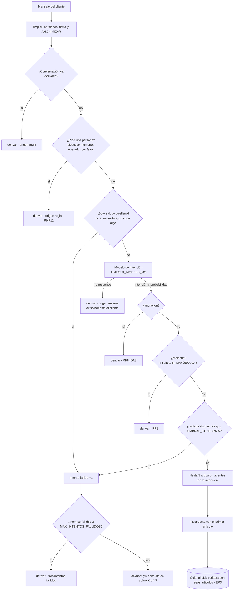

# Caso 2 · Andesnet · el asistente que reconoce la intención y sabe cuándo derivar

[Índice de la guía](../README.md) · Fichas: [recomendación](recomendacion.md) · **chatbot** · [fraude](fraude.md)

Esta guía explica cómo está resuelto el caso 2 en la plantilla, qué decisiones quedaron tomadas y cuáles
tiene que revisar y defender tu equipo. Cada número sale de `datos/tratados/REPORTE.md` y de
`modelo/artefactos/METRICAS.md`: si cambias una regla, vuelve a correr `python datos/preparar.py` y
`python modelo/entrenar.py` y actualiza los números en tu informe.

## 1. Tu caso en una página

| | |
|---|---|
| **Qué decide el modelo** | La **intención** de un mensaje del cliente, entre 10: `facturacion`, `falla_tecnica`, `cobertura`, `cambio_plan`, `visita_tecnica`, `anulacion`, `equipos`, `portabilidad`, `roaming`, `tv`. Devuelve la intención, su probabilidad y las dos alternativas siguientes (RF2) |
| **Qué NO decide el modelo** | Si se deriva a un ejecutivo. Eso lo deciden reglas escritas en el dominio (RF8, RNF11), y nunca el LLM |
| **Quién usa la salida** | El cliente, que recibe la respuesta del artículo de ayuda (RF6) o el aviso de derivación; el ejecutivo, que ve en `GET /api/derivaciones` qué pidió el cliente y por qué se derivó (RF7); y Experiencia de clientes, que mira la tasa de derivación y de modo degradado en el dashboard (RNF9) |
| **Entrada** | `POST /api/predict` o `POST /api/conversacion` con `{"mensaje", "conversacion_id"?, "cliente_id"?, "canal": "web" \| "whatsapp" \| "app"}`. El mismo flujo para los tres canales (RF1) |
| **Salida** | `decision` (la intención, `aclarar` o `derivar`), `probabilidad`, `mensaje`, `articulos`, `alternativas`, `derivar`, `motivo_derivacion`, `origen` (`modelo`, `regla` o `reserva`) y `estado_llm` |

Los requerimientos que mandan en este caso:

| Código | Qué exige | Dónde se cumple |
|---|---|---|
| **RF2** | Reconocer la intención en español de Chile, con errores de escritura | El modelo (`comun/caracteristicas/chatbot.py`, `modelo/entrenar.py`) |
| **RF6** | Responder con la base de conocimiento | `_articulos()` en `servicios/dominio/app/casos/chatbot.py` |
| **RF7** | Derivar con el historial, sin que el cliente repita | `GET /api/derivaciones` y la tabla `sesiones_chat` |
| **RF8** | Derivar ante anular, molestia o tres intentos fallidos | `predecir()` del dominio, paso 4 |
| **RNF5** | Ningún dato personal sale sin anonimizar | `comun/anonimizar.py`, aplicado al texto ANTES de todo |
| **RNF8** | Derivar en menos de 30 s | Las reglas de derivación no esperan al LLM |
| **RNF9** | Medir tasa de resolución y de derivación | `GET /api/dashboard` |
| **RNF11** | «Quiero hablar con una persona» funciona siempre | Regla `PIDE_PERSONA`, antes del modelo |
| **DA3, DA5, RN3** | El bot no cancela; el cliente sabe que habla con una máquina | Anular siempre deriva; el campo `aviso` va en cada respuesta |

## 2. Los datos y sus problemas

Cuatro archivos en `datos/crudos/chatbot/`. Lo que hace `datos/casos/chatbot.py` con cada problema:

| Tabla | Problema | Regla | Filas | Decisión |
|---|---|---|---|---|
| tickets | Filas idénticas por reproceso | `drop_duplicates()` | 312 | descartar |
| tickets | Canal escrito de 22 formas para 5 valores | mapa `CANALES_TICKET` | 7.438 | corregir |
| tickets | Cuatro formatos de fecha, dos con una zona que no es real | `FORMATOS_FECHA_HORA` (C1) | 24.000 | corregir |
| tickets | Cierre anterior a la apertura | se marca `cierre_invalido` y el cierre queda nulo | 274 | marcar |
| tickets | Categoría escrita de 66 formas | mapa `INTENCIONES` a 10 intenciones (C2) | 9.528 | corregir |
| tickets | Categoría «otros», «consulta_general», vacía o «N/A» | fuera del entrenamiento (C4) | 958 | conservar |
| tickets | Texto con RUT · teléfono · correo · tarjeta | `comun/anonimizar.py` | 3.221 · 2.332 · 1.422 · 464 | corregir |
| tickets | Texto con al menos un dato personal | (las cuatro anteriores) | 7.439 (31,0%) | corregir |
| tickets | Entidades HTML («&amp;» en lugar de «y», «&#241;» en lugar de «ñ») | `sin_entidades()` | 1.108 | corregir |
| tickets | «\n» escrito y firma «Enviado desde mi iPhone» | `limpiar()` | 1.699 | corregir |
| tickets | Espacios dobles | `limpiar()` | 2.385 | corregir |
| tickets | Espera negativa · espera de 86.400 s | nulo | 347 · 196 | marcar |
| tickets | `resuelto` en seis dialectos | `booleano()` | 6.215 | corregir |
| tickets | CSAT 0 o 99 | nulo | 290 | marcar |
| tickets | CSAT en escala 1-10 desde 2025-06-01 | techo de x/2 (C3) | 5.329 | corregir |
| tickets | Cliente que no existe en clientes.csv | se conserva | 582 | conservar |
| clientes | Duplicados de la migración de 2024 | `drop_duplicates()` | 74 | descartar |
| clientes | `fecha_alta` posterior a la extracción | nulo | 21 | marcar |
| clientes | Plan escrito de varias formas | mapa `PLANES` | 3.606 | corregir |
| clientes | Plan que ya no se vende (R7) | `plan_descontinuado = 1` | 842 | marcar |
| clientes | Región con número romano o sin tilde | mapa `REGIONES` | 3.452 | corregir |
| clientes | Antigüedad negativa | nulo | 174 | marcar |
| clientes | Deuda negativa = saldo a favor | pasa a `saldo_a_favor_clp` | 179 | corregir |
| clientes | `acepta_contacto` vacío | 0, no acepta | 1.098 | imputar |
| faq | Etiquetas HTML y enlaces «Ver mas» rotos | se quitan | 117 | corregir |
| faq | Categoría que no describe el artículo | intención según la pregunta (C5) | 454 de 500 | corregir |
| faq | Preguntas casi idénticas | queda 1 por pregunta (12 preguntas distintas) | 488 | marcar |
| faq | `vigente` vacío | 0, no vigente (C5) | 83 | imputar |
| faq | Menciona un plan descontinuado | `plan_descontinuado = 1` | 90 | marcar |
| conversaciones | Duplicados de la migración | `drop_duplicates()` | 241 | descartar |
| conversaciones | Más de 40 turnos: bucle del bot anterior | `bucle = 1` | 335 | marcar |
| conversaciones | Intención del bot viejo «desconocida» o vacía | nulo | 4.181 | marcar |
| conversaciones | Transcripción con al menos un dato personal | `limpiar()` | 3.333 (41,7%) | corregir |

Tres hallazgos para contar en voz alta:

1. **La progresión de las fechas.** Si se cree en la «Z» del formato `2025-06-03T14:13:45Z`, aparecen
   2.211 cierres antes de la apertura, casi todos entre 2 y 4 horas antes. Leyendo los cuatro formatos
   como hora de Chile quedan **274**. Ocho de cada nueve «defectos» eran del analista, no de los datos.
2. **«&amp;» era una «y».** El sistema de transcripción cambió la letra «y» por «&amp;»: «a&amp;uda»,
   «9 &amp; 13», «@&amp;ahoo.es». Devolver la «y» antes de anonimizar destapa **13 correos más** que
   el anonimizador no veía. Sin ese paso, esos 13 correos llegaban a la base y al LLM.
3. **De 500 artículos de ayuda quedan 12 publicables.** La categoría no sirve (454 no coinciden con la
   pregunta), casi todos son la misma pregunta con otro relleno, y 196 no están vigentes o mencionan un
   plan descontinuado. Una intención (`anulacion`) siempre deriva, así que su artículo no se usa.

## 3. Las variables del modelo

El modelo no lee palabras sino números. `comun/caracteristicas/chatbot.py` convierte el texto así:

| Paso | De dónde sale | Por qué |
|---|---|---|
| 1. `sin_entidades()` | `html.unescape` y «&» -> «y» | Ver el hallazgo 2: va ANTES de anonimizar |
| 2. `limpiar()` | Quita «\n» escritos, la firma del iPhone, anonimiza y junta espacios | Es el texto que se guarda: legible y sin datos personales |
| 3. `normalizar()` | Minúsculas y sin tildes | «Señal», «SEÑAL» y «senal» tienen que ser lo mismo para el modelo |
| 4. `palabras()` | Palabras y marcadores `[rut]`, `[correo]` | El marcador es una palabra más: no aporta intención, pero tampoco filtra el dato |
| 5. Unigramas y bigramas | Cada palabra y cada par seguido («no tengo», «tengo internet») | El bigrama distingue «bajar mi plan» de «dar de baja» |
| 6. Hash a 512 casilleros `h000`…`h511` | `zlib.crc32(término) % 512` | No hay vocabulario que guardar ni que se desactualice. Nunca `hash()` de Python: cambia en cada proceso |
| 7. `log1p` y norma L2 | Cada fila queda con largo 1 | Un mensaje largo no pesa más que uno corto |

Es la **misma función** al entrenar (`datos/preparar.py`) y al servir (`servicios/ia`). Las 512 columnas
son también el CSV numérico que recibe el XGBoost de SageMaker en EP3.

## 4. El modelo y su métrica contra la línea base

`LogisticRegression(C=4.0, class_weight="balanced")`, entrenada con 17.283 tickets y probada con 5.759
separados antes de entrenar (75/25, estratificado, semilla 1102). Gate: `f1_macro >= 0.95`
(`modelo/config.json`).

| Métrica (prueba) | Modelo | Línea base: decir siempre `facturacion` |
|---|---|---|
| accuracy | 1,000 | 0,252 |
| F1 macro | 1,000 | 0,040 |
| F1 por intención | 1,000 en las 10 | 0,40 en facturación, 0 en las demás |

**Que dé 1,000 no es una buena noticia, es una pregunta (DESAFÍO M4).** El 99,2% de los mensajes de
prueba aparece idéntico en entrenamiento: los tickets se escribieron con 754 textos distintos para 23.042
tickets. La métrica mide «reconoce lo que ya vio». Si se separa la prueba por **plantilla** (ningún texto
de prueba se parece a uno de entrenamiento), el F1 macro cae a **0,17** con el mismo modelo. Esa es la
cifra honesta de cuánto entiende frases nuevas, y la razón por la que el dominio tiene umbral de
confianza, intentos fallidos y derivación.

La matriz de confusión y el F1 por clase están en `modelo/artefactos/metadatos.json`
(`metricas_prueba.matriz_confusion`).

## 5. Reglas fuera del modelo

Todo esto vive en `servicios/dominio/app/casos/chatbot.py` y se configura con variables de entorno (en
el `.env`, sin desplegar código):

| Variable | Por defecto | Qué hace |
|---|---|---|
| `UMBRAL_CONFIANZA` | 0.45 | Bajo esto el mensaje cuenta como intento fallido (D1) |
| `TIMEOUT_MODELO_MS` | 1500 | Cuánto se espera al modelo antes de derivar por reserva (D2) |
| `MAX_INTENTOS_FALLIDOS` | 3 | Intentos fallidos de una conversación antes de derivar (RF8) |
| `MAX_ARTICULOS` | 3 | Artículos de ayuda por respuesta (RF6) |



Detalles que importan en la defensa:

- **El orden.** Pedir una persona va antes del modelo: si el modelo está caído, igual funciona (RNF11).
  Anular y molestia se evalúan después del modelo solo para que el ejecutivo reciba la intención; si
  el modelo no responde, la reserva ya deriva.
- **Los intentos se cuentan por conversación** en la tabla `sesiones_chat` (no se carga desde CSV, la
  crea `chatbot.sql`). Son acumulativos: tres en la misma conversación, aunque haya un acierto entre
  medio. Sin `conversacion_id` no hay sesión y cada mensaje se evalúa solo.
- **Una conversación derivada sigue derivada.** El cliente no vuelve al bot en medio de la atención.
- **Qué artículos.** Los publicables de la intención (vigentes, sin duplicar, sin plan descontinuado),
  primero los que comparten más palabras con el mensaje y después los más vistos. El primero es la
  respuesta base que ve el cliente aunque el LLM no responda.
- **`aclarar` no es una intención**: es la respuesta «no estoy seguro, ¿es sobre X o Y?». Cuenta como
  no resuelta en el dashboard.
- **Plan de reserva (RNF2 y RNF8).** Si el modelo no responde, no se adivina: se
  deriva con el mensaje «En este momento no puedo procesar tu mensaje automáticamente…». Es honesto y
  cumple los 30 segundos de RNF8, a costa de cargar al contact center.

## 6. El LLM en tu caso (EP3)

| | |
|---|---|
| **Cuándo se encola** | Solo cuando NO se deriva y no hay que aclarar: hay intención con confianza suficiente y al menos un artículo publicable. Derivar, aclarar o reserva: `estado_llm = no_solicitado` |
| **Qué recibe** | `instruccion`: redactar una respuesta cordial de máximo tres líneas, usando SOLO los artículos, diciendo que es un asistente automático, sin inventar montos ni prometer descuentos. `contenido`: `{"mensaje": <ya anonimizado>, "intencion": ..., "articulos": [{"pregunta", "respuesta"}]}` |
| **Qué nunca va** | RUT, nombre, teléfono, correo, dirección, tarjeta (RNF5): el mensaje va con `[RUT]`, `[CORREO]`… y además `registro.registrar()` vuelve a anonimizar todo el contenido antes de publicarlo. Tampoco van `cliente_id`, `conversacion_id`, la deuda ni el plan del cliente |
| **Cómo llega al cliente** | `POST /api/conversacion` responde de inmediato con la intención, el artículo base y `respuesta_llm_en`. El texto del LLM aparece después en `GET /api/predicciones/{id}` (`texto_llm`). Si la cola está caída, `estado_llm = degradado` y el cliente igual tiene el artículo |
| **Qué no puede hacer** | Decidir si se deriva, cambiar la intención o responder sin artículos. Por eso un saldo inventado (R5) no puede salir del LLM: no recibe saldos |

**Nombres y direcciones** no se detectan con expresiones regulares. La defensa es no mandar nunca esos
campos: al LLM va el mensaje del cliente (que puede traer su nombre: díganlo en el informe como riesgo
residual) y artículos públicos.

## 7. Desafíos de tu caso

Cada desafío está marcado en el código con un comentario `# DESAFÍO`. Los comandos suponen que ya
corriste `python datos/preparar.py` y `python modelo/entrenar.py`.

### C1 · Las zonas horarias que no son

- **Qué decidir.** Si los formatos con «Z» y «-03:00» se leen como UTC/offset o como hora de Chile.
- **Dónde.** `datos/casos/chatbot.py`: `FORMATOS_FECHA_HORA` y `_fecha_hora()`.
- **Cómo comprobarlo.**
  ```bash
  python -c "
  import pandas as pd; from datos.limpieza import fecha
  t = pd.read_csv('datos/crudos/chatbot/tickets.csv', dtype=str, keep_default_na=False).drop_duplicates()
  L = ['%Y-%m-%d %H:%M:%S', '%d/%m/%Y %H:%M']
  for nombre, loc, zona in [('Z es UTC', L, ['%Y-%m-%dT%H:%M:%SZ', '%Y-%m-%d %H:%M:%S%z']),
                            ('todo hora local', L + ['%Y-%m-%dT%H:%M:%SZ', '%Y-%m-%d %H:%M:%S-03:00'], [])]:
      a, c = fecha(t.fecha_apertura, loc, zona), fecha(t.fecha_cierre, loc, zona)
      print(nombre, int((c < a).sum()), ((c - a)[c < a].dt.total_seconds() / 3600).round().value_counts().head(3).to_dict())"
  ```
- **Qué escribir.** La tabla con los dos conteos y la distribución de horas, en el capítulo 8.4 del arc42
  (calidad de datos).
- **Pregunta probable.** «¿Cómo sabe que la Z miente y no que el cierre está mal?» (porque la diferencia
  se concentra entre 2 y 4 horas, el desfase de Chile con UTC según la época del año).

### C2 · El mapa de intenciones

- **Qué decidir.** Qué variantes de categoría son la misma intención. Aquí «cobros» es facturación y
  «señal» es cobertura (no falla técnica).
- **Dónde.** `datos/casos/chatbot.py`: `INTENCIONES`.
- **Cómo comprobarlo.** Los textos de «cobros» y de «facturacion» son los mismos:
  ```bash
  python -c "
  import pandas as pd
  t = pd.read_csv('datos/tratados/tablas/tickets.csv')
  for c in ('cobros', 'facturacion', 'senal', 'cobertura', 'falla_tecnica'):
      print(c, t[t.categoria_original == c].texto.str[:45].value_counts().head(3).to_dict())"
  ```
- **Qué escribir.** El mapa completo (66 variantes a 10 intenciones) en el capítulo 8.4.
- **Pregunta probable.** «¿Qué pasa si mañana aparece una categoría nueva?» (queda nula y sale en las
  notas del reporte como «sin mapa»: no se pierde en silencio).

### C3 · La escala de CSAT

- **Qué decidir.** Desde cuándo rige la escala 1-10 y cómo se lleva a 1-5.
- **Dónde.** `datos/casos/chatbot.py`: `_tickets()`, bloque del CSAT.
- **Cómo comprobarlo.**
  ```bash
  python -c "
  import pandas as pd
  t = pd.read_csv('datos/crudos/chatbot/tickets.csv', dtype=str, keep_default_na=False)
  t['mes'] = t.fecha_apertura.str[:7].where(t.fecha_apertura.str[4] == '-', t.fecha_apertura.str[6:10] + '-' + t.fecha_apertura.str[3:5])
  csat = pd.to_numeric(t.csat, errors='coerce')
  print(t.assign(entre_6_y_10=csat.between(6, 10)).groupby('mes').entre_6_y_10.sum().loc['2025-03':'2025-08'])"
  ```
- **Qué escribir.** El CSAT promedio con tu conversión y sin ella (capítulo 8.4 y 10, calidad).
- **Pregunta probable.** «¿Un 3 de julio de 2025 es un 3 de 5 o de 10?»

### C4 · Qué entra al entrenamiento

- **Qué decidir.** Se entrena solo con tickets que tienen intención: sin «otros» (958 tickets) y sin las
  conversaciones del bot anterior.
- **Dónde.** `datos/casos/chatbot.py`: `preparar()` y la nota de `_conversaciones()`.
- **Cómo comprobarlo.** En `datos/tratados/REPORTE.md`, la nota «el bot anterior coincide… en 83,4%» y
  «no entendió el 52%». Y prueba qué hace el modelo con un saludo:
  ```bash
  curl -s -X POST localhost:8080/api/ia/predict -H 'Content-Type: application/json' \
       -d '{"filas": [{"texto": "hola"}, {"texto": "buenas tardes"}]}'
  ```
  Verás `facturacion` con cerca de 0,6 para «hola» y `falla_tecnica` con más de 0,9 para «buenas
  tardes»: el modelo nunca vio un saludo solo, y «buenas tardes, el servicio está intermitente» sí.
- **Qué escribir.** Por qué no hay clase «otros» y qué la reemplaza (la regla de mensaje sin contenido).
  Capítulo 8 (conceptos transversales: datos de entrenamiento).
- **Pregunta probable.** «¿Por qué no usó las 8.000 conversaciones?» (sus etiquetas las puso el sistema
  que se está reemplazando).

### C5 · La base de conocimiento

- **Qué decidir.** Tres cosas: la intención de cada artículo sale de su pregunta y no de su categoría;
  `vigente` vacío es «no vigente»; los artículos que mencionan planes descontinuados no se usan.
- **Dónde.** `datos/casos/chatbot.py`: `TEMAS_FAQ` y `_faq()`.
- **Cómo comprobarlo.**
  ```bash
  python -c "
  import pandas as pd
  f = pd.read_csv('datos/tratados/tablas/faq.csv')
  print(f[['pregunta', 'categoria_declarada', 'intencion']].head(8).to_string())
  print(f.query('vigente == 1 and duplicado == 0 and plan_descontinuado == 0')[['articulo_id', 'intencion', 'pregunta']])"
  ```
- **Qué escribir.** Que la base de conocimiento quedó en 12 artículos y quién debe corregirla (RF11, RO5).
  Capítulo 11 (riesgos y deuda técnica).
- **Pregunta probable.** «Con 12 artículos, ¿cómo cumple RF6 sobre 500?»

### M1 y M2 · El gate y el estimador

- **Qué decidir.** El mínimo de F1 macro (0,95) y el estimador (`LogisticRegression`, C=4).
- **Dónde.** `modelo/config.json` («chatbot») y `ESTIMADORES["chatbot"]` en `modelo/entrenar.py`.
- **Cómo comprobarlo.** `python modelo/entrenar.py` imprime la métrica y el resultado del gate.
- **Qué escribir.** Mínimo contra línea base (0,040): capítulo 10 (requisitos de calidad).
- **Pregunta probable.** «Si todo da 1,0, ¿para qué sirve el gate?» (detecta que alguien rompió las
  variables o el mapa; no mide generalización: ver M4).

### M3 · Cuántos casilleros

- **Qué decidir.** `N_CASILLEROS = 512`. Más casilleros: menos palabras distintas en el mismo casillero,
  pero más columnas para SageMaker y para el CSV.
- **Dónde.** `comun/caracteristicas/chatbot.py`: `N_CASILLEROS`.
- **Cómo comprobarlo.** Cuántos términos chocan:
  ```bash
  python -c "
  import pandas as pd, zlib; from comun.caracteristicas.chatbot import palabras
  t = pd.read_csv('datos/tratados/tablas/tickets.csv')
  ts = {w for x in t.texto for p in [palabras(x)] for w in p + [a + ' ' + b for a, b in zip(p, p[1:])]}
  for n in (128, 512, 2048): print(n, len(ts), len(ts) - len({zlib.crc32(w.encode()) % n for w in ts}))"
  ```
  Con 512 casilleros, de los 997 términos distintos de los tickets 561 caen en un casillero ya ocupado
  (con 2.048, 220). El modelo igual separa las intenciones porque cada una tiene varios términos propios.
  Si cambias N, reentrena: el servicio de IA se niega a partir si las columnas no coinciden.
- **Qué escribir.** El número de choques y la métrica con dos valores de N: capítulo 8.
- **Pregunta probable.** «¿Por qué no `hash()` de Python?»

### M4 · La métrica de prueba está inflada

- **Qué decidir.** Qué métrica informar: la de la partición estratificada (1,0) o la separada por
  plantilla (~0,17).
- **Dónde.** `datos/casos/chatbot.py`, nota en `preparar()`.
- **Cómo comprobarlo.**
  ```bash
  python -c "
  import pandas as pd, zlib; from comun.caracteristicas.chatbot import normalizar
  from sklearn.linear_model import LogisticRegression; from sklearn.metrics import f1_score
  d = pd.read_csv('datos/tratados/dataset.csv'); t = pd.read_csv('datos/tratados/tablas/tickets.csv').dropna(subset=['intencion']).reset_index(drop=True)
  p = t.texto.map(normalizar).str.replace(r'(mi (rut|numero) es|escribanme a|pague con).*$', '', regex=True).str.replace(r'[^a-z ]', '', regex=True).str.split().str.join(' ')
  fuera = p.map(lambda s: zlib.crc32(s.encode()) % 4 == 0); X = d.drop(columns=['y', 'particion']).to_numpy()
  m = LogisticRegression(max_iter=3000, C=4.0, class_weight='balanced').fit(X[~fuera], d.y[~fuera])
  print(p.nunique(), 'plantillas · F1 macro con plantillas nuevas:', round(f1_score(d.y[fuera], m.predict(X[fuera]), average='macro'), 3))"
  ```
- **Qué escribir.** Las dos cifras y qué significa cada una: capítulo 10 y en las láminas de EP3.
- **Pregunta probable.** «¿Su modelo funciona con clientes reales?»

### D1 · El umbral de confianza

- **Qué decidir.** `UMBRAL_CONFIANZA` (0,45). Más alto: más «aclarar» y más derivaciones por tres
  intentos; más bajo: más respuestas sobre la intención equivocada.
- **Dónde.** `servicios/dominio/app/casos/chatbot.py`: `UMBRAL_CONFIANZA`.
- **Cómo comprobarlo.** Manda frases que el modelo nunca vio y mira `probabilidad`:
  ```bash
  for m in "no me anda el wifi" "cuando viene el tecnico" "quiero portar mi numero"; do
    curl -s -X POST localhost:8080/api/predict -H 'Content-Type: application/json' \
         -d "{\"mensaje\": \"$m\"}" | python -c "import sys,json; r=json.load(sys.stdin); print(r['decision'], r['probabilidad'])"; done
  ```
- **Qué escribir.** Una tabla de 20 frases nuevas con su probabilidad y si la intención era correcta:
  capítulo 10.
- **Pregunta probable.** «¿Cómo eligió 0,45?»

### D2 · Cuánto esperar al modelo

- **Qué decidir.** `TIMEOUT_MODELO_MS` (1.500 ms) y qué hacer cuando vence (aquí: derivar).
- **Dónde.** `servicios/dominio/app/casos/chatbot.py`: `TIMEOUT_MODELO_MS` y el `except ia.ModeloNoDisponible`.
- **Cómo comprobarlo.** Ver el comando de reserva en la sección 8. Con SageMaker serverless, mide el
  arranque en frío (L10) y compáralo con este valor.
- **Qué escribir.** El presupuesto de RNF1 (3 s) repartido entre modelo, base y LLM: capítulo 7.
- **Pregunta probable.** «¿Por qué derivar y no responder con palabras clave cuando cae el modelo?»

### D3 · Las listas de palabras

- **Qué decidir.** Qué frases cuentan como «pide una persona» (`PIDE_PERSONA`), como molestia
  (`MOLESTIA`, más `!!!` y mayúsculas sostenidas) y como mensaje sin contenido (`VACIAS`).
- **Dónde.** `servicios/dominio/app/casos/chatbot.py`.
- **Cómo comprobarlo.** Pásalas por los textos reales:
  ```bash
  PYTHONPATH=servicios/dominio:. CASO=chatbot python -c "
  import pandas as pd; from app.casos import chatbot as c; from comun.caracteristicas.chatbot import normalizar
  t = pd.read_csv('datos/tratados/tablas/tickets.csv'); n = t.texto.map(normalizar)
  print('pide persona:', n.map(c._pide_persona).sum(), '· molestia:', sum(map(c._molestia, t.texto, n)),
        '· sin contenido:', n.map(c._sin_contenido).sum())"
  ```
  Ningún ticket con intención pide persona (el «otro operador» de portabilidad no deriva) y los 958
  «sin contenido» son exactamente los tickets «otros». Pero 1.302 tickets (5,4%) cuentan como molestia,
  1.121 de ellos solo por venir escritos en MAYÚSCULAS.
- **Qué escribir.** Cuántas derivaciones por molestia esperarían y si eso cabe en el contact center:
  capítulo 11.
- **Pregunta probable.** «¿Escribir en mayúsculas es estar molesto?»

## Para un 7 en EP3

La respuesta modelo del IE3 para este caso (la decisión, quién la toma y el costo de equivocarse), con
los números de esta plantilla, está en el [capítulo 18.2](../guia/18-respuestas-de-7.md#182-ie3--18--la-decisión-del-negocio);
las láminas, en [`entrega/laminas-ep3.md`](../entrega/laminas-ep3.md#caso-2--andesnet--chatbot). El costo
mensual de referencia (`herramientas/costos.py`): USD 193, de los que 153 son del LLM. La prueba del 422 en
vivo: `"canal": "fax"` (capítulo 18.7). Reemplacen todo número por el de su sistema.

## 8. Qué mostrar en la defensa

Con el sistema arriba (`docker compose -p equipoNN up -d`) y `URL=http://localhost:8080`. Si activaste
`API_KEYS`, agrega `-H "X-API-Key: <clave>"` a cada llamada.

```bash
URL=http://localhost:8080
# 1. Salud de todas las piezas y el formulario del caso
curl -s $URL/api/health | python -m json.tool
curl -s $URL/api/caso | python -m json.tool | head -20

# 2. Un mensaje con datos personales: intención, artículos y lo que quedó guardado (sin el RUT ni el correo)
R=$(curl -s -X POST $URL/api/conversacion -H 'Content-Type: application/json' \
  -d '{"mensaje": "Hola, me llego la boleta con un cobro que no reconozco. Mi rut es 12.345.678-9 y mi correo ana@correo.cl", "canal": "whatsapp"}')
echo "$R" | python -m json.tool
ID=$(echo "$R" | python -c "import sys, json; print(json.load(sys.stdin)['id'])")
curl -s $URL/api/predicciones/$ID | python -m json.tool      # entrada.mensaje trae [RUT] y [CORREO]

# 3. RNF11: pedir una persona deriva sin pasar por el modelo (origen «regla»)
curl -s -X POST $URL/api/predict -H 'Content-Type: application/json' -d '{"mensaje": "quiero hablar con una persona"}'

# 4. RF8: anular deriva; tres intentos fallidos derivan
curl -s -X POST $URL/api/predict -H 'Content-Type: application/json' -d '{"mensaje": "me voy a la competencia, como cancelo?"}'
for i in 1 2 3; do curl -s -X POST $URL/api/predict -H 'Content-Type: application/json' \
  -d '{"mensaje": "hola", "conversacion_id": "defensa-1"}' | python -c "import sys, json; r=json.load(sys.stdin); print(r['decision'], r['intentos_fallidos'])"; done
curl -s $URL/api/sesiones/defensa-1

# 5. Plan de reserva: se detiene la IA, el asistente deriva con aviso honesto (origen «reserva»)
docker compose -p equipoNN stop ia
curl -s -X POST $URL/api/predict -H 'Content-Type: application/json' -d '{"mensaje": "no tengo internet desde ayer"}'
docker compose -p equipoNN start ia

# 6. La cola del ejecutivo, la base de conocimiento y el dashboard (RNF9)
curl -s $URL/api/derivaciones | python -m json.tool | head -30
curl -s "$URL/api/faq?intencion=facturacion" | python -m json.tool
curl -s $URL/api/dashboard | python -m json.tool

# 7. La carga es idempotente: la segunda vez inserta 0 filas nuevas
docker compose -p equipoNN run --rm carga
```

En EP3, después del paso 2, consulta otra vez `GET /api/predicciones/$ID` a los pocos segundos: el campo
`texto_llm` trae la respuesta redactada y `estado_llm` pasa de `pendiente` a `listo`.
