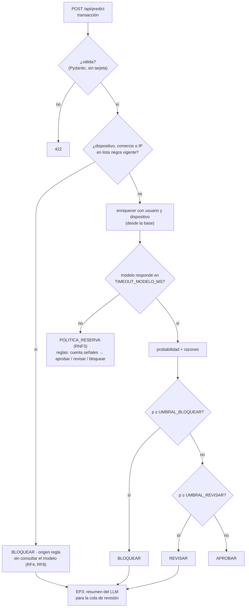

# Caso 3 · Kipu Pagos · detección de fraude explicable

[Índice de la guía](../README.md) · Fichas: [recomendación](recomendacion.md) · [chatbot](chatbot.md) · **fraude**

Esta ficha explica lo que la plantilla ya resuelve para el caso 3 y, sobre todo, **los desafíos**: las
decisiones que tu equipo tiene que revisar, cambiar si no está de acuerdo y defender con su número.

---

## 1. Tu caso en una página

| | |
|---|---|
| **Qué decide el modelo** | La probabilidad de que una transacción sea fraude. Con los umbrales de riesgo, se convierte en **aprobar, revisar o bloquear** (RF1), con **las razones ordenadas por peso** (RF2) |
| **Quién usa la salida** | El core de pagos (decide en línea) y los seis analistas de fraude (la **cola de revisión**, RF5) |
| **El costo de equivocarse** | Un falso positivo bloquea a un cliente bueno: cuesta USD 1,16 M al año, **más del doble** que el fraude (USD 0,5 M). «No me traigan un modelo con 99% de exactitud» (Ignacia Bravo) |
| **Lo que manda** | RNF1 p99 < 100 ms · RT8 cada decisión explicable · RF4 reglas duras antes del modelo · RF3 umbrales sin desplegar código · RNF3 política de reserva · RNF5 el número de tarjeta nunca sale |
| **El LLM (EP3)** | Redacta un resumen en lenguaje común para el analista, **solo** para lo que va a revisar o bloquear, a partir de las razones ya calculadas. Nunca decide |

## 2. Los datos y sus problemas

Números de `datos/tratados/REPORTE.md` (corre `python datos/preparar.py` y compáralos):

| Tabla | Problema | Regla | Filas | Decisión |
|---|---|---|---|---|
| usuarios | Filas repetidas idénticas | `drop_duplicates()` | 38 | descartar |
| usuarios | País como `CL`, `chile `, `CHILE`, `Argentina`… | mapa a ISO2 | 1.243 | corregir |
| usuarios | `nivel_kyc` = -1 | fuera de 0–3 → nulo | 58 | marcar desconocido |
| usuarios | `edad_cuenta_dias` negativa | → nulo | 116 | marcar desconocido |
| dispositivos | `emulador` vacío | se deja nulo | 4.933 | marcar desconocido |
| lista_negra | `vigente` vacío | → 1 | 74 | imputar (DESAFÍO F2) |
| transacciones | Filas idénticas (duplicado del sistema) | `drop_duplicates()` | 97 | descartar |
| transacciones | Misma persona, comercio y monto (reintentos) | se marcan `es_reintento` | 324 | conservar |
| transacciones | 4 formatos de fecha, UTC y hora de Chile | uno por uno → hora de Chile | 28.323 | corregir |
| transacciones | Moneda vacía | por el formato del monto | 1.162 | imputar (DESAFÍO F3) |
| transacciones | USD mezclado con CLP | × 950 | 3.422 | corregir (DESAFÍO F1) |
| transacciones | Monto cero, negativo o ilegible | | 602 | descartar |
| transacciones | Coordenadas (0, 0) | → nulo | 1.214 | marcar desconocido |
| transacciones | `es_fraude` vacío | **no** es «legítima» | 26.489 | conservar vacío; no se entrena con ellas |
| transacciones | `revisado_por_analista`, `motivo_bloqueo`, `resultado_autorizacion` | columnas fuera | — | **fuga de información** |
| transacciones | Usuario que no existe en `usuarios.csv` | variables de usuario = desconocido | 598 | conservar |

**El hallazgo del caso:** `motivo_bloqueo` está lleno **solo** en filas de fraude. Un modelo que lo use
acierta casi todo y no sirve: al momento de decidir, esa columna está vacía. Y la tasa de fraude es
**11,2% entre lo revisado, 0,5% en el archivo y 0,012% en producción** (R3 del caso): cualquier umbral o
costo calculado con las dos primeras está mal por dos órdenes de magnitud.

## 3. Las variables del modelo

`comun/caracteristicas/fraude.py` · 17 columnas, todas conocidas **antes** de decidir:

| Columna | De dónde sale | Por qué |
|---|---|---|
| `monto_clp` | `monto` convertido según `moneda` | Montos atípicos (motivo histórico de bloqueo) |
| `hora_local`, `madrugada` | `timestamp` en hora de Chile | El 49% del fraude ocurre entre 00:00 y 06:00 (R4) |
| `intentos_previos_1h` | transacción | Velocidad (RF10) |
| `edad_cuenta_dias`, `nivel_kyc`, `verificado`, `telefono_verificado`, `email_desechable` | `usuarios.csv` | Cuentas nuevas y poco verificadas |
| `usuarios_distintos`, `emulador`, `sin_dispositivo` | `dispositivos.csv` | Dispositivos compartidos o emulados |
| `pais_distinto` | país de la transacción vs país del usuario | «País no habitual» |
| `canal_app`, `canal_web`, `canal_pos`, `canal_api` | `canal` normalizado | El riesgo cambia por canal |

Un dato desconocido vale `-1`: los árboles aprenden que «no se sabe» es distinto de 0.

## 4. El modelo y su métrica

`HistGradientBoostingClassifier` (árboles con *boosting*, `class_weight="balanced"`), entrenado con las
**1.233 transacciones revisadas** (925 entrenamiento, 308 prueba, estratificado):

| Métrica (prueba, umbral 0,5) | Modelo | Línea base |
|---|---|---|
| PR-AUC | **0,969** | 0,110 (azar = tasa de fraude) |
| Accuracy | 0,987 | 0,890 («nunca es fraude») |
| Precision · Recall · F1 | 0,969 · 0,912 · 0,939 | 0 · 0 · 0 |
| Matriz | VP 31 · FP 1 · FN 3 · VN 273 | |

**Léelo con desconfianza:** son datos de muestra, generados, y la prueba es pequeña (34 fraudes). Un
PR-AUC de 0,97 es para preguntarse si hay fuga (ya se sacaron las tres columnas) y para no prometerlo en
producción. El accuracy **no sirve para decidir** (EP3 §3.3): con 0,012% de fraude, «nunca es fraude» da
99,988%.

## 5. Reglas fuera del modelo

`servicios/dominio/app/casos/fraude.py`:



| Variable de entorno | Por defecto | Qué controla |
|---|---|---|
| `UMBRAL_REVISAR` | 0.5 | Desde qué probabilidad va a la cola de revisión (RF3) |
| `UMBRAL_BLOQUEAR` | 0.9 | Desde qué probabilidad se bloquea (RF3) |
| `TIMEOUT_MODELO_MS` | 300 | Cuánto se espera al modelo (RNF1/RNF3) |
| `POLITICA_RESERVA` | `reglas` | `reglas`, `aprobar`, `revisar` o `bloquear` cuando el modelo no responde |

Se cambian en el `.env` y `docker compose up -d dominio`: **sin desplegar código** (RF3).

**Interpretabilidad (RF2, RT8):** cada decisión del modelo trae hasta 4 razones, calculadas **con el
modelo** por oclusión (`servicios/ia/app/explicar.py`): para cada variable, cuánto baja la probabilidad si
esa variable tuviera su valor típico. Va en la misma llamada al modelo que la predicción.

## 6. El LLM en tu caso (EP3)

- **Cuándo se encola:** decisión `revisar` o `bloquear` (también las de lista negra).
- **Qué recibe:** decisión, probabilidad, razones, monto en CLP, canal y hora. Ya anonimizado.
- **Qué nunca recibe:** número de tarjeta (ni siquiera entra al sistema: `Entrada` lo rechaza con 422),
  nombre, RUT, IP del usuario.
- **Ruta propia:** `GET /api/revision` — la cola priorizada por `probabilidad × monto`, con el resumen
  del LLM cuando está listo (RF5).
- **Dashboard:** decisiones, tasa de bloqueo por día (RF12), cola de revisión.

## 7. Desafíos de tu caso

### F1 · La tasa USD → CLP
- **Qué decidir.** Con qué tasa se convierten los 3.422 montos en dólares.
- **Dónde.** `datos/casos/fraude.py:TASA_USD_CLP` y `servicios/dominio/app/casos/fraude.py:TASA_USD_CLP` (la misma, en los dos lados).
- **Cómo comprobarlo.** `grep -n "USD" datos/tratados/REPORTE.md`.
- **En el informe.** 8.4 (EP2), con la fuente de la tasa. ¿Una tasa fija o una tabla diaria?
- **Pregunta probable.** «¿Qué pasa con el modelo si el dólar sube 10%?»

### F2 · `vigente` vacío en la lista negra
- **Qué decidir.** Si una entrada sin estado bloquea. La plantilla dice que sí (74 entradas): ante la duda, regla dura y revisión humana. Hay entradas de 2019 nunca revisadas.
- **Dónde.** `datos/casos/fraude.py:_lista_negra`.
- **Cómo comprobarlo.** `docker compose -p proyecto exec db psql -U app -d proyecto -c "SELECT vigente, count(*) FROM lista_negra GROUP BY 1"`.
- **En el informe.** 8.4 y 11 (riesgo: bloquear a clientes buenos por una entrada vieja; R7 del caso).
- **Pregunta probable.** «¿Cuántos clientes buenos bloquearía esa regla al día?»

### F3 · La moneda vacía
- **Qué decidir.** Cómo inferir la moneda de 1.162 transacciones sin moneda. La plantilla mira el formato: dos decimales → USD.
- **Dónde.** `datos/casos/fraude.py:_transacciones` (`parece_usd`).
- **Cómo comprobarlo.** Compara la distribución de montos inferidos USD con la de los declarados USD.
- **En el informe.** 8.4.
- **Pregunta probable.** «¿Y un monto en pesos escrito "12,50"?»

### F4 · Entrenar solo con lo revisado
- **Qué decidir.** La plantilla entrena con las 1.233 transacciones con etiqueta. Es un **sesgo**: se revisó lo que el motor viejo marcó. Alternativas: tratar lo no revisado como legítimo con peso bajo (más datos, etiquetas ruidosas), o usar la revisión del modo sombra (RF6, RO3).
- **Dónde.** `datos/casos/fraude.py:preparar` (`etiquetadas`).
- **Cómo comprobarlo.** Prueba la alternativa en una rama `feat/` y compara PR-AUC.
- **En el informe.** 8.4 y 11. Conéctalo con la decisión abierta 9.2.7 del caso (etiquetas que llegan días después).
- **Pregunta probable.** «¿Qué fraude nunca va a aprender este modelo?»

### D1 · Los umbrales
- **Qué decidir.** `UMBRAL_REVISAR` y `UMBRAL_BLOQUEAR`. La meta del caso: falsos positivos sobre bloqueos **< 15%** sin dejar pasar más fraude. Con 0,012% de fraude real, un umbral que en la muestra parece perfecto bloquea a miles de clientes buenos al día.
- **Dónde.** `.env` → `UMBRAL_REVISAR`, `UMBRAL_BLOQUEAR`.
- **Cómo comprobarlo.** `UMBRAL=0.3 python3 sagemaker/4_probar.py` (EP3) o cambiando el umbral en `modelo/entrenar.py:metricas_binarias`. Calcula: con 200.000 tx/día, ¿cuántos falsos positivos al día da cada umbral?
- **En el informe.** EP3 apartado 2 y 5; EP2 8.4.
- **Pregunta probable (IE3).** «Muéstrame una predicción. ¿Qué hace el analista con ella? ¿Qué cuesta si el modelo se equivoca?»

### D2 · El timeout y la política de reserva
- **Qué decidir.** Cuánto esperar al modelo y qué hacer si no responde: aprobar todo (pierde fraude), bloquear todo (castiga clientes), revisar todo (satura a seis analistas) o un motor de reglas (la plantilla). Y quién asume ese costo (decisión abierta 9.2.4 del caso).
- **Dónde.** `.env` → `TIMEOUT_MODELO_MS`, `POLITICA_RESERVA`; reglas en `servicios/dominio/app/casos/fraude.py:_reserva`.
- **Cómo comprobarlo.** `docker compose -p proyecto stop ia` y una predicción: `origen: reserva`. En EP3: con SageMaker serverless, ¿cuántas decisiones caen en reserva? (dashboard, `por_reserva`).
- **En el informe.** EP2 8.2 y 9 (ADR); EP3 apartado 3 (RNF1 p99 < 100 ms: si no se cumple, medirlo y proponer cómo).
- **Pregunta probable.** «Son las 3 de la mañana y SageMaker no responde: ¿qué le pasa a la compra de un cliente?»

## Para un 7 en EP3

La respuesta modelo del IE3 para este caso (la decisión, quién la toma y el costo de equivocarse), con
los números de esta plantilla, está en el [capítulo 18.2](../guia/18-respuestas-de-7.md#182-ie3--18--la-decisión-del-negocio);
las láminas, en [`entrega/laminas-ep3.md`](../entrega/laminas-ep3.md#caso-3--kipu-pagos--fraude). Medido en
el Learner Lab con este caso: cold start 6,2 s, p95 del dominio 102 ms (RNF1 p99 < 100 ms **no se
cumple** con serverless: capítulo 11.6), costo de referencia USD 77/mes. La prueba del 422 en vivo:
`"monto": -5` (capítulo 18.7). Reemplacen todo número por el de su sistema.

## 8. Qué mostrar en la defensa

```bash
B=http://localhost:8080        # EP3: https://<tu-nombre>.sslip.io y -H "X-API-Key: ..."
# una decisión del modelo, con sus razones
curl -s -X POST $B/api/predict -H 'content-type: application/json' -d '{"usuario_id":"KP300267","comercio_id":"CM40847","dispositivo_id":"D-1358e431cbe4","monto":250000,"moneda":"CLP","canal":"app","hora_local":3,"intentos_previos_1h":4,"pais_transaccion":"CL"}'
# regla dura: dispositivo en lista negra → bloquear sin modelo
curl -s -X POST $B/api/predict -H 'content-type: application/json' -d '{"usuario_id":"KP300267","dispositivo_id":"D-1da29c52b0ed","monto":9000,"canal":"web"}'
# el número de tarjeta no entra (RNF5) → 422
curl -s -X POST $B/api/predict -H 'content-type: application/json' -d '{"usuario_id":"KP300267","monto":9000,"canal":"web","tarjeta":"4111111111111111"}'
# la cola de revisión priorizada
curl -s $B/api/revision
# el modelo caído → política de reserva
docker compose -p proyecto stop ia
curl -s -X POST $B/api/predict -H 'content-type: application/json' -d '{"usuario_id":"KP300267","monto":9000,"canal":"web","hora_local":2,"intentos_previos_1h":6}'
docker compose -p proyecto start ia
```
