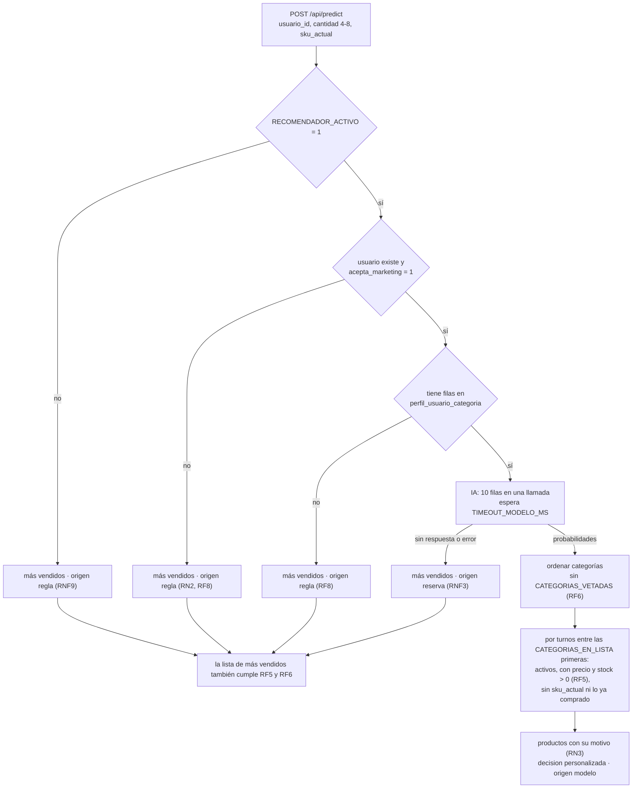

# Caso 1 · Nexus Retail · recomendación de productos

[Índice de la guía](../README.md) · Fichas: **recomendación** · [chatbot](chatbot.md) · [fraude](fraude.md)

Esta guía explica cómo está resuelto el caso 1 en la plantilla, qué decisiones vienen tomadas y cuáles
tiene que revisar y defender tu equipo. Los números salen de correr `python datos/preparar.py`,
`python modelo/entrenar.py` y `python -m datos.casos.recomendacion` sobre los datos publicados. Si
cambias una regla, tus números cambian: usa siempre los de tu `datos/tratados/REPORTE.md` y tu
`modelo/artefactos/METRICAS.md`.

## 1. Tu caso en una página

**Qué decide el modelo.** Para un cliente identificado, la probabilidad de que compre en cada una de las
10 categorías del catálogo en los próximos 90 días (propensión por usuario y categoría). Es un
clasificador binario que se evalúa una vez por categoría: 10 filas en una sola llamada al microservicio
de IA. El dominio ordena las categorías por probabilidad y arma la lista de 4 a 8 productos con los más
vendidos de esas categorías que tienen stock.

**Quién usa la salida.**

- La tienda (Shopify), en la ficha de producto y en la home: `POST /api/predict` responde en menos de
  200 ms con los productos (RF1, RF2).
- Marketing, para Mailchimp: `POST /api/campanas/{usuario}` guarda la lista y encola un texto de 2 a 3
  líneas que redacta el LLM (RF4, solo EP3).
- La gerenta de e-commerce, en el dashboard: recomendaciones entregadas y qué parte salió de la lista de
  reserva.

**Los requerimientos que mandan.**

| Código | Qué exige | Dónde se cumple |
|---|---|---|
| RF1 | Entre 4 y 8 productos | `Entrada.cantidad` (4 a 8, si no 422) |
| RF4 | Lista por cliente para Mailchimp | `POST /api/campanas/{usuario}` |
| RF5 | Nada sin stock | `DISPONIBLE` en `servicios/dominio/app/casos/recomendacion.py` |
| RF6 | Vetar categorías | `CATEGORIAS_VETADAS` |
| RF8 | Algo útil sin historial | lista de más vendidos, origen `regla` |
| RF11 | Dejar de usar el historial si el cliente lo pide | `POST /api/usuarios/{usuario}/revocar-consentimiento` |
| RNF1 | p95 bajo 200 ms | se mide con `herramientas/medir.sh` |
| RNF3 | Sin respuesta del modelo en 200 ms: más vendidos | `TIMEOUT_MODELO_MS`, origen `reserva` |
| RNF7 | Sin correo, nombre, dirección ni RUT en logs ni en el LLM | no existen en la base; al LLM van categorías y productos |
| RNF9 | Apagar el sistema con configuración | `RECOMENDADOR_ACTIVO=0` |
| RN2 | Perfilar exige consentimiento explícito | solo `acepta_marketing = 1` se personaliza y se entrena |
| RN3 | Explicar por qué se recomendó | campo `motivo` de cada producto |

## 2. Los datos y sus problemas

Cuatro archivos crudos en `datos/crudos/recomendacion/`. Lo que va a la base: `productos`, `usuarios`,
`transacciones` (el historial que muestra el front) y `perfil_usuario_categoria` (las variables del
modelo de cada cliente). El clickstream tratado no se carga: solo alimenta las variables.

| Tabla | Filas antes | Filas después | Duplicados antes |
|---|---|---|---|
| productos | 1.531 | 1.500 | 31 |
| usuarios | 4.026 | 4.000 | 26 |
| transacciones | 22.187 | 22.001 | 186 |
| clickstream | 29.340 | 27.299 | 263 |

Las reglas, con sus filas (de `REPORTE.md`; ahí está la tabla completa, 44 reglas):

| Problema | Regla | Filas | Decisión |
|---|---|---|---|
| SKU con espacios y fichas repetidas | `strip` y quitar repetidos | 42 · 31 | corregir · descartar |
| Categoría escrita de 20 formas («Notebooks », «NOTEBOOKS», «Cables», «cables y adaptadores») | mapa a mano a 10 categorías | 383 | corregir |
| Precio como texto `$19.990` | quitar `$` y puntos | 174 | corregir |
| Precio 0 (producto en edición) o vacío | nulo; no se recomienda | 62 | marcar |
| Costo mayor que el precio | columna `costo_sobre_precio` | 32 | marcar |
| Stock `ERROR` · stock negativo | nulo · 0 | 16 · 36 | marcar · corregir |
| `activo` en seis dialectos | 1 o 0 | 1.084 | corregir |
| Región escrita de 33 formas | mapa a 10 regiones | 2.761 | corregir |
| Comuna | no se guarda (minimización, Ley 21.719) | 4.000 | descartar columna |
| Consentimiento vacío | se deja vacío: no es «no» ni «sí» | 729 | conservar |
| Edad 0, 999 o negativa | nulo | 155 | marcar |
| Fecha de registro futura | nulo | 28 | marcar |
| Líneas idénticas (reproceso de marzo) | quitar repetidas | 186 | descartar |
| `pedido_id` repetido | **se conserva**: un pedido tiene varias líneas | 4.855 | conservar |
| Usuario «invitado», «N/A», «UNKNOWN» | compra sin usuario | 277 | marcar |
| Usuario o SKU que no existe en su archivo | se conserva la venta | 381 · 647 | conservar |
| Fecha en el futuro (hasta 2027) | nula; no es venta | 30 | marcar |
| Cantidad 0 o negativa | no es venta | 538 | marcar |
| `precio_unitario` como texto · vacío recuperable | limpiar · `(total + descuento) / cantidad` | 2.580 · 425 | corregir · imputar |
| Descuento vacío · negativo | 0 · nulo | 8.565 · 54 | imputar · marcar |
| `total` que no cuadra con `cantidad × precio − descuento` | `total_cuadra = 0`; se usa `total` | 2.173 | marcar |
| Estado `-` | nulo; no es venta | 450 | marcar |
| Anuladas, devueltas, sin estado, sin unidades, sin fecha | `es_venta = 0` | 3.735 | marcar |
| Robots (user agent con bot, curl, Scrapy, python-requests) | se quitan | 1.791 (6,10%) | descartar |
| Evento repetido por reintento del tag | se quita | 250 | descartar |
| `tipo_evento` en español e inglés | 4 eventos | 4.572 | corregir |
| Sesión compartida entre usuarios (284 sesiones, la última del 31-10-2024) | `sesion_compartida = 1` | 1.498 | conservar y marcar |
| Sin consentimiento explícito | fuera del entrenamiento y del perfil | 1.923 | excluir |

> **Comparado con L2B.** L2B cuenta 2.244 descuadres de `total` con el descuento vacío leído como 0 y 431
> precios recuperables, sobre el archivo crudo. Aquí salen 2.173 y 425 porque antes se quitan las 186
> líneas duplicadas y se exige cantidad positiva. Ventas reales: 18.266 líneas (el 17,7% del archivo no
> son ventas); ticket promedio $144.610 con 1,27 líneas por pedido. 930 de los 1.500 SKU no se vendieron
> nunca (R7).

## 3. Las variables del modelo

Una fila es un par (usuario, categoría) en una **fecha de corte**. Todas salen de lo que pasó antes del
corte, con una sola función: `perfil_por_categoria` en `datos/casos/recomendacion.py`. Para entrenar el
corte es el 03-05-2026 (90 días antes del fin de los datos) y la etiqueta es «compró en esa categoría
entre el corte y el 01-08-2026». Para servir, el corte es el 01-08-2026 y el resultado se carga en la
tabla `perfil_usuario_categoria`; el dominio la lee y la manda tal cual al microservicio de IA, que la
pasa por `vectorizar()` de `comun/caracteristicas/recomendacion.py`. Misma función, mismas columnas.

| Columna | De dónde sale | Por qué |
|---|---|---|
| `compras_cat` | pedidos distintos del usuario en la categoría (ventas reales) | quien ya compró ahí tiende a volver |
| `unidades_cat` | unidades compradas en la categoría | intensidad de la preferencia |
| `gasto_cat` | suma de `total` en la categoría | separa accesorios baratos de compras grandes |
| `dias_desde_ultima_cat` | días entre la última compra en la categoría y el corte; -1 si nunca | recencia; «nunca» es distinto de «hace mucho» |
| `compras_cat_90d` | pedidos en la categoría en los 90 días previos al corte | interés reciente |
| `share_cat` | líneas en la categoría / líneas totales del usuario | qué parte de su gasto es esta categoría |
| `compras_totales` | pedidos del usuario | separa al cliente frecuente del ocasional |
| `dias_desde_ultima_compra` | días desde su última compra | cliente activo o dormido |
| `vistas_cat`, `clics_cat`, `carrito_cat` | eventos del clickstream sin robots, por categoría del SKU | interés que todavía no es compra |
| `popularidad_cat` | parte de las ventas de la tienda (incluidos invitados) de la categoría, 90 días previos | lo que se vende en general; es la línea base que el modelo tiene que superar |

Fuera del modelo quedan la región, la edad y el canal de captación: perfilar por edad o región necesita
una justificación que el caso no da, y no mejoran el orden de las categorías del propio cliente.

## 4. El modelo y su métrica contra la línea base

`HistGradientBoostingClassifier(max_depth=3, learning_rate=0.05, max_iter=200, min_samples_leaf=50,
l2_regularization=1.0, class_weight="balanced")`. Entrenamiento: 1.963 usuarios con consentimiento e
historia × 10 categorías = 19.630 filas, 5,0% positivas. La prueba se separa **por usuario** (491
usuarios, 4.910 filas, semilla 1102): las 10 filas de un cliente quedan todas del mismo lado.

| Métrica (prueba) | Modelo | Línea base |
|---|---|---|
| ROC-AUC | **0,7455** | 0,601 ordenando solo por `popularidad_cat` |
| PR-AUC | 0,1498 | 0,0466 (azar = tasa de positivos) |
| Precision · recall · F1 en umbral 0,5 | 0,119 · 0,585 · 0,198 | — |
| Accuracy | 0,779 | 0,953 diciendo «nunca compra» (por eso no sirve) |

El gate (`modelo/config.json`) pide ROC-AUC ≥ 0,70: por debajo del 0,7455 medido para tolerar la
variación entre reentrenamientos, y claramente por encima de 0,60, lo que da ordenar por popularidad.

La métrica que entiende el negocio es de **ranking**: `python -m datos.casos.recomendacion`, sobre los 165
usuarios de prueba que sí compraron en los 90 días:

| Categorías: alguna de las k primeras es donde compró | Modelo | Más vendidos |
|---|---|---|
| hit rate@1 | 0,552 | 0,212 |
| hit rate@2 | 0,697 | 0,345 |
| hit rate@3 | 0,806 | 0,479 |
| hit rate@5 | 0,861 | 0,721 |

| Lista de 5 productos | hit rate@5 | precision@5 |
|---|---|---|
| Modelo (3 categorías por turnos, sin lo ya comprado) | 0,259 | 0,058 |
| Los 5 más vendidos de la tienda | 0,205 | 0,042 |

`class_weight="balanced"` hace que la probabilidad no sea una frecuencia real (el 0,72 de un cliente no
significa «72 de cada 100»): sirve para ordenar categorías, que es lo único para lo que se usa. Sin
balancear, la ROC-AUC es casi igual (0,740) pero precision, recall y F1 en 0,5 dan 0, porque ninguna
probabilidad llega a 0,5.

## 5. Reglas fuera del modelo

Viven en `servicios/dominio/app/casos/recomendacion.py`. Las variables de entorno se declaran vacías en
`compose.yaml` (servicio `dominio`); vacía significa «el valor por defecto del código».

| Variable | Por defecto | Qué controla |
|---|---|---|
| `TIMEOUT_MODELO_MS` | 200 | cuánto se espera al modelo antes de responder más vendidos (RNF3) |
| `RECOMENDADOR_ACTIVO` | 1 | con 0, todo el mundo recibe más vendidos (RNF9) |
| `CATEGORIAS_VETADAS` | vacío | categorías que nunca se recomiendan, separadas por coma (RF6) |
| `CATEGORIAS_EN_LISTA` | 3 | entre cuántas categorías se reparten los cupos |



Toda respuesta se guarda en `predicciones` con su entrada, resultado, origen y versión de modelo (RF7
en su parte mínima: la impresión con el identificador del modelo). Los clics y las compras atribuidas
(RF10) no están implementados: no hay datos de impresiones en el caso.

## 6. El LLM en tu caso (EP3)

- **Cuándo se encola.** Solo en `POST /api/campanas/{usuario}`, y solo si el cliente tiene
  `acepta_marketing = 1` (sin consentimiento responde 409 y no guarda nada). `POST /api/predict` nunca
  encola: la respuesta de 200 ms no espera a nadie.
- **Qué recibe.** La instrucción `INSTRUCCION_LLM` y un contenido con las 3 categorías más probables y,
  por producto, nombre, categoría, marca, precio y motivo («compraste 5 veces en Notebooks»). Antes de
  publicarlo en la cola, `app/registro.py` lo pasa por `comun/anonimizar.py`.
- **Qué nunca va.** Ni el `usuario_id`, ni correo, nombre, dirección o RUT (RNF7): esos datos ni siquiera
  están en la base. El LLM no decide nada: redacta sobre una lista que ya eligieron el modelo y las
  reglas. El texto queda en `texto_llm` y se lista en `GET /api/campanas`.
- **Si el LLM falla.** La campaña queda guardada con sus productos y `estado_llm = degradado`; la
  recomendación no cambia.

## 7. Desafíos de tu caso

Cada uno está marcado con `DESAFÍO` en el código. Revísalos, cambia lo que no compartas y defiende tu
decisión con un número.

### R1 · La fecha de extracción

- **Qué decidir.** Desde qué fecha un dato es «futuro». La plantilla fija el 01-08-2026 porque el
  clickstream y el grueso de las ventas terminan el 31-07-2026.
- **Dónde.** `datos/casos/recomendacion.py:FIN_DATOS`.
- **Cómo comprobarlo.** `python datos/preparar.py && grep -i futur datos/tratados/REPORTE.md` (30
  transacciones y 28 registros).
- **En el informe.** Capítulo 8.4 (tratamiento de datos), en la tabla de reglas.
- **Pregunta probable.** «¿Por qué no usaron la fecha de hoy?» (con la fecha de hoy, las ventas de 2027
  de este archivo seguirían siendo imposibles y el corte de entrenamiento se movería solo).

### R2 · El total que no cuadra

- **Qué decidir.** Si lo pagado es `total` o `cantidad × precio_unitario − descuento`. La plantilla usa
  `total` (lo que cobró la pasarela) y marca 2.173 líneas con `total_cuadra = 0`.
- **Dónde.** `datos/casos/recomendacion.py:_transacciones`, regla «total ≠ ...».
- **Cómo comprobarlo.** `grep "total ≠" datos/tratados/REPORTE.md`; para ver el efecto, cambia `gasto_cat`
  para usar el recalculado, reentrena y compara la ROC-AUC.
- **En el informe.** 8.4, y en el capítulo 11 (riesgos) si no logran explicar la diferencia.
- **Pregunta probable.** «¿Leyeron el descuento vacío como 0 o como nulo? ¿Cuántos descuadres da cada
  lectura?» (L2B: 2.244 y 1.365).

### R3 · Consentimiento: vacío no es sí

- **Qué decidir.** Qué hacer con `acepta_marketing` vacío (729 clientes) y si se entrena con el historial
  de quien no consintió. La plantilla: vacío no se personaliza, y solo `acepta_marketing = 1` entra al
  entrenamiento y al perfil (1.923 usuarios fuera).
- **Dónde.** `datos/casos/recomendacion.py:_usuarios` y `preparar` (`con_consentimiento`); en el dominio,
  `recomendar` (`acepta_marketing != 1`).
- **Cómo comprobarlo.**
  `curl -s -X POST $URL/api/predict -H "Content-Type: application/json" -d '{"usuario_id":"U103808"}'`
  (consentimiento vacío: `origen` regla).
- **En el informe.** Capítulo 2 (restricciones, RN2) y 8.4; si alguien entrena con todos, una decisión en
  el capítulo 9.
- **Pregunta probable.** «¿Entrenar un modelo con las compras de quien no consintió es perfilarlo?».

### R4 · El horizonte de la etiqueta

- **Qué decidir.** «Compra en los próximos N días». Con 90 días hay 5,0% de positivos.
- **Dónde.** `datos/casos/recomendacion.py:HORIZONTE_DIAS`.
- **Cómo comprobarlo.** Cámbialo a 60 o 180 y corre
  `python datos/preparar.py && python modelo/entrenar.py && python -m datos.casos.recomendacion`.
- **En el informe.** Capítulo 8 (concepto del modelo) con la tabla de métricas de cada horizonte.
- **Pregunta probable.** «¿Por qué separaron la prueba por usuario y no por fila?» (si no, el mismo
  cliente aparece en los dos lados y la métrica sale inflada).

### R5 · Las sesiones compartidas

- **Qué decidir.** Qué hacer con las 284 sesiones que tienen más de un usuario. La plantilla las
  conserva y marca, porque las variables se cuentan por usuario.
- **Dónde.** `datos/casos/recomendacion.py:_clickstream`.
- **Cómo comprobarlo.** `grep sesion_id datos/tratados/REPORTE.md` (1.498 eventos, la última el
  31-10-2024).
- **En el informe.** 8.4, y en el capítulo 11 (R3 del caso) para cualquier métrica por sesión.
- **Pregunta probable.** «Si midieran CTR por sesión (RNF8), ¿qué harían con ellas?».

### D1 · Los 200 ms

- **Qué decidir.** Cuánto esperar al modelo. 200 ms sale de RNF3; con SageMaker serverless el arranque en
  frío tarda segundos y todas esas respuestas serían de reserva.
- **Dónde.** `servicios/dominio/app/casos/recomendacion.py:TIMEOUT_MODELO_MS`.
- **Cómo comprobarlo.** En el dashboard, `proporcion_reserva_pct` después de una prueba de carga
  (`herramientas/medir.sh`).
- **En el informe.** Capítulo 10 (escenarios de calidad: RNF1 y RNF3) con la proporción medida.
- **Pregunta probable.** «¿Qué porcentaje de respuestas salió de la reserva en su prueba de carga y qué
  harían para bajarlo?».

### D2 · El stock que llega con 30 minutos de atraso

- **Qué decidir.** RF5 contra RT6. La plantilla exige `stock > 0`; un producto con 2 unidades puede
  haberse agotado hace 20 minutos.
- **Dónde.** `servicios/dominio/app/casos/recomendacion.py:DISPONIBLE`.
- **Cómo comprobarlo.** `curl -s "$URL/api/mas-vendidos?limite=10"`: mira la columna `stock`.
- **En el informe.** Capítulo 9 (decisión) y 11 (riesgo R4 del caso).
- **Pregunta probable.** «¿Cuántos productos dejarían de recomendarse con `stock > 2` y qué cuesta eso?».

### D3 · Vetos sin pedirle nada a tecnología

- **Qué decidir.** RNF10 pide que marketing configure vetos solo. Con `CATEGORIAS_VETADAS` en el `.env`
  hay que reiniciar el dominio, y eso lo hace tecnología.
- **Dónde.** `servicios/dominio/app/casos/recomendacion.py:CATEGORIAS_VETADAS`.
- **Cómo comprobarlo.** `CATEGORIAS_VETADAS=Notebooks` en el `.env`, `docker compose -p equipoNN up -d`
  y repite el `curl` de la sección 8: no aparece ninguna Notebook.
- **En el informe.** Capítulo 9, con la alternativa (una tabla de vetos que el dominio lea en cada
  petición) y su costo.
- **Pregunta probable.** «¿Cómo cumplirían RNF10 de verdad?».

### D4 · Cuántas categorías mezclar

- **Qué decidir.** Entre cuántas categorías se reparten los cupos. Medido con hit rate@5 de productos:
  1 categoría 0,271; 2 categorías 0,289; 3 categorías 0,259 (la plantilla usa 3, más variada).
- **Dónde.** `servicios/dominio/app/casos/recomendacion.py:CATEGORIAS_EN_LISTA` y, para medir,
  `datos/casos/recomendacion.py:lista_por_categorias` (`n_categorias`).
- **Cómo comprobarlo.** Cambia `n_categorias` y corre `python -m datos.casos.recomendacion`.
- **En el informe.** Capítulo 8 (concepto del modelo) o 10 (calidad), con la tabla.
- **Pregunta probable.** «¿Prefieren la lista que más acierta o la más variada? ¿Qué diría Paulina?».

### M1 y M2 · El gate y el estimador

- **Qué decidir.** El mínimo de ROC-AUC (`modelo/config.json`) y los hiperparámetros
  (`modelo/entrenar.py:ESTIMADORES["recomendacion"]`).
- **Cómo comprobarlo.** `python modelo/entrenar.py` imprime la métrica y si pasa el gate.
- **En el informe.** Capítulo 8 y 10, con la métrica antes y después de cada cambio.
- **Pregunta probable.** «Si el modelo nuevo baja de 0,70, ¿qué pasa en el pipeline y quién se entera?»
  (RF9).

## Para un 7 en EP3

La respuesta modelo del IE3 para este caso (la decisión, quién la toma y el costo de equivocarse), con
los números de esta plantilla, está en el [capítulo 18.2](../guia/18-respuestas-de-7.md#182-ie3--18--la-decisión-del-negocio);
las láminas, en [`entrega/laminas-ep3.md`](../entrega/laminas-ep3.md#caso-1--nexus-retail--recomendación).
En SageMaker, el XGBoost de este caso dio PR-AUC 0,098 y recall 0,38 con muchos falsos positivos (el peso
de la clase positiva es alto): compárenlo con el modelo de EP2 y decidan cuál defienden. Costo de
referencia: USD 42/mes. La prueba del 422 en vivo: `"cantidad": 9` (capítulo 18.7).

## 8. Qué mostrar en la defensa

`URL=http://localhost:8080` en EP2 (o `https://<ip>.sslip.io` en EP3). Si hay `API_KEYS`, agrega
`-H "X-API-Key: $CLAVE"` a cada llamada a `/api/` que no sea `health`.

```bash
# 1. Todo sano y el caso cargado
curl -s $URL/api/health
docker compose -p equipoNN logs carga | tail -6        # filas cargadas; si corre otra vez, 0 nuevas

# 2. Recomendación personalizada (cliente con consentimiento e historial), mirando la ficha NX-11040
curl -s -X POST $URL/api/predict -H "Content-Type: application/json" \
     -d '{"usuario_id":"U100255","cantidad":6,"sku_actual":"NX-11040"}'
#    decision personalizada, origen modelo, version_modelo, productos con motivo, categorias con probabilidad

# 3. Reglas sin modelo: sin consentimiento (RN2), sin historial (RF8), visitante desconocido
curl -s -X POST $URL/api/predict -H "Content-Type: application/json" -d '{"usuario_id":"U103013"}'
curl -s -X POST $URL/api/predict -H "Content-Type: application/json" -d '{"usuario_id":"U100006"}'
curl -s -X POST $URL/api/predict -H "Content-Type: application/json" -d '{"usuario_id":"VISITANTE"}'

# 4. La reserva (RNF3): se apaga la IA y la tienda sigue recibiendo productos
docker compose -p equipoNN stop ia
curl -s -X POST $URL/api/predict -H "Content-Type: application/json" -d '{"usuario_id":"U100255"}'
#    decision mas_vendidos, origen reserva, «el modelo no respondió a tiempo»
docker compose -p equipoNN start ia

# 5. Validación (RF1): 9 productos no se aceptan
curl -s -o /dev/null -w "%{http_code}\n" -X POST $URL/api/predict \
     -H "Content-Type: application/json" -d '{"usuario_id":"U100255","cantidad":9}'     # 422

# 6. Campaña para Mailchimp (EP3): se encola para el LLM y el texto llega después
curl -s -X POST $URL/api/campanas/U100255                   # estado_llm pendiente
curl -s $URL/api/predicciones/<id>                          # texto_llm cuando esté listo
curl -s -o /dev/null -w "%{http_code}\n" -X POST $URL/api/campanas/U103013   # 409: sin consentimiento

# 7. El historial del cliente, la lista de reserva y el dashboard
curl -s $URL/api/usuarios/U100255
curl -s "$URL/api/mas-vendidos?limite=5"
curl -s $URL/api/dashboard          # recomendaciones_entregadas, proporcion_reserva_pct, top_categorias_recomendadas
```

En el front (`$URL/`) el formulario pide usuario, cantidad y ficha; debajo aparecen los más vendidos y
las campañas. El dashboard está en `$URL/dashboard.html`.

Ten a mano también la revocación (RF11): `curl -s -X POST $URL/api/usuarios/<usuario>/revocar-consentimiento`
cambia la respuesta de ese cliente a más vendidos en la llamada siguiente. Ojo: si el servicio de carga
vuelve a correr, reinserta las filas de perfil borradas (no se usan, porque el consentimiento queda en
0); en el informe es deuda técnica del capítulo 11.
