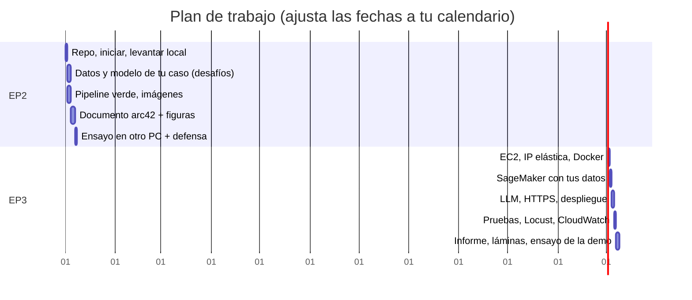

# 0 · Antes de empezar

**Lo que vas a lograr:** que el equipo sepa qué entrega, quién hace qué, y que cada integrante tenga sus
cuentas y herramientas funcionando **antes** de tocar el código. Media hora aquí ahorra un día después.

[← Volver al índice](../README.md) · [Siguiente: 1 · Repositorio y gitflow →](01-repositorio-y-gitflow.md) · ¿Llegan a EP3 sin sistema? [0b · Ruta exprés →](00b-ruta-express-ep3.md)

---

## 0.1 Qué piden EP2 y EP3, en una página

```mermaid
flowchart LR
    subgraph EP2["EP2 · 30% · encargo 30 + defensa 70"]
        A1["Datos tratados<br/>preparar.py"] --> A2["Modelo propio<br/>con métrica"]
        A2 --> A3["7 piezas en Docker<br/>compose.yaml"]
        A3 --> A4["Pipeline publica<br/>imágenes :ep2"]
        A4 --> A5["arc42 15 págs<br/>8 figuras"]
        A5 --> A6["Defensa 20 min<br/>en el PC del profe"]
    end
    subgraph EP3["EP3 · 40% · encargo 20 + presentación 80"]
        B1["EC2 + HTTPS"] --> B2["Modelo en<br/>SageMaker"]
        B2 --> B3["LLM NVIDIA<br/>por cola"]
        B3 --> B4["API segura<br/>10+ pruebas, Locust"]
        B4 --> B5["Monitoreo<br/>CloudWatch"]
        B5 --> B6["Informe 10 págs<br/>6 láminas"]
        B6 --> B7["Demo 15 min<br/>en vivo"]
    end
    A6 ==> B1
```

| | EP2 | EP3 |
|---|---|---|
| Dónde corre | Docker en cualquier computador | Una EC2 `t3.medium` del Learner Lab |
| El modelo | Dentro de la imagen de IA | En un endpoint serverless de SageMaker |
| Lo nuevo | Gateway, réplicas, base, carga, pipeline | HTTPS, LLM por cola, API con clave, pruebas, carga, CloudWatch |
| Se entrega | PDF arc42 (15 págs) + repos con tag `ep2` + imágenes `:ep2` | Informe (10 págs) + 6 láminas + repos con tag `ep3` + URLs vivas |
| Lo que más pesa | Defensa con teclado: IE4 (22%), IE2 (18%), IE6 (18%) | Presentación: IE3 (18%), IE6 (18%), IE9 demo (12%), IE13 (12%) |

**La regla de oro de las dos:** lo que se evalúa es que **entiendan su sistema**. Una demo que falla y
que el equipo explica con precisión sostiene la nota; un sistema perfecto que nadie sabe explicar no.

## 0.2 Repartir el trabajo

El enunciado exige al menos **dos pull requests por integrante** (EP2) y commits y PR propios en el
periodo de EP3. Y las preguntas con teclado se dirigen primero **al autor del PR** de esa pieza. Reparte
así, para que cada uno sea dueño de algo que se pregunta:

| Rol | EP2: es dueño de | EP3: es dueño de | Le preguntan |
|---|---|---|---|
| **Datos y modelo** | `datos/casos/<caso>.py`, `modelo/`, capítulo 8.4 | `sagemaker/`, métricas del modelo, cold start | IE6 (limpieza), IE6 EP3 (configuración del endpoint) |
| **Servicios** | `servicios/dominio`, `servicios/ia`, contrato JSON | worker, anonimización, modo degradado, rutas del caso | IE6 EP2 (contrato), IE8 EP3 (falla del LLM) |
| **Infraestructura** | gateway, `compose.yaml`, pipeline, réplicas, 7.2 | EC2, HTTPS, despliegue, CloudWatch, Locust | IE2, IE4, IE10 (EP2) · IE9, IE11 (EP3) |

Con dos integrantes, junten «Servicios» e «Infraestructura». **Todos** deben poder responder lo de
todos: la repregunta va a otro integrante.

## 0.3 Las cuentas

Cada integrante, con su propio usuario:

- [ ] **GitHub**, con verificación en dos pasos (la pide GHCR para publicar paquetes).
- [ ] **AWS Academy Learner Lab** (EP3): entra, aprieta **Start Lab** y comprueba que el punto se pone
      verde. El crédito es **tuyo y no se recarga**: no dejes cosas encendidas.
- [ ] **build.nvidia.com** (EP3, uno por equipo basta): crea la cuenta esta semana; la clave se genera
      en el capítulo 12.

## 0.4 Las herramientas

| Herramienta | Para qué | Cómo comprobar que está |
|---|---|---|
| **Docker Desktop** (Windows/Mac) o Docker Engine (Linux) | Todo | `docker run --rm hello-world` |
| **Git** (en Windows, *Git for Windows*, que trae **Git Bash**) | Repositorio y scripts `.sh` | `git --version` |
| Un editor (VS Code recomendado) | Código y Markdown con Mermaid | Extensión *Markdown Preview Mermaid Support* |
| `curl` | Probar la API | `curl --version` (en PowerShell usa `curl.exe`) |
| Python 3.12 *(opcional)* | Correr las pruebas sin Docker | `python --version` |

> **En Windows:** los scripts de `herramientas/` son de bash. Ábrelos desde **Git Bash** (clic derecho
> en la carpeta → *Open Git Bash here*). En Docker Desktop, *Settings → Resources* con al menos **4 GB**
> de memoria.

## 0.5 Cómo leer esta guía

Cada capítulo tiene la misma forma:

- **Ya lo tengo si…** — para saltarlo con seguridad.
- **Pasos** — comandos exactos. Lo que va entre `<ángulos>` lo reemplazas tú.
- **Lo visible** — lo que deberías ver si salió bien. Si ves otra cosa, ve a
  [Problemas frecuentes](17-problemas-frecuentes.md).
- **Al informe** — qué capítulo o apartado alimenta, con qué evidencia.
- **En la defensa** — la pregunta que viene y cómo se responde con el teclado.
- **DESAFÍO** — decisiones de tu caso: están explicadas en `casos/<caso>.md`.

## 0.6 Un plan de días, si van atrasados

Si solo tienen **tres días para EP3**: día 1 capítulos 10 y 11 (EC2 + endpoint), día 2 capítulos 12 y 13
(LLM + HTTPS + despliegue), día 3 capítulos 14 a 16. El orden de prioridad del enunciado (EP3 §6) es
ese mismo: sin endpoint invocado desde la EC2 por HTTPS no hay demo.

[Siguiente: 1 · Repositorio y gitflow →](01-repositorio-y-gitflow.md) · ¿Llegan a EP3 sin sistema? [0b · Ruta exprés →](00b-ruta-express-ep3.md)
