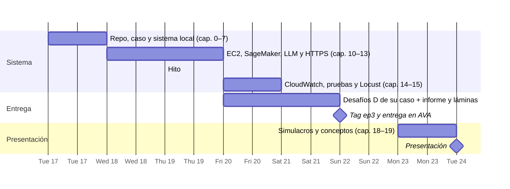

# 0b · Ruta exprés: EP3 en cinco días, partiendo de cero

**Para quién:** el equipo que llega a EP3 sin sistema de EP2, o con uno que no sirve de base. Si su EP2
funciona, sigan los capítulos 10 a 16 en orden y usen esta página solo como calendario.

[← 0 · Antes de empezar](00-antes-de-empezar.md) · [Índice](../README.md) · [1 · Repositorio →](01-repositorio-y-gitflow.md)

> **Lo honesto primero.** La plantilla les da un sistema que funciona; la nota la da poder explicarlo,
> cambiarlo y defenderlo con el teclado (80% de EP3). En cinco días alcanza para tener el sistema en AWS
> **y** entenderlo, solo si cada integrante hace sus piezas con sus propios PR y ensaya las preguntas.
> Copiar y desplegar sin entender da un sistema que corre y una presentación incipiente.

---

## El calendario

Fechas de EP3 §8: cierre el **domingo 22 de noviembre a las 23:59**, presentaciones el **martes 24 o el
jueves 26**. El jueves 19 es la autoevaluación de avance: la URL HTTPS responde y `POST /api/predict`
invoca SageMaker.

## Día 1 · El repositorio y el sistema en su computador

| Paso | Capítulo | Quién | Listo cuando |
|---|---|---|---|
| Cuentas: GitHub, AWS Academy, NVIDIA; Docker y Git instalados | [0](00-antes-de-empezar.md) | Todos | `docker run hello-world` funciona en cada computador |
| Repositorio desde la plantilla; `herramientas/iniciar.sh <caso>`; ramas `main` y `dev` | [1](01-repositorio-y-gitflow.md) | A | Cada integrante clonó y tiene su rama `feat/…` |
| Datos, modelo y sistema local en un comando | [2](02-datos.md)–[6](06-compose-defensa.md) | Todos, cada uno en su computador | `herramientas/levantar-local.sh` y el front en `http://localhost:8080` |
| Leer **su** pieza: cada integrante lee los capítulos de sus piezas (18.10) | 2–6 | Cada uno | Puede explicar su pieza en 2 minutos a los demás |
| Pipeline: primer PR `feat/…` → `dev` → `main`; imágenes en GHCR | [7](07-pipeline.md) | C | Workflow verde y paquetes públicos en GHCR |

**Lo que no pueden saltarse aunque estén apurados:** los PR por integrante. La pregunta va al autor del
PR (EP3 §5.4): si uno solo hizo todo, los demás no tienen qué defender.

## Días 2 y 3 · AWS

| Paso | Capítulo | Quién | Listo cuando | Tiempo medido |
|---|---|---|---|---|
| Learner Lab, EC2 `t3.medium`, IP elástica, rol, Docker | [10](10-aws-ec2.md) | C | `"Code" : "Success"` en 10.6 | — |
| SageMaker: `1_subir` a `4_probar` desde CloudShell | [11](11-sagemaker.md) | A | Endpoint `InService` y métricas de `4_probar.py` | Entrenar ~3 min, endpoint ~3 min |
| Concurrencia del endpoint a 10 | [11.6](11-sagemaker.md#116-lo-que-pasó-de-verdad-cold-start-throttling-y-concurrencia) | A | `3_endpoint.py --concurrencia 10` | ~3 min |
| Clave NVIDIA y el modelo del foro, probados con `curl` | [12.2](12-llm-cola.md#122-tu-clave-de-nvidia) | B | `HTTP 200` en menos de 2 s | — |
| `.env` de la EC2, `docker compose up -d`, HTTPS | [13](13-https-despliegue.md) | C | `https://<ip-con-guiones>.sslip.io/api/health` → `ok`, `motor: sagemaker` | Certificado en segundos |
| Modo degradado probado a propósito | [12.5](12-llm-cola.md#125-romperlo-a-propósito-la-pregunta-del-ie8) | B | Clave inválida → `degradado: HTTP 401` | — |

**Hito del jueves 19:** si la URL HTTPS no responde o la IA no dice `motor: sagemaker`, escriban al
docente ese día (EP3 §8). El capítulo 17 tiene los síntomas medidos en el Learner Lab.

## Día 4 · Monitoreo, pruebas y las decisiones de su caso

| Paso | Capítulo | Quién | Listo cuando |
|---|---|---|---|
| Logs a CloudWatch, dashboard y alarmas | [14](14-monitoreo.md) | C | Encuentran una predicción por `id` en *Search all log streams* |
| Pruebas: las 6 obligatorias + las del caso, en el pipeline | [15.1–15.2](15-pruebas-carga.md) | B | `herramientas/probar.sh` verde y workflow verde |
| Locust **3 minutos** contra AWS | [15.4](15-pruebas-carga.md#154-la-prueba-de-carga-con-locust) | C | `carga_stats.csv` guardado; cola del LLM vaciada después |
| Cold start medido dos veces | [15.6](15-pruebas-carga.md) | A | Dos números y la captura de `ModelSetupTime` |
| Los desafíos **D** de su ficha (umbrales, timeout, reserva) | [ficha del caso](../casos/) | Todos | Cada decisión con su número y quién la defiende |

Los desafíos D son los que más pesan en la presentación: son las respuestas del IE3 y del IE6. Los de
datos (F, R, C) y de modelo (M) sostienen el apartado 5 y las repreguntas.

## Día 5 · Informe, láminas y entrega

| Paso | Dónde | Listo cuando |
|---|---|---|
| Juntar evidencias en la EC2 | `herramientas/evidencias.sh` | `evidencias/EVIDENCIAS-…md` con salud, versiones, consumo y predicciones |
| Costos al volumen del caso | `python3 herramientas/costos.py --latencia-ms <su ModelLatency>` | Tabla del apartado 3 |
| Informe de 10 páginas | [`entrega/informe-ep3.md`](../entrega/informe-ep3.md) | Cada `‹…›` reemplazado con un dato de su sistema |
| 6 láminas | [`entrega/laminas-ep3.md`](../entrega/laminas-ep3.md) | 4:00 cronometrados |
| Tag `ep3` y `TAG=ep3` en la EC2 | [13.7](13-https-despliegue.md#137-la-entrega-tag-ep3) | Workflow del tag verde; la EC2 corre `:ep3` |
| PDF a AVA antes de las 23:59 | EP3 §6 | Lo sube un integrante |

## Entre la entrega y la presentación

| Qué | Dónde |
|---|---|
| Dos simulacros de 15 minutos, el segundo con el endpoint frío | [18.11](18-respuestas-de-7.md#1811-simulacro-15-minutos-como-el-día-de-la-presentación) |
| Cada integrante escribe y corre la prueba del 422 en menos de 3 minutos | [18.7](18-respuestas-de-7.md#187-ie13--12--teclado-sin-ayuda) |
| Los conceptos, explicados sobre su sistema | [19](19-conceptos.md) |
| Antes del turno: Start Lab 30 min antes, salud, calentar, `LIMITE_POR_MINUTO` en su valor | [16.5](16-informe-presentacion-ep3.md#165-antes-del-turno) |

## Si no alcanza el tiempo

El orden de EP3 §6, con lo que cada cosa sostiene:

1. **SageMaker invocado desde la EC2, con HTTPS.** Sin eso no hay IE9 (12%) y las preguntas de IE6, IE8,
   IE11 e IE13 quedan con máximo 30%: la presentación cae bajo el 60%.
2. **Worker con NVIDIA, modo degradado y anonimización.** IE8 (9%) e IE2.
3. **Las seis pruebas y Locust.** IE10, IE11, IE13.
4. **El dashboard completo y el informe.** El encargo vale 20%.
