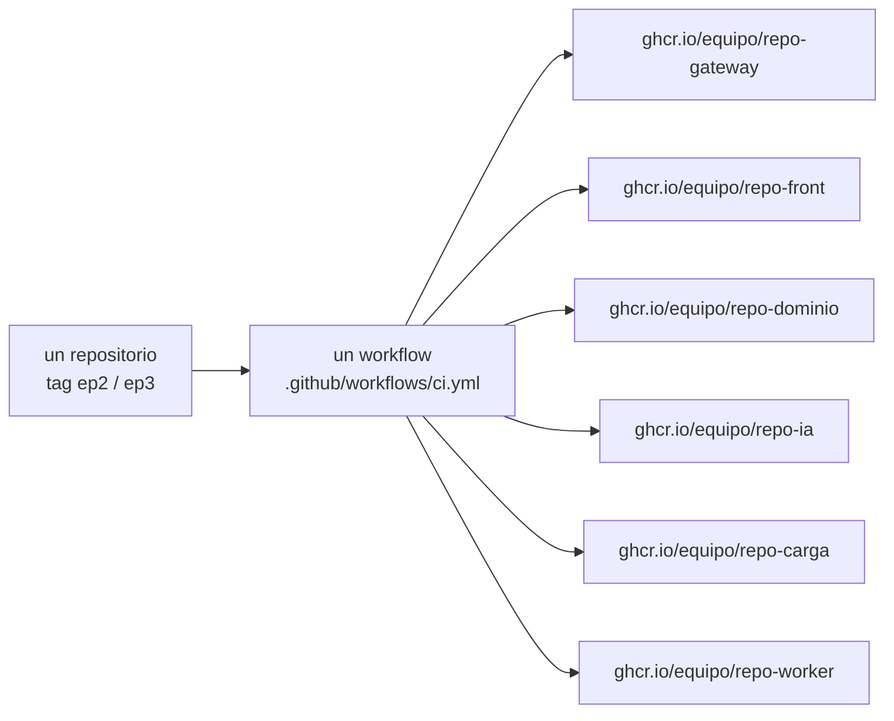
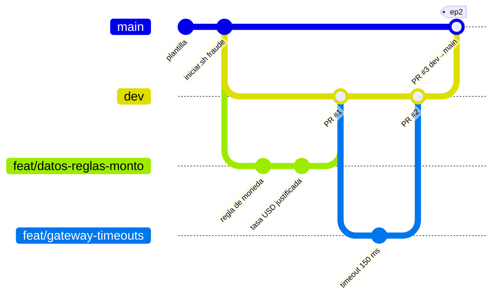

# 1 · Repositorio y gitflow

**Lo que vas a lograr:** el repositorio de tu equipo creado desde la plantilla, con tu caso elegido, las
ramas `main` y `dev`, `main` protegida, y el ciclo `feat/ → dev → main` funcionando con un pull request
de cada integrante.

[← 0 · Antes de empezar](00-antes-de-empezar.md) · [Índice](../README.md) · [2 · Datos →](02-datos.md)

**Ya lo tengo si…** tu repositorio tiene `main` y `dev`, `main` no acepta push directo, y cada
integrante ya integró un PR desde una rama `feat/`. Si tu proyecto vive en varios repositorios (uno por
servicio), también sirve: lee la nota de 1.6.

---

## 1.1 Un repositorio o varios

EP2 §2.6 permite las dos cosas. Esta plantilla es un **monorepo**: un solo repositorio, una carpeta por
servicio, un solo workflow que construye y publica una imagen por carpeta. Es lo que recomendamos para
un equipo atrasado: un gitflow, un pipeline, un tag, un anexo C corto.



## 1.2 Crear tu copia

**Una persona del equipo** (después invita a las demás como colaboradores):

**Opción A · si el docente publicó esta plantilla como *template repository*:** en la página del
repositorio, **Use this template → Create a new repository** → dueño: tu usuario o una organización del
equipo · nombre: por ejemplo `kipu-fraude-equipo04` · **Public** → **Create repository**.

**Opción B · si te llegó como carpeta o zip:** crea en GitHub un repositorio **vacío y público** (sin
README), y desde la carpeta de la plantilla:

```bash
git init -b main
git add -A
git commit -m "Plantilla inicial del proyecto"
git remote add origin https://github.com/<tu-usuario>/<tu-repo>.git
git push -u origin main
```

Después, **Settings → Collaborators → Add people**: los otros integrantes y, si el repositorio no es
público, el usuario de GitHub del docente.

## 1.3 Elegir tu caso

Cada integrante clona el repositorio. **Uno** corre el script de inicio y sube el cambio:

```bash
git clone https://github.com/<tu-usuario>/<tu-repo>.git
cd <tu-repo>
herramientas/iniciar.sh fraude          # o: recomendacion · chatbot
git add -A
git commit -m "Inicia el proyecto con el caso fraude"
git push
```

**Lo visible:** el archivo `CASO` dice tu caso; en `compose.yaml` las imágenes ahora son
`ghcr.io/<tu-usuario>/<tu-repo>-gateway:${TAG:-ep2}`; la carpeta `datos/crudos/` tiene solo tu caso.

> Este es el **único** push directo a `main` que se permite. Desde el paso siguiente, todo entra por
> pull request.

## 1.4 Las ramas y la protección

```bash
git switch -c dev
git push -u origin dev
```

En GitHub: **Settings → Branches → Add branch ruleset** (o *Add classic branch protection rule*):

| Campo | Valor |
|---|---|
| Ruleset name | `main protegida` |
| Enforcement status | **Active** |
| Target branches | **Add target → Include by pattern** → `main` |
| Rules | ☑ **Restrict deletions** · ☑ **Require a pull request before merging** · ☑ **Require status checks to pass** → agrega `pruebas` y `reglas-compose` (aparecen después de la primera ejecución del pipeline) · ☑ **Block force pushes** |

Haz lo mismo con `dev` (sin exigir revisión, para no trabarse). Si tu cuenta gratuita no deja proteger
la rama, **respétenlo como convención**: igual se revisa en el historial (EP2 §2.4).

## 1.5 El ciclo de cada cambio



Para **cada** funcionalidad, el mismo ciclo (es el de EP2 §2.4):

```bash
git switch dev
git pull
git switch -c feat/<qué-cambia>        # ej. feat/datos-mapa-categorias, no feat/juan
# ... cambios ...
git add -A
git commit -m "Mapa de categorías completo: 41 variantes a 10 intenciones"
git push -u origin feat/<qué-cambia>
```

En GitHub aparece **Compare & pull request**: base `dev` ← compare `feat/...` → **Create pull request**.
El pipeline corre solo (capítulo 7). Cuando esté en verde: **Merge pull request** → **Delete branch**.

Cuando `dev` funciona entera: pull request de `dev` hacia `main`. Ese merge publica las imágenes con
`sha-xxxxxxx` y `latest`.

> **Regla para el equipo:** cada integrante abre **al menos dos PR `feat/` hacia `dev`** con su propio
> usuario (EP2) y tiene commits y PR propios en el periodo de EP3. Los desafíos de tu caso son un buen
> reparto: cada desafío resuelto es un PR con nombre propio.

## 1.6 Si ya tienen varios repositorios

No hace falta migrar. Cada repositorio necesita lo mismo: `main` protegida, `dev`, ramas `feat/`, su
propio workflow (copia el de esta plantilla y deja en la matriz solo su servicio) y su tag `ep2`/`ep3`.
El `compose.yaml` de la defensa vive en uno de ellos y el anexo C dice en cuál.

## 1.7 Los tags de entrega

Al cierre, con `main` al día con `dev` y el último workflow de `main` en verde:

```bash
git switch main && git pull
git tag ep2          # en EP3: git tag ep3
git push origin ep2
```

El pipeline publica las imágenes con el tag `ep2`. **Ese tag queda congelado:** moverlo después del
cierre cuenta como entrega atrasada.

## Al informe

- **7.4** (EP2): la figura del gitflow y el pipeline (la de 1.5 y la del capítulo 7 sirven de base).
- **Anexo C**: link del repositorio, del tag, del último workflow verde de `main`, de cada paquete GHCR,
  del `compose.yaml`, y una fila por integrante con su usuario de GitHub.

## En la defensa

**IE10 (EP2):** «¿Qué commit está corriendo? Muéstrame el PR que lo llevó a `main`». Se responde en el
capítulo 9 con `docker image inspect`; aquí lo importante es que **exista** ese camino limpio
`feat/ → dev → main → ep2` en el historial.

[Siguiente: 2 · Datos →](02-datos.md)
