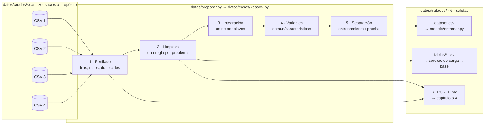
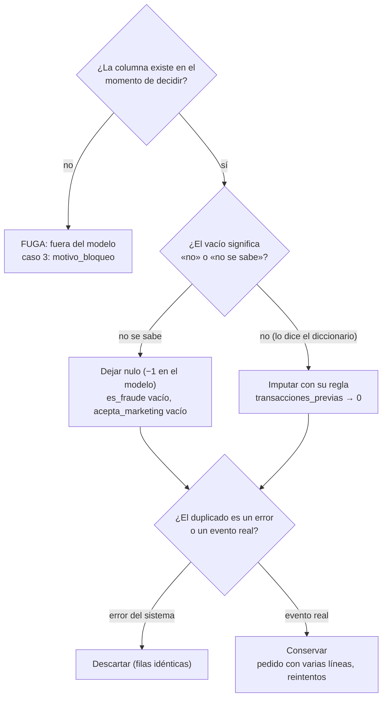
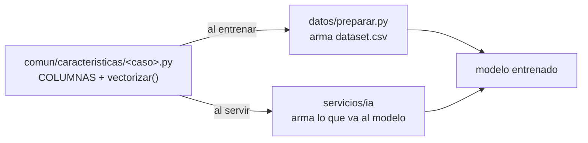

# 2 · Datos: de crudo a tratado

**Lo que vas a lograr:** correr y **entender** `datos/preparar.py`, el tratamiento que exige EP2 §2.2:
perfilado, limpieza, integración, variables, separación y salidas. Al final tendrás `REPORTE.md` con
cada regla y su número, que es literalmente el capítulo 8.4 del documento y la pregunta del IE6.

[← 1 · Repositorio](01-repositorio-y-gitflow.md) · [Índice](../README.md) · [3 · Modelo →](03-modelo.md)

**Ya lo tengo si…** tu tratamiento está en un script versionado (no en un notebook suelto), lo corre el
pipeline, y puedes decir de memoria cuántas filas descartó tu regla más importante y por qué.

---

## 2.1 El recorrido completo



Los seis pasos de EP2 §2.2 y dónde están:

| Paso | Qué pide el enunciado | Dónde está en la plantilla |
|---|---|---|
| 1 · Perfilado | Filas, columnas, tipos, nulos y duplicados, **antes y después** | `reporte.perfil_antes()` en cada tabla; `perfil_despues()` lo hace `preparar.py` |
| 2 · Limpieza | Una regla escrita por problema: corregir, descartar o marcar, y por qué | Cada `reporte.regla(tabla, problema, decisión, filas, porqué)` en `datos/casos/<caso>.py` |
| 3 · Integración | Unir por claves; qué queda sin pareja y qué se hace | Los `merge(..., how="left")` y la regla de huérfanos |
| 4 · Variables | Cuáles, de qué columnas, cómo se calculan | `comun/caracteristicas/<caso>.py`: `COLUMNAS` y `vectorizar()` |
| 5 · Separación | Antes de entrenar; métrica sobre la prueba | Columna `particion` del dataset (estratificada o por usuario/tiempo según el caso) |
| 6 · Salidas | Tablas para la carga y modelo serializado para la imagen | `datos/tratados/tablas/`, `dataset.csv`; el modelo lo hace el capítulo 3 |

## 2.2 Correrlo

**Sin instalar Python** (usa un contenedor; es lo que hace `levantar-local.sh`):

```bash
docker run --rm -u "$(id -u):$(id -g)" -e HOME=/tmp -v "$PWD":/trabajo -w /trabajo python:3.12-slim \
  bash -c "pip install -q --user -r datos/requirements.txt && python datos/preparar.py"
```

**Con Python 3.12 instalado** (más rápido para iterar):

```bash
python -m venv .venv && source .venv/bin/activate      # Windows Git Bash: source .venv/Scripts/activate
pip install -r requirements-dev.txt
python datos/preparar.py
```

**Lo visible** (caso fraude; tu caso tendrá otras tablas y cifras):

```text
Caso fraude: 4 tablas tratadas en 1.0 s
  usuarios                        5000 filas
  dispositivos                    7000 filas
  lista_negra                      349 filas
  transacciones                  27722 filas
  dataset: 1233 filas (925 entrenamiento, 308 prueba), 17 variables
  18 reglas aplicadas. Detalle en datos/tratados/REPORTE.md
```

Abre `datos/tratados/REPORTE.md`. Tiene dos tablas: el **perfil antes y después** de cada archivo, y
**cada regla con su conteo**. Ejemplo real del caso 3:

| Tabla | Problema | Decisión | Filas | Por qué |
|---|---|---|---|---|
| transacciones | filas idénticas en todas las columnas | descartar | 97 | Duplicado del sistema: contarlo dos veces infla el volumen |
| transacciones | misma persona, comercio y monto en otra fila | conservar | 324 | Son reintentos legítimos: la velocidad es una señal de fraude |
| transacciones | revisado_por_analista, motivo_bloqueo, resultado_autorizacion | descartar columnas | 27722 | Fuga de información: al decidir no existen |

## 2.3 Las herramientas de limpieza

`datos/limpieza.py` tiene una función por problema típico. Todas las de tu caso se arman con ellas:

| Función | Arregla | Ejemplo |
|---|---|---|
| `leer(ruta)` | Lee **todo como texto**, sin convertir vacíos: ves el dato como vino | `leer(crudos / "tickets.csv")` |
| `texto(serie)` | Quita espacios y convierte `""`, `-`, `N/A`, `UNKNOWN`, `ERROR`… en nulo **de verdad** | 640 nulos disfrazados en el caso 1 |
| `clave_normalizada(serie)` | `" Falla Técnica "` → `falla_tecnica` | Para comparar categorías |
| `mapear(serie, mapa)` | Traduce con un mapa escrito a mano y **te devuelve lo que no estaba en el mapa** | 66 escrituras de la categoría → 10 intenciones |
| `booleano(serie)` | `1/0/si/no/TRUE/vacío` → 1, 0 o nulo (**vacío no es falso**) | `acepta_marketing`, `es_fraude` |
| `entero`, `monto_clp`, `monto_decimal` | Números que llegan como texto (`$9.570`, `12,50`) | Montos y cantidades |
| `fecha(serie, formatos_locales, formatos_con_zona)` | **Un formato a la vez**, todo a hora de Chile | 4 formatos mezclados con UTC |

> **Por qué `fecha()` no usa `format="mixed"` ni `dayfirst=True`.** En el caso 2, los tickets que
> «cierran antes de abrir» son 2.482 si dejas que pandas adivine, 1.576 si quitas la zona horaria y
> **279** si reconoces los cuatro formatos uno por uno. `dayfirst=True` los sube a 1.836. Adivinar mejor
> no es limpiar: limpiar es saber qué escribió cada sistema (L2B).

## 2.4 Cómo se escribe una regla

Toda regla tiene la misma forma: **detectar → contar → decidir → registrar**. Así queda la del monto en
el caso 3:

```python
invalido = df["monto_clp"].isna() | (df["monto_clp"] <= 0)          # detectar
r.regla("transacciones", "monto cero, negativo o ilegible",          # registrar: tabla, problema
        "descartar", int(invalido.sum()),                            # decisión, CUÁNTAS filas
        "No es un pago que haya que evaluar: un monto negativo es una devolución, otro flujo")  # por qué
df = df[~invalido].copy()                                            # aplicar
```

| Lo que escribiste | Qué hace |
|---|---|
| `invalido = ...` | Una serie de verdadero/falso: qué filas tienen el problema |
| `r.regla(...)` | Anota la regla en el reporte, **con su conteo**: es la fila del 8.4 |
| `"descartar"` | La decisión. Las cuatro posibles: corregir, descartar, marcar (dejar nulo/bandera), imputar |
| `df[~invalido]` | Aplica: se queda con las que no tienen el problema |

**Una regla sin su número no se puede defender.** La pregunta del IE6 es literal: *«¿cuántas filas
descartó tu limpieza y por qué?»*.

## 2.5 Las tres trampas que el docente busca



1. **Fuga de información.** Una columna que solo se llena **después** del resultado (caso 3:
   `motivo_bloqueo` está lleno en las 142 filas de fraude y en ninguna otra). Un modelo que la use da
   99% de exactitud y no sirve en producción.
2. **Vacío no es falso.** `es_fraude` vacío significa «nadie la revisó», no «legítima»; `acepta_marketing`
   vacío no es consentimiento (RN2 del caso 1).
3. **No todo duplicado se borra.** Un `pedido_id` repetido es un pedido con varias líneas (caso 1); una
   transacción repetida en segundos puede ser un reintento legítimo (caso 3).

## 2.6 Las variables: una sola definición

Las variables del modelo se definen **una vez**, en `comun/caracteristicas/<caso>.py`, y las usan dos:



Si las variables se calcularan de dos formas distintas, el modelo vería en producción algo distinto de lo
que vio al entrenar, y nadie se daría cuenta hasta que las predicciones empeoren. Por eso `vectorizar()`
es la misma función en los dos lados, y el microservicio de IA **se niega a arrancar** si las columnas del
modelo no coinciden con `COLUMNAS`.

## 2.7 Tus desafíos de datos

Abre la ficha de tu caso y resuelve los desafíos de datos (los que empiezan con la letra de tu caso):

| Caso | Ficha | Lo más importante |
|---|---|---|
| 1 · Recomendación | [casos/recomendacion.md](../casos/recomendacion.md) | Qué es una venta (estados), el descuento vacío, robots en el clickstream, la ventana de la etiqueta |
| 2 · Chatbot | [casos/chatbot.md](../casos/chatbot.md) | Los datos personales en el texto, el mapa de 66 categorías, los 4 formatos de fecha |
| 3 · Fraude | [casos/fraude.md](../casos/fraude.md) | La fuga, la tasa de fraude real (0,012%), las monedas, entrenar solo con lo revisado |

Cada cambio a una regla es un PR `feat/datos-...` con el antes y el después del conteo en la descripción.

## 2.8 La prueba que lo protege

`tests/test_datos.py` corre en el pipeline y falla si:

- una tabla tiene **nulos o duplicados en sus columnas clave** (lo pide EP2 §2.5);
- el dataset no tiene exactamente las columnas del modelo, o tiene nulos;
- falta alguna clase en la prueba;
- una regla no tiene conteo;
- correr el tratamiento dos veces no da **exactamente** el mismo archivo (determinismo).

```bash
pytest -v tests
```

## Al informe

**8.4 Datos** (sección nueva de EP2): las dos tablas de `REPORTE.md` (perfil antes/después y reglas),
las variables del modelo (tabla columna → origen → por qué, de la ficha de tu caso), la métrica
(capítulo 3) y la figura del modelo de datos (capítulo 8). **11 Riesgos:** el hallazgo de tu caso con su
número (la fuga, los datos personales o los robots).

## En la defensa

**IE6 (EP2):** *«¿Cuántas filas de transacciones descartó tu limpieza y por qué?»* — abre `REPORTE.md` o
corre `python datos/preparar.py` y lee la regla. Después: *«muéstrame esa regla en el código»* — `grep -n
"descartar" datos/casos/<caso>.py`.

[Siguiente: 3 · Modelo →](03-modelo.md)
