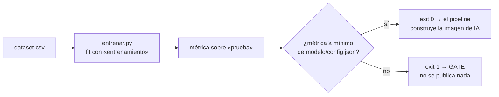
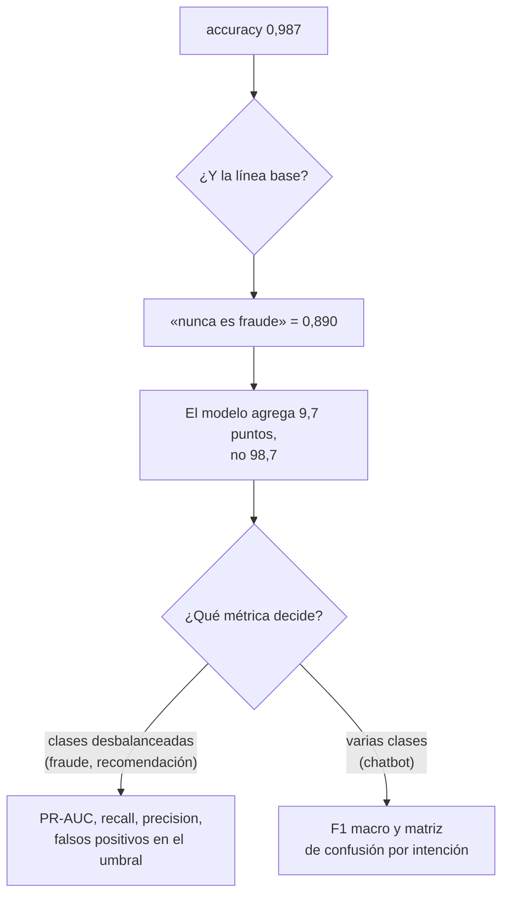

# 3 · El modelo y su gate

**Lo que vas a lograr:** entrenar tu modelo con el dataset tratado, medirlo **contra una línea base** con
datos que no vio, y entender el *gate*: la regla que impide publicar un modelo peor que el mínimo.

[← 2 · Datos](02-datos.md) · [Índice](../README.md) · [4 · Servicios →](04-servicios.md)

**Ya lo tengo si…** tu modelo sale de un script del repositorio (no hay un `.pkl` subido a mano), tienes
su métrica sobre la prueba comparada con una línea base, y tu pipeline se detiene si la métrica baja.

---

## 3.1 Qué predice el modelo en cada caso

| Caso | Tipo | Cada fila es | Predice | Métrica del gate | Línea base |
|---|---|---|---|---|---|
| 1 · Recomendación | Binaria | (usuario, categoría) | Probabilidad de que el usuario compre en esa categoría en los próximos 90 días | ROC-AUC | Recomendar las categorías más vendidas |
| 2 · Chatbot | Multiclase | Un mensaje | La intención (facturación, falla técnica, anulación…) | F1 macro | Responder siempre la intención más frecuente |
| 3 · Fraude | Binaria | Una transacción | Probabilidad de fraude | PR-AUC | Tasa de fraude (azar) y accuracy de «nunca es fraude» |

El modelo **no tiene que ser bueno, tiene que ser tuyo y estar servido de verdad** (EP2 §2.1). Un `if`
escrito a mano no es un modelo; un árbol entrenado con los datos del caso sí.

## 3.2 Correrlo

```bash
python modelo/entrenar.py
```

(o dentro del contenedor, como en el capítulo 2: `... && python modelo/entrenar.py`).

**Lo visible** (caso fraude):

```text
Modelo fraude-local-202611171049 entrenado en 0.3 s con 925 filas
  accuracy: 0.987
  precision: 0.9688
  recall: 0.9118
  pr_auc: 0.9685
  linea_base_accuracy_todo_0: 0.8896
  linea_base_pr_auc_azar: 0.1104
GATE: pr_auc = 0.9685 >= 0.3. El modelo se puede publicar.
```

Y en `modelo/artefactos/`:

| Archivo | Para qué | Lo usa |
|---|---|---|
| `modelo.joblib` | El modelo entrenado | La imagen de IA en EP2 (va **dentro**) |
| `metadatos.json` | Caso, tipo, **versión**, columnas, clases, métricas, fila de referencia | La IA (versión, explicaciones), SageMaker |
| `METRICAS.md` | Las métricas en una tabla | Tu informe |
| `xgboost/*.csv` | Los mismos datos en el formato del XGBoost de SageMaker | EP3, capítulo 11 |

## 3.3 El gate de calidad



`modelo/config.json` fija la métrica y el mínimo de tu caso. Si un cambio en la limpieza o en las
variables baja la métrica bajo ese mínimo, `entrenar.py` termina con error, el job `datos-y-modelo` queda
en rojo y **ninguna imagen se publica**. Es la respuesta a la pregunta de EP1 que siempre vuelve:
*«¿en qué paso se detiene tu pipeline si el modelo nuevo sale peor?»*.

**DESAFÍO M1 · el mínimo.** No lo pongas «al azar»: tiene que estar **sobre la línea base** (si no, el
gate deja pasar un modelo que no aporta) y **bajo tu métrica actual** con un margen (si no, cualquier
ruido detiene el pipeline). Escribe en el informe de dónde sale.

**Pruébalo:** cambia el mínimo a algo imposible (`0.999`), corre `python modelo/entrenar.py`, mira el
mensaje `GATE: ... El modelo NO se publica.` y vuelve a dejarlo como estaba.

## 3.4 Leer las métricas sin engañarse



- **Siempre contra la línea base.** En el L10, el modelo de recomendación tuvo *menos* accuracy que «no
  recomendar nada». Un número solo no dice nada.
- **El umbral es una decisión de negocio, no del modelo.** Con probabilidad 0,5 como corte en fraude se
  detecta una cosa; con 0,3, otra. Los umbrales viven en la configuración del dominio (capítulo 4).
- **Caso 3:** la tasa de fraude del archivo (11% entre lo revisado) **no es la de producción** (0,012%).
  Cualquier umbral o costo calculado con la del archivo está mal por dos órdenes de magnitud.

## 3.5 La versión del modelo

Cada predicción guarda **qué versión del modelo la hizo** (EP2 §2.1, EP3 §2.2). En la plantilla:

| Dónde | Versión |
|---|---|
| Tu computador | `fraude-local-202611171049` (fecha del entrenamiento) |
| El pipeline | `fraude-a1b2c3d` (el commit: se puede rastrear hasta el PR) |
| EP3, SageMaker | `ep3-fraude-20261120-153012` (la configuración del endpoint) |

## 3.6 DESAFÍO M2 · el estimador

`ESTIMADORES` en `modelo/entrenar.py` define el modelo de cada caso (árboles con *boosting* o regresión
logística, de scikit-learn). Son razonables, no óptimos. Si cambias uno: un PR `feat/modelo-...` con la
métrica **antes y después** en la descripción, y la justificación del framework en el informe (IE6
pregunta *«justifica el framework del modelo»*).

## Al informe

**EP2 8.4:** tipo de modelo, framework y por qué, variables, separación, métrica vs línea base.
**EP2 7.4:** el gate en la figura del pipeline. **EP3 apartado 1:** lo mismo, ahora para el modelo de
SageMaker (capítulo 11), y **apartado 5:** métricas de tu caso según EP3 §3.

## En la defensa

*«¿Qué métrica tiene tu modelo y contra qué la comparas?»* — `cat modelo/artefactos/METRICAS.md`.
*«¿Qué pasa si el modelo nuevo sale peor?»* — el gate; muéstralo en el workflow o con el mínimo imposible.

[Siguiente: 4 · Servicios →](04-servicios.md)
