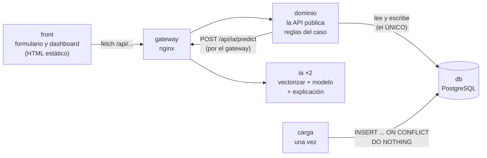
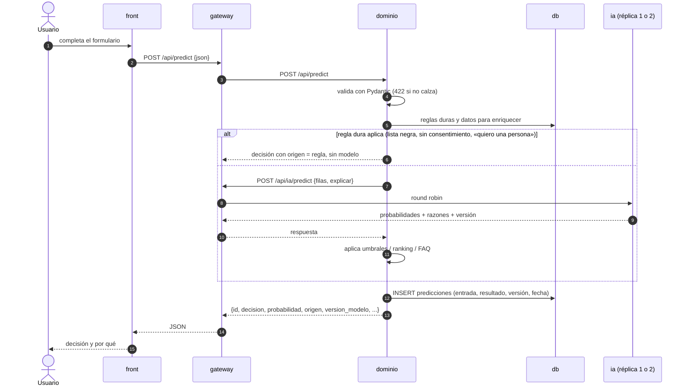

# 4 · Los servicios: IA, dominio, carga y base

**Lo que vas a lograr:** levantar el sistema en tu computador, hacer una predicción de punta a punta y
entender qué hace cada servicio, qué contrato JSON tiene y por qué está separado así.

[← 3 · Modelo](03-modelo.md) · [Índice](../README.md) · [5 · Gateway y réplicas →](05-gateway-front-replicas.md)

**Ya lo tengo si…** puedes dibujar de memoria el camino de una predicción desde el front hasta la base, y
mostrar en la base la predicción que acabas de hacer.

---

## 4.1 Levantar todo

```bash
herramientas/levantar-local.sh
```

Trata los datos, entrena, construye las 5 imágenes propias y levanta los 7 contenedores. La primera vez
tarda unos minutos (descarga imágenes base); después, segundos.

**Lo visible:**

```text
NAME                 SERVICE   STATUS                    PORTS
proyecto-db-1        db        Up (healthy)              5432/tcp
proyecto-dominio-1   dominio   Up (healthy)              8000/tcp
proyecto-front-1     front     Up (healthy)              80/tcp
proyecto-gateway-1   gateway   Up (healthy)              0.0.0.0:8080->8080/tcp
proyecto-ia-1        ia        Up (healthy)              8000/tcp
proyecto-ia-2        ia        Up (healthy)              8000/tcp
```

`carga` no aparece: corrió, cargó la base y terminó (`docker compose -p proyecto ps -a` la muestra como
`Exited (0)`). Abre **http://localhost:8080**: es el front de tu caso. Y **http://localhost:8080/docs**:
la API documentada, con un ejemplo listo en `POST /api/predict` → *Try it out* → *Execute*.

## 4.2 Quién es quién



| Servicio | Hace | No hace | Código |
|---|---|---|---|
| **dominio** | Recibe la petición, valida (422), la enriquece con la base, pide la predicción, aplica las **reglas del caso** (lista negra, stock, derivación, umbrales, reserva), guarda y responde | Cargar el modelo | `servicios/dominio/app/main.py` (común) y `app/casos/<caso>.py` (tu caso) |
| **ia** | Convierte filas de negocio en números (`vectorizar`), predice, explica (caso 3) y devuelve con la **versión** | Tocar la base, decidir | `servicios/ia/app/` |
| **db** | Guarda los datos tratados y cada predicción | — | `servicios/carga/esquemas/*.sql` |
| **carga** | Crea las tablas y mete los CSV tratados (que vienen **dentro de su imagen**). Si corre dos veces, no duplica | Correr siempre (`restart: "no"`) | `servicios/carga/cargar.py` |

¿Por qué la IA no lee la base? Porque así se puede **escalar y reemplazar sola**: en EP3 el modelo se va
a SageMaker y nada más cambia. Y porque con dos réplicas sin estado, cualquiera puede responder.

## 4.3 Una predicción, paso a paso



Pruébalo con `curl` (el cuerpo de ejemplo de tu caso está en `/docs`):

```bash
curl -s -X POST http://localhost:8080/api/predict -H 'content-type: application/json' \
  -d '<el ejemplo de /docs>' | python3 -m json.tool
```

## 4.4 El contrato de `/predict`

Hay **dos** contratos y en la defensa te van a pedir uno de los dos (IE6):

**El público** (`POST /api/predict`, lo usa el front): el cuerpo es el `Entrada` de tu caso, definido
en `servicios/dominio/app/casos/<caso>.py`. Campos de más o de tipo incorrecto → `422` con el detalle.
La respuesta siempre trae: `id`, `decision`, `probabilidad`, `origen` (`modelo`, `reserva` o `regla`),
`version_modelo`, `latencia_ms`, `estado_llm` y lo propio del caso (`razones`, `productos`, `articulos`…).

**El interno** (`POST /api/ia/predict`, lo usa el dominio):

```json
// petición
{"filas": [{"monto_clp": 250000, "hora_local": 3, "canal": "app", "...": "..."}], "explicar": true}
// respuesta
{"version_modelo": "fraude-a1b2c3d", "motor": "local", "replica": "af8a8f95df5d", "latencia_ms": 4,
 "resultados": [{"probabilidad": 0.0507, "razones": [{"variable": "intentos_previos_1h",
   "descripcion": "transacciones del usuario en la hora previa", "valor": 4.0, "aporte": 0.0506}]}]}
```

En el caso multiclase (chatbot) cada resultado es `{"clase", "probabilidad", "alternativas"}`.

## 4.5 Los tres orígenes de una decisión

Cada predicción guarda de dónde salió. Es lo que hace al sistema **explicable y resistente**:

| `origen` | Cuándo | Ejemplo |
|---|---|---|
| `modelo` | El modelo respondió a tiempo | Probabilidad de fraude 0,93 → bloquear |
| `regla` | Una regla dura decide **antes** del modelo | Dispositivo en lista negra (caso 3), sin consentimiento (caso 1), «quiero hablar con una persona» (caso 2) |
| `reserva` | El modelo **no respondió** a tiempo (`TIMEOUT_MODELO_MS`) | Más vendidos (caso 1), derivar a ejecutivo (caso 2), motor de reglas (caso 3) |

Pruébalo: detén las dos réplicas de IA y vuelve a predecir.

```bash
docker compose -p proyecto stop ia
curl -s -X POST http://localhost:8080/api/predict -H 'content-type: application/json' -d '<ejemplo>' \
  | python3 -c "import json,sys; d=json.load(sys.stdin); print(d['decision'], d['origen'], d['latencia_ms'])"
docker compose -p proyecto start ia
```

**Lo visible:** la decisión sale igual, con `origen` = `reserva` y una latencia cercana al timeout. El
sistema **no se cae** porque el modelo se cae: eso es RNF3 de los casos 1 y 3.

## 4.6 La base, por dentro

```bash
docker compose -p proyecto exec db psql -U app -d proyecto
```

```sql
\dt                                                     -- las tablas de tu caso + predicciones
SELECT id, creada, decision, origen, version_modelo, latencia_ms FROM predicciones ORDER BY creada DESC LIMIT 5;
SELECT entrada, resultado FROM predicciones ORDER BY creada DESC LIMIT 1;
\q
```

Y la carga **no duplica** (EP2 §2.1): córrela otra vez y mira que todas las tablas dicen `0 nuevas`.

```bash
CASO=$(cat CASO) docker compose -p proyecto -f compose.yaml -f compose.dev.yaml run --rm carga
```

¿Por qué no duplica? Cada tabla tiene **clave primaria** y la carga inserta con `ON CONFLICT DO
NOTHING`: una fila que ya está no se vuelve a insertar.

## 4.7 Lo que cambia de un caso a otro

Solo dos archivos del dominio son de tu caso; el resto es común:

| Lo que define `app/casos/<caso>.py` | Caso 1 | Caso 2 | Caso 3 |
|---|---|---|---|
| `Entrada` | usuario, cantidad 4–8, producto actual | mensaje, cliente, conversación, canal | transacción |
| Reglas antes del modelo | Sin consentimiento o sin historial → más vendidos | «Quiero una persona» → derivar | Lista negra → bloquear |
| Uso del modelo | Una fila por categoría, ranking | Intención + confianza | Probabilidad + razones |
| Reglas después | Stock > 0, vetos, no repetir | Anulación, molestia, 3 intentos → derivar | Umbrales revisar / bloquear |
| Reserva | Más vendidos (RNF3: 200 ms) | Derivar a ejecutivo | Motor de reglas |
| Ruta propia | `POST /api/campanas/{usuario}` | `POST /api/conversacion` | `GET /api/revision` |

Los **DESAFÍOS D…** de tu ficha están en este archivo: umbrales, timeouts, política de reserva.

## Al informe

**5.2** contenedores y **5.3** componentes del microservicio de IA (capítulo 8 tiene las figuras listas),
**6** la secuencia de 4.3 con el camino de falla, **8.4** el modelo de datos (`\d predicciones`).

## En la defensa

**IE6 (EP2):** *«¿Qué contrato JSON tiene `/predict`? Detén el microservicio de IA: ¿qué responde el
gateway y qué muestra el front? Entra a la base y muéstrame la predicción que acabo de hacer.»* — 4.4,
4.5 y 4.6, en ese orden.

[Siguiente: 5 · Gateway, front y réplicas →](05-gateway-front-replicas.md)
