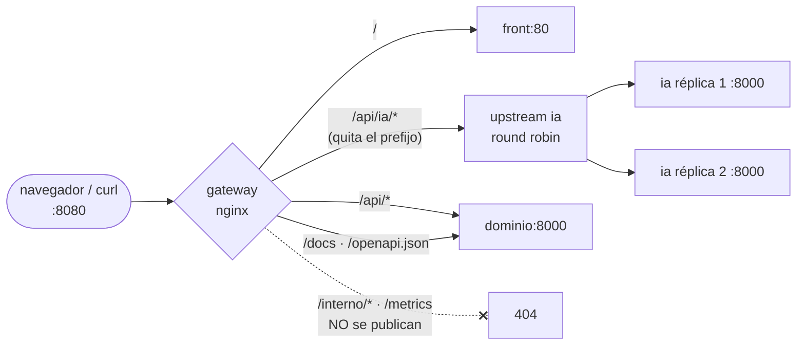
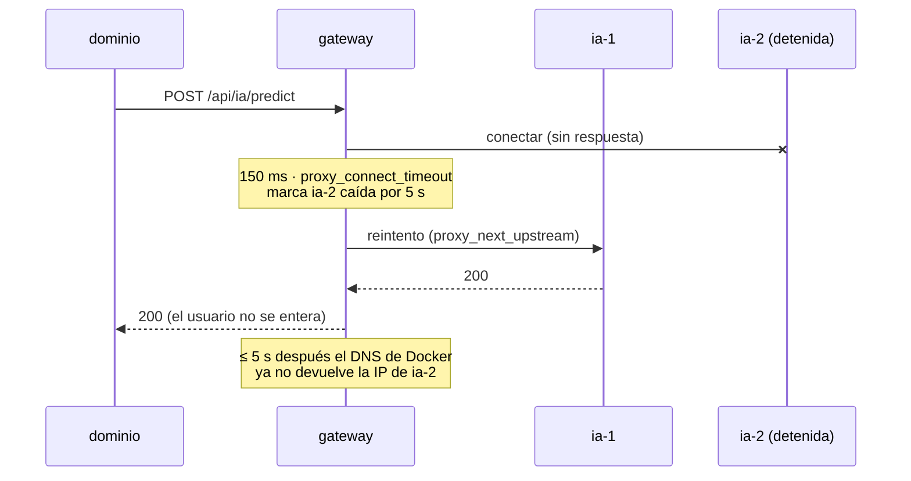
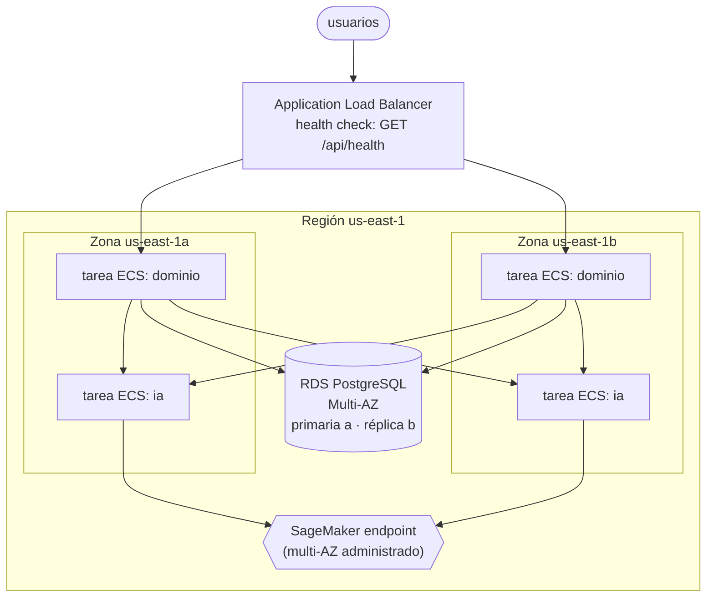

# 5 · Gateway, front y réplicas

**Lo que vas a lograr:** entender la única puerta de entrada (nginx), ver cómo reparte entre las dos
réplicas de IA, y **provocar la caída de una réplica** mientras el sistema sigue respondiendo: es la
pregunta que más pesa en la defensa de EP2 (IE4, 22%).

[← 4 · Servicios](04-servicios.md) · [Índice](../README.md) · [6 · Compose de la defensa →](06-compose-defensa.md)

**Ya lo tengo si…** detienes una réplica con `docker stop` mientras haces peticiones y ninguna falla, y
puedes explicar por qué.

---

## 5.1 Las rutas del gateway

`servicios/gateway/nginx.conf`:



| Bloque de `nginx.conf` | Qué hace |
|---|---|
| `resolver 127.0.0.11 valid=5s` | Usa el DNS de Docker y vuelve a preguntar cada 5 s: si una réplica se detiene, sale de la lista; si nace otra, entra sola |
| `upstream ia { server ia:8000 resolve ... }` | Docker devuelve **una IP por réplica**; nginx las reparte por turnos (*round robin*) |
| `max_fails=1 fail_timeout=5s` | Una réplica que falla queda fuera 5 s |
| `proxy_connect_timeout 150ms` | Conectar dentro de Docker toma menos de 1 ms: si en 150 ms no conecta, está caída |
| `proxy_next_upstream error timeout http_502 http_503 non_idempotent` | Si la réplica elegida falla, **reintenta en la otra**. Se permite también para el POST porque predecir no tiene efectos secundarios |
| `location /api/ia/ { proxy_pass http://ia/; }` | La barra final quita el prefijo: `/api/ia/predict` llega como `/predict` |
| `location /api/` | Todo lo demás de la API va al dominio |

Y el dominio llama a la IA **a través del gateway** (`URL_IA: http://gateway:8080/api/ia`), no directo:
así el balanceo y el reintento valen también para el tráfico interno.

## 5.2 Ver el balanceo

```bash
for i in 1 2 3 4; do curl -s -D - -o /dev/null http://localhost:8080/api/ia/health | grep -i x-replica; done
```

**Lo visible:** dos IP que se alternan (`X-Replica-IA: 172.19.0.2:8000`, `172.19.0.5:8000`, …). El
gateway agrega esa cabecera para que lo puedas ver. También en los logs:

```bash
docker compose -p proyecto logs gateway --tail 6
```

Cada línea es JSON con `ruta`, `codigo`, `ms` y `upstream`: la réplica que respondió.

## 5.3 Provocar la caída de una réplica (la pregunta del IE4)

En una terminal, peticiones continuas; en otra, detienes una réplica:

```bash
# terminal 1
while true; do
  curl -s -o /dev/null -w '%{http_code} %{time_total}s\n' -X POST http://localhost:8080/api/predict \
    -H 'content-type: application/json' -d '<ejemplo de tu caso>'
  sleep 0.3
done
```

```bash
# terminal 2
docker stop proyecto-ia-2
# ... mira la terminal 1 ...
docker start proyecto-ia-2
```

**Lo visible (medido):** todas `200`. Una sola tarda ~170 ms en vez de ~15 ms: la que intentó la réplica
caída, esperó 150 ms, y el gateway la reintentó en la otra. Las siguientes ya no la eligen.



**Y si caen las dos:** el dominio no recibe respuesta en `TIMEOUT_MODELO_MS` y aplica la **política de
reserva** (capítulo 4.5): el usuario recibe una respuesta degradada, no un error.

## 5.4 Del computador a la nube: alta disponibilidad de verdad

Las dos réplicas en un computador protegen contra la caída de **un proceso**, no de la máquina. En el
documento tienes que mostrar el **despliegue objetivo** en AWS, donde la misma idea se lleva a zonas de
disponibilidad:



| Concepto | Qué escribir en 8.2 | Cómo se calcula |
|---|---|---|
| **Disponibilidad** | El RNF de tu caso: 99,5% (casos 1 y 2) o 99,9% (caso 3) | Minutos de caída al mes = 43.200 × (1 − disponibilidad): **216 min** con 99,5%, **43,2 min** con 99,9% |
| **RTO** (cuánto tarda en volver) | Ej.: 5 min | Lo que tarda el ALB en sacar la tarea enferma (intervalo × umbral del health check) + lo que tarda ECS en lanzar otra |
| **RPO** (cuántos datos se pierden) | Ej.: ~0 para las predicciones | RDS Multi-AZ replica en forma síncrona; los backups automáticos dan RPO de 5 min ante corrupción |
| **Si cae una zona** | El ALB deja de mandar a esa zona; RDS hace *failover* a la réplica (1–2 min) | Por eso se necesitan al menos dos zonas y dos tareas |

## 5.5 El front

`servicios/front/` es HTML y JavaScript sin frameworks. **Es genérico:** pide `GET /api/caso` y dibuja
el formulario de tu caso con lo que define `FRONT` en `servicios/dominio/app/casos/<caso>.py`. Muestra
la decisión, la probabilidad, el origen, la versión del modelo, las razones o productos o artículos, el
historial, y (EP3) el texto del LLM cuando llega. `dashboard.html` muestra `/api/health` y
`/api/dashboard` cada 10 s.

**DESAFÍO opcional:** si tu equipo sabe Angular o React, puede reemplazarlo. La regla es la misma: un
contenedor propio, detrás del gateway, sin publicar puertos.

## Al informe

**4 y 9:** ficha ADR de los patrones **API gateway** y **réplicas con balanceo** (requerimiento que los
justifica, alternativa descartada). **7.1:** despliegue actual (Compose) y despliegue objetivo (5.4).
**8.2:** disponibilidad, RTO, RPO, qué pasa si cae una zona.

## En la defensa

**IE4 (EP2):** *«Mientras hago peticiones desde el front, detén una de las dos réplicas. ¿Qué ve el
usuario? ¿Qué pasa si cae una zona de disponibilidad y cuál es tu RTO?»* — 5.3 con el teclado, 5.4 con
la figura y los números del 8.2. En la defensa el proyecto se llama `equipoNN`: el contenedor es
`equipoNN-ia-2`.

[Siguiente: 6 · Compose de la defensa →](06-compose-defensa.md)
