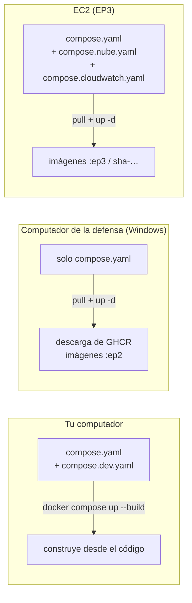
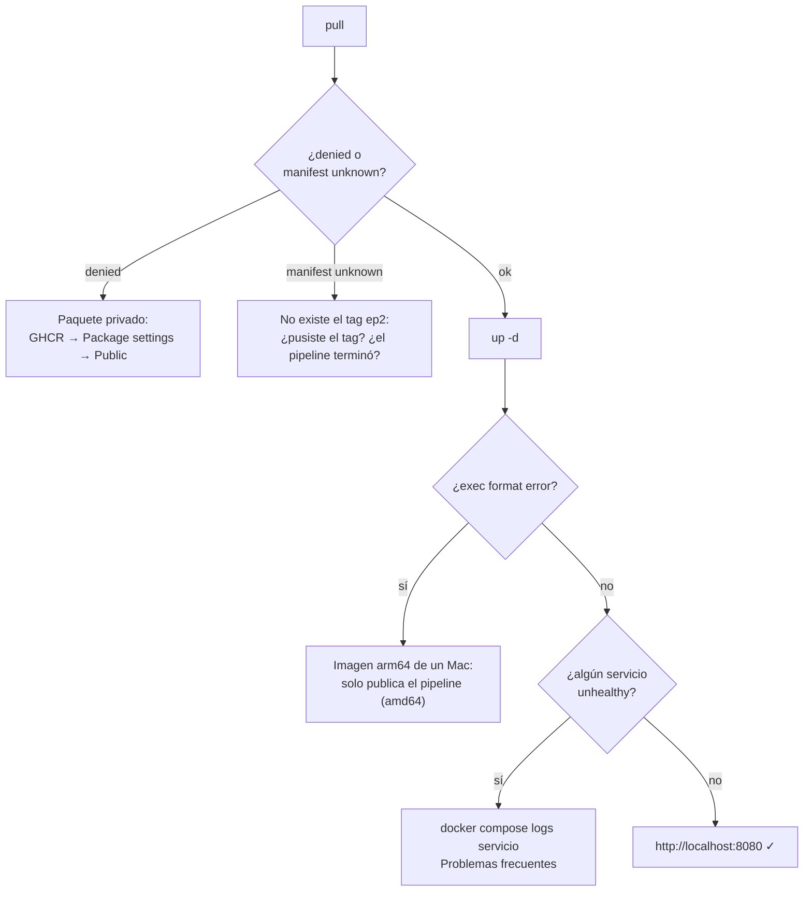

# 6 · El compose de la defensa

**Lo que vas a lograr:** un `compose.yaml` que cumple las nueve reglas de EP2 §2.3 y levanta tu sistema
en un computador que **nunca vio tu código**, con dos comandos. Es lo primero que pasa en la defensa: si
no levanta, el IE5 queda con tope de 30% y se complica todo lo demás.

[← 5 · Gateway y réplicas](05-gateway-front-replicas.md) · [Índice](../README.md) · [7 · Pipeline →](07-pipeline.md)

**Ya lo tengo si…** alguien del equipo que no escribió el compose lo levantó en un computador limpio,
después de borrar todas las imágenes locales, con `pull` + `up -d`.

---

## 6.1 Tres archivos, tres usos



`compose.yaml` es **uno solo** y sirve para los tres; los otros se le **suman** encima. Nunca tiene
`build:` (regla 1): para construir en tu computador, `compose.dev.yaml` agrega el `build:`.

## 6.2 Las nueve reglas, en tu archivo

| # | Regla (EP2 §2.3) | Dónde se cumple en `compose.yaml` |
|---|---|---|
| 1 | Descarga imágenes, no las construye | Cada servicio propio: `image: ghcr.io/<tu-usuario>/<tu-repo>-<servicio>:${TAG:-ep2}`, sin `build:` |
| 2 | Imágenes públicas y `linux/amd64` | Las construye el pipeline con `platforms: linux/amd64` (capítulo 7); las haces públicas en GHCR |
| 3 | Sin bind mounts | Modelo y datos van **dentro** de las imágenes `ia` y `carga`; la base usa el volumen con nombre `datos_db` |
| 4 | Solo el gateway publica puerto, el 8080 | Solo `gateway` tiene `ports:` |
| 5 | `healthcheck` y `depends_on` con condición | Cada servicio propio tiene `healthcheck`; `dominio` espera a `db: service_healthy` y `carga: service_completed_successfully`; `gateway` espera a los tres |
| 6 | `cpus` y `mem_limit` en cada servicio propio | Todos los tienen. **DESAFÍO S1:** son el punto de partida; los tuyos salen de medir (6.4) |
| 7 | Menos de 2 GB sumando imágenes | Medido: ia ≈ 650 MB, dominio ≈ 265 MB, carga ≈ 245 MB, gateway y front ≈ 76 MB c/u, postgres ≈ 270 MB → **≈ 1,6 GB** |
| 8 | Nada secreto; funciona con valores por defecto | Todo `${VAR:-valor}`; no hay `.env` obligatorio (el grupo que exigía `copy .env.example .env` lo perdió) |
| 9 | `pull` + `up -d` y nada más | Ver 6.3 |

El script que lo revisa (también lo corre el pipeline):

```bash
herramientas/verificar-defensa.sh           # reglas 1, 3, 4, 5, 6 y 8
herramientas/verificar-defensa.sh --pull    # además 2: intenta descargar SIN sesión, como la defensa
```

## 6.3 El ensayo en un computador limpio

Así va a ser en la defensa. Háganlo **antes**, con alguien que no escribió el compose, idealmente en
Windows:

```powershell
# PowerShell, en una carpeta vacía con SOLO el compose.yaml descargado de GitHub (botón Raw)
docker image rm $(docker image ls -q "ghcr.io/<tu-usuario>/*") 2>$null
docker compose -p equipo04 pull
docker compose -p equipo04 up -d
start http://localhost:8080
```

**Lo visible:** en menos de un minuto `docker compose -p equipo04 ps` muestra todo `healthy` y el front
responde. Para terminar: `docker compose -p equipo04 down -v`.



## 6.4 Medir para fijar los límites (DESAFÍO S1)

Los `cpus` y `mem_limit` no se copian: se **miden**. El dominio limita a 120 solicitudes por minuto (y
responde `429` al pasarse), así que para medir el sistema y no el límite, levántalo con el límite alto:

```bash
LIMITE_POR_MINUTO=1000000 herramientas/levantar-local.sh --sin-datos
herramientas/medir.sh                      # 60 s de carga, 8 clientes en paralelo
```

**Lo visible** (medido en el caso 3, en un Mac con Docker Desktop):

```text
Solicitudes: 4887 · códigos: {'200': 4887}
Latencia ms  p50 87 · p95 161 · p99 195 · máx 362

Pico por contenedor (para el capítulo 7.2):
contenedor                   CPU máx %  RAM máx MiB  límite
proyecto-db-1                     12.6         55.5  256MiB
proyecto-dominio-1                53.1         45.6  192MiB
proyecto-front-1                   0.0          9.2  32MiB
proyecto-gateway-1                 7.1         11.8  64MiB
proyecto-ia-1                     27.4         98.7  320MiB
proyecto-ia-2                     19.2         94.2  320MiB
```

**Cómo se lee.** En `docker stats`, 100% es un núcleo completo. El dominio llegó a 53% con `cpus: 0.5`:
**está en su techo**, y es el cuello de botella (las réplicas de IA no pasan de 27%). Por eso la latencia
sube a p50 87 ms con 8 clientes. La memoria sobra en todos: la IA usa ~99 MiB de 320.

Con eso decides y escribes en el 7.2, por ejemplo: «el dominio satura su 0,5 CPU con ~80 solicitudes por
segundo; para el pico del caso subimos a 1 CPU o a 2 réplicas del dominio. La IA usa 99 MiB en el pico:
bajamos `mem_limit` a 192m, que deja 2× de margen». Y la pregunta del IE2: *«¿qué pasa si el límite es
menor que el consumo?»* → con la memoria, el kernel mata el proceso (*OOMKilled*:
`docker inspect proyecto-ia-1 --format '{{.State.OOMKilled}}'`); con la CPU, no muere: **se pone lento**.

## Al informe

**7.1:** la figura del despliegue actual (Compose: contenedores, red interna, el único puerto).
**7.2:** la tabla de 6.4 con tu medición, el límite elegido y su proyección a la instancia de AWS
(capítulo 8). **Anexo C:** el link directo al `compose.yaml` de la defensa (en el tag `ep2`).

## En la defensa

**IE2 (EP2):** *«Tu microservicio de IA tiene este `mem_limit`. Genera carga, muéstrame `docker stats` y
dime de dónde salió ese número»*:

```bash
docker stats --no-stream          # en otra terminal: herramientas/medir.sh, o el bucle de 5.3
```

[Siguiente: 7 · Pipeline y GHCR →](07-pipeline.md)
