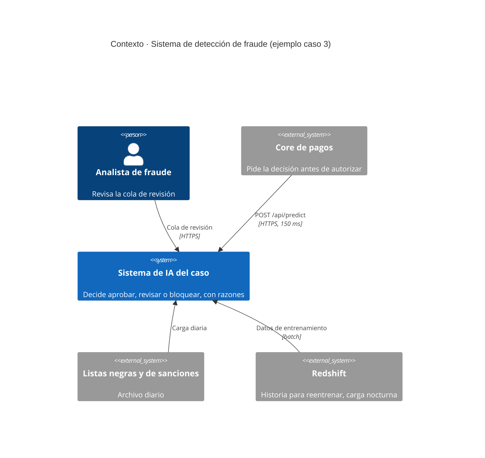
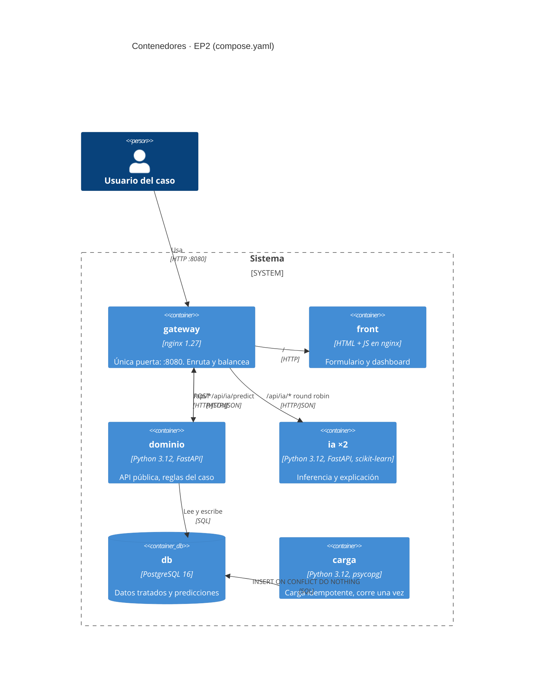
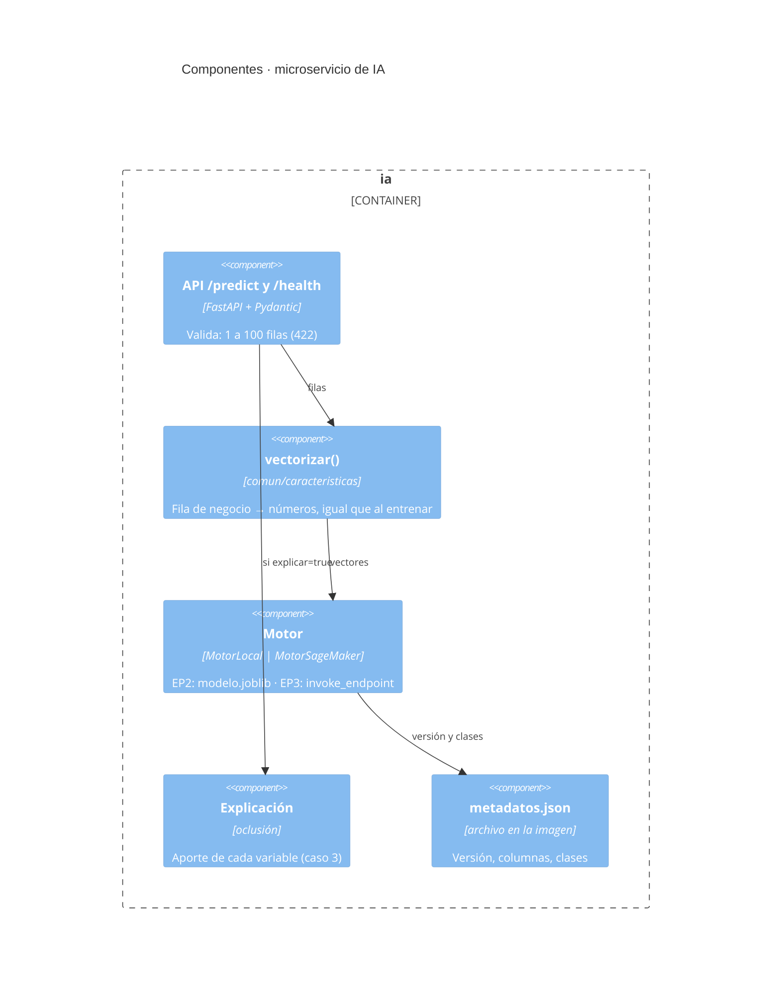
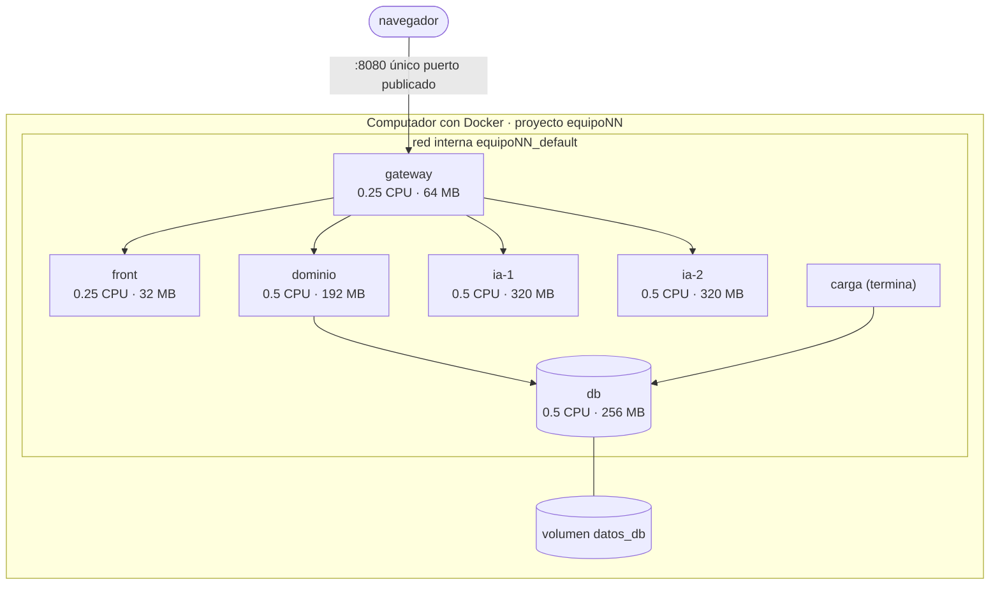
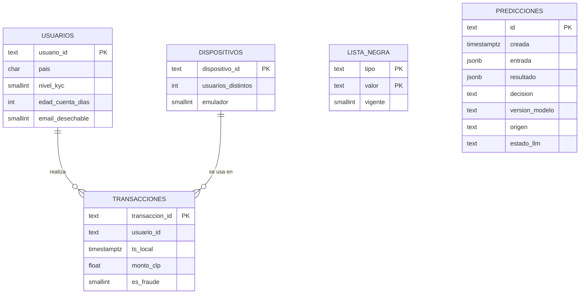

# 8 · El documento de EP2

**Lo que vas a lograr:** el arc42 de EP1 corregido y extendido hasta lo que pide EP2 §3: las **8 figuras**
(listas para copiar y adaptar en Mermaid), el dimensionamiento con tu medición, los costos, la alta
disponibilidad, la seguridad, el monitoreo y los datos. Máximo **15 páginas** del capítulo 1 al 10.

[← 7 · Pipeline](07-pipeline.md) · [Índice](../README.md) · [9 · Defensa EP2 →](09-defensa-ep2.md)

**Ya lo tengo si…** cada apartado de la tabla 8.1 tiene su capítulo, cada cifra del capítulo 7 sale de
una medición o de la calculadora de AWS, y la figura 5.2 tiene exactamente los servicios del `compose.yaml`.

---

## 8.1 Qué va en cada capítulo

| Apartado EP2 | Capítulo | Contenido mínimo | De dónde lo sacas | IE |
|---|---|---|---|---|
| 1.1 Contexto | 3.1–3.2 | Figura 1, corregida con la retro de EP1 | 8.2 fig. 1 | IE1 |
| 1.1 Contenedores | 5.2 | Figura 2 + tabla responsabilidad / tecnología / puerto | 8.2 fig. 2, `compose.yaml` | IE1 |
| 1.1 Componentes | 5.3 | Figura 3 del microservicio de IA | 8.2 fig. 3, `servicios/ia/app/` | IE1 |
| 1.2 Dimensionamiento | 7.2 | Tabla medida con `docker stats` y proyección a AWS | 8.3, capítulo 6.4 | IE2 |
| 1.2 Costos | 7.3 | Costo mensual del despliegue objetivo | 8.4 | IE2 |
| 1.3 Patrones | 4 y 9 | ≥ 2 fichas ADR (gateway, réplicas, cola…) | 8.5 | IE3 |
| 1.3 Implementación | 6 | Figura 4: secuencia con camino de falla | 8.2 fig. 4 | IE3 |
| 1.4 Contenedores y orquestación | 7.1 | Imagen base por servicio y por qué; figuras 5 y 6; ADR del orquestador | 8.2 figs. 5 y 6 | IE5 |
| 1.4 Balanceo y health checks | 7.1 y 8 | Cómo reparte el gateway hoy y qué haría el ALB | capítulo 5 | IE5 |
| 1.5 Seguridad | 8.3 | Implementado vs. pendiente para producción | 8.6 | IE7 |
| 1.5 Monitoreo | 8.1 | Métricas con umbral y acción | 8.7, `monitoreo/alertas.yml` | IE7 |
| 1.6 Alta disponibilidad | 8.2 | Multi-AZ, RTO, RPO, backup, failover | capítulo 5.4 | IE4 |
| Pipeline y gitflow | 7.4 | Figura 7 | 8.2 fig. 7 | IE5 |
| Datos | 8.4 | Perfil antes/después, reglas, variables, métrica, figura 8 | `REPORTE.md`, `METRICAS.md`, 8.2 fig. 8 | IE1, IE6 |

Anexos: **A** referencias APA 7 (mín. 2, citadas) · **B** declaración de uso de IA, firmada, **que cubra
también el código** (y que partieron de esta plantilla) · **C** repositorios y sistema (capítulo 1.7).

## 8.2 Las ocho figuras

Escríbelas en Mermaid dentro del repositorio (`docs/figuras/*.md`): se versionan y en EP3 se actualizan.
Para el PDF, exporta desde [mermaid.live](https://mermaid.live) a PNG. Reemplaza lo que dice *Tu caso*.

### Figura 1 · Contexto (C4 nivel 1)

### Figura 2 · Contenedores (C4 nivel 2) — **los mismos servicios que `compose.yaml`**

> **Verificación:** cuenta las cajas y cuenta los servicios de `compose.yaml`. Si sobra o falta uno,
> uno de los dos está mal (EP2 §3.3).

### Figura 3 · Componentes del microservicio de IA (C4 nivel 3)

### Figura 4 · Secuencia del flujo principal, con el camino de falla

Usa la del capítulo 4.3 y agrega la caída de una réplica (capítulo 5.3) y el timeout → reserva.

### Figura 5 · Despliegue actual (Compose en un computador)

### Figura 6 · Despliegue objetivo en AWS

La del capítulo 5.4 (ALB, dos zonas, ECS o Kubernetes, RDS Multi-AZ, SageMaker). Acompáñala con la
ficha ADR del orquestador (8.5).

### Figura 7 · Pipeline

La del capítulo 7.1, más las ramas del capítulo 1.5.

### Figura 8 · Modelo de datos (ejemplo caso 3; el tuyo está en `servicios/carga/esquemas/<caso>.sql`)

## 8.3 Dimensionamiento (7.2) — con tu medición

Corre `herramientas/medir.sh` (capítulo 6.4) y llena:

| Servicio | CPU pico medido | RAM pico medida | `cpus` | `mem_limit` | Por qué ese límite |
|---|---|---|---|---|---|
| ia (por réplica) | _ % | _ MiB | 0.5 | 320m | pico × margen para el modelo de producción |
| dominio | _ % | _ MiB | 0.5 | 192m | … |
| … | | | | | |

**Proyección a AWS.** Suma lo que pide producción según el volumen de tu caso (no el de la muestra):

| Caso | Volumen del caso | Pico | Qué implica |
|---|---|---|---|
| 1 | 100.000 usuarios/mes; Cyber 8×, 10.000 concurrentes | RNF4 | Muchas réplicas pequeñas que escalan; recomendaciones precalculadas |
| 2 | 340.000 contactos/mes; 1.000 conversaciones simultáneas | RNF3 | El cuello es Siebel (40 concurrentes) y el LLM, no la CPU |
| 3 | 200.000 tx/día → 1.000.000 sin rediseño; 5.500/min | RNF4 | ~92 tx/s en el pico: latencia p99 < 100 ms manda sobre la CPU |

Ejemplo de razonamiento: «medimos 50 solicitudes/s por réplica de IA con 0,5 CPU; el pico del caso son 92
tx/s → 2 réplicas + 1 de holgura por zona → 6 tareas de 0,5 vCPU / 0,5 GB en ECS Fargate».

## 8.4 Costos (7.3)

Sobre el **despliegue objetivo**, con la [calculadora de AWS](https://calculator.aws), región `us-east-1`.
Deja el link de la estimación en el documento. Estructura mínima:

| Componente | Configuración | Cálculo | USD/mes |
|---|---|---|---|
| Cómputo (ECS Fargate o EC2) | _ tareas × _ vCPU × _ GB × 730 h | calculadora | |
| Balanceador (ALB) | 1 ALB + LCU | calculadora | |
| Base (RDS PostgreSQL Multi-AZ) | `db.t4g.small` Multi-AZ + _ GB | calculadora | |
| Modelo (SageMaker) | serverless _ MB, _ invocaciones/mes × _ ms | calculadora | |
| Logs y métricas (CloudWatch) | _ GB/mes de logs | calculadora | |
| Transferencia | _ GB/mes | calculadora | |
| **Total** | | | **vs. presupuesto del caso: USD 3.000 / 8.500 / 6.000** |

Referencia de precio verificable: una `t3.medium` on-demand en `us-east-1` cuesta USD 0,0416/h ≈
**USD 30,4/mes** (730 h). Cada número de la tabla tiene que poder rastrearse (EP2 §3.5).

## 8.5 Fichas ADR (4 y 9)

Una por patrón, con esta forma:

| Campo | Ejemplo · réplicas con balanceo |
|---|---|
| Contexto | RNF2 del caso: 99,5% mensual (216 min de caída al mes) |
| Decisión | Dos réplicas sin estado del microservicio de IA detrás del gateway, con health check |
| Alternativas | Una sola réplica (más barata, un fallo = caída); escalar verticalmente (no protege de fallos) |
| Consecuencias | +1 contenedor de memoria; el servicio de IA no puede guardar estado en memoria |
| Evidencia | Prueba 5.3: `docker stop` de una réplica sin errores para el usuario |

Candidatas: **API gateway**, **réplicas con balanceo**, **microservicios** (dominio separado de IA),
**reglas antes del modelo + política de reserva** (*circuit breaker* simple), y en EP3 **cola de mensajes
(Event-Driven)** para el LLM. Y la del **orquestador** objetivo: ECS Fargate vs Kubernetes (EKS).

## 8.6 Seguridad (8.3): implementado vs. pendiente

| Medida | En esta versión (EP2) | Para producción |
|---|---|---|
| Superficie | Solo el gateway publica puerto; base, IA y dominio no | + WAF en el ALB |
| Entrada | Validación con esquema (422), campos desconocidos rechazados | — |
| Autenticación | Lista para activarse con `API_KEYS` (EP3 la activa) | OAuth2 / Cognito |
| Límite de solicitudes | Por clave o IP en el dominio (429) | En el ALB/API Gateway, compartido |
| Secretos | Ninguno en el repo ni en imágenes; `.env` fuera de Git | AWS Secrets Manager |
| Datos personales | Caso 2: anonimizados antes de entrenar y guardar · caso 3: sin número de tarjeta · caso 1: sin datos personales | Cifrado en reposo (RDS/KMS) |
| Contenedores | Imágenes `slim`, procesos con `USER nobody` | Escaneo de imágenes en el pipeline |
| Cifrado en tránsito | No (HTTP local) | HTTPS (EP3 lo agrega con Caddy) |

## 8.7 Monitoreo (8.1): métrica, umbral, acción

Cada fila sale de `monitoreo/alertas.yml` (Prometheus, como en L8) y se ve en el dashboard de Grafana:

| Métrica | Umbral | Durante | Acción |
|---|---|---|---|
| p95 de `POST /api/predict` | > RNF de tu caso (200 ms / 3 s / 100 ms) | 1 min | Revisar IA (cold start, réplica caída), `docker stats` |
| % de respuestas 5xx | > 5% | 1 min | `docker compose logs dominio`, `/api/health` |
| % de decisiones por reserva | > 20% | 2 min | El modelo no responde a tiempo: latencia de la IA |
| Réplicas de IA arriba | < 2 | 30 s | `docker compose up -d ia` |
| Métrica del modelo en producción | Caída de 10 pts (RNF9 caso 2) / 20% CTR (RNF8 caso 1) | semanal | Revisar datos y reentrenar |

Para verlo andando: `docker compose -p proyecto -f compose.yaml -f compose.dev.yaml -f compose.monitoreo.yaml up -d`
→ Grafana en http://localhost:3000 (admin/admin), carpeta *Proyecto*.

[Siguiente: 9 · La defensa de EP2 →](09-defensa-ep2.md)
