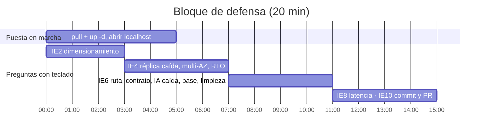

# 9 · La defensa de EP2

**Lo que vas a lograr:** llegar a los 20 minutos sabiendo exactamente qué comando responde cada
pregunta. La defensa vale el **70%** de EP2 y casi todo se responde **con el teclado** sobre tu sistema
corriendo en el computador de la sala.

[← 8 · Documento EP2](08-documento-ep2.md) · [Índice](../README.md) · [10 · AWS: la EC2 →](10-aws-ec2.md)

---

## 9.1 Los 20 minutos



En PowerShell, en el computador de la sala (las imágenes ya están descargadas):

```powershell
docker compose -p equipoNN pull
docker compose -p equipoNN up -d
docker compose -p equipoNN ps
start http://localhost:8080
```

> En PowerShell usa `curl.exe` (no `curl`, que es otro comando). Para JSON legible, pega la respuesta en
> el navegador o usa `/docs`. Los ejemplos de abajo están en PowerShell; en bash son iguales sin `.exe`.

## 9.2 Cada pregunta, con su respuesta

### IE2 · 18% · Dimensionamiento

> *«Tu microservicio de IA tiene este `mem_limit`. Genera carga con un bucle de peticiones, muéstrame
> `docker stats` y dime de dónde salió ese número. ¿Qué instancia de AWS usarías y cuánto cuesta al mes?»*

```powershell
# terminal 1: carga (el cuerpo es el ejemplo de /docs de tu caso, guardado en ejemplo.json)
1..300 | % { curl.exe -s -o NUL -X POST http://localhost:8080/api/predict -H "content-type: application/json" --data "@ejemplo.json" }
# terminal 2: el consumo real
docker stats --no-stream
```

**Una buena respuesta:** «La réplica de IA usa ~99 MiB en carga contra un límite de 320 MiB; lo medimos
con `medir.sh` (tabla 7.2) y dejamos margen para el modelo de producción. Si el
límite fuera menor que el consumo, el kernel mata el proceso: `OOMKilled`, el health check falla, Docker
lo reinicia y mientras tanto el gateway manda todo a la otra réplica. En AWS, con el volumen del caso,
usaríamos … (7.2) y cuesta … al mes (7.3, calculadora).»

### IE4 · 22% · Alta disponibilidad

> *«Mientras hago peticiones desde el front, detén una de las dos réplicas. ¿Qué ve el usuario? ¿Y si se
> cae una zona de disponibilidad completa? ¿Cuál es tu RTO?»*

```powershell
docker stop equipoNN-ia-2
# el docente usa el front: sigue respondiendo
docker compose -p equipoNN logs gateway --tail 5     # "upstream": solo la IP de ia-1
docker start equipoNN-ia-2
```

**Una buena respuesta:** capítulo 5.3 (connect timeout 150 ms, `proxy_next_upstream`, DNS de Docker) y
capítulo 5.4 (ALB + dos zonas + RDS Multi-AZ; minutos de caída que permite el RNF; RTO y RPO con su
cálculo). Si además detienen **las dos**: muestra el `origen: reserva` (capítulo 4.5).

### IE6 · 18% · Integración y frameworks

> *«Muéstrame en la configuración del gateway la ruta hacia el microservicio de IA. ¿Qué contrato JSON
> tiene `/predict`? Detén el microservicio de IA: ¿qué responde el gateway y qué muestra el front?»* y
> *«Entra a la base y muéstrame la predicción que acabo de hacer. ¿Cuántas filas descartó tu limpieza y
> por qué?»*

```powershell
docker compose -p equipoNN exec gateway cat /etc/nginx/nginx.conf      # location /api/ia/
docker compose -p equipoNN stop ia
curl.exe -s http://localhost:8080/api/ia/health                         # 502 Bad Gateway
# en el front: la decisión sale con origen «reserva»
docker compose -p equipoNN start ia
docker compose -p equipoNN exec db psql -U app -d proyecto -c "SELECT id, creada, decision, origen, version_modelo FROM predicciones ORDER BY creada DESC LIMIT 3;"
```

Para la limpieza: el `REPORTE.md` (en el repositorio, en el resumen del workflow o en el 8.4) y la
regla en `datos/casos/<caso>.py`. Para el framework: por qué FastAPI (validación 422, OpenAPI gratis),
por qué scikit-learn (modelo liviano, entra en la imagen, mismo algoritmo de árboles que el XGBoost de
EP3), por qué nginx (configuración declarativa, balanceo y reintentos sin código).

### IE8 · 3% · Optimización

> *«¿Cuál es la latencia de una predicción y cómo la bajarías si el caso te exigiera la mitad?»*

```powershell
curl.exe -s -o NUL -w "%{time_total}\n" -X POST http://localhost:8080/api/predict -H "content-type: application/json" --data "@ejemplo.json"
```

La respuesta trae `latencia_ms`. Optimizaciones concretas con su costo: precalcular (caso 1), cachear el
perfil del usuario, explicación solo cuando se decide revisar (caso 3), más réplicas, modelo más chico.

### IE9 · 3% · Lenguaje técnico

Durante toda la defensa: réplica, health check, contrato, límite, imagen, tag, zona de disponibilidad,
RTO, RPO, idempotencia, fuga de información, línea base.

### IE10 · 6% · Dominio del sistema

> *«¿Qué commit está corriendo ahora en este computador? Muéstrame el PR que lo llevó a `main` y el
> workflow que publicó esa imagen. ¿Qué habría detenido una imagen rota?»*

```powershell
docker image inspect ghcr.io/<tu-usuario>/<tu-repo>-ia:ep2 --format "{{ index .Config.Labels \"org.opencontainers.image.revision\" }}"
```

Y en GitHub: el commit → su PR → la ejecución del workflow (capítulo 7.5). Lo que habría detenido una
imagen rota: el gate, las pruebas y `reglas-compose` (capítulo 7.1).

## 9.3 Si algo falla en vivo

**Explica qué falló, por qué y cómo se corrige: eso sostiene el indicador** (EP2 §4.3). Ten a mano:

```powershell
docker compose -p equipoNN ps -a
docker compose -p equipoNN logs <servicio> --tail 30
curl.exe -s http://localhost:8080/api/health
```

## 9.4 La lista del día anterior

- [ ] Tag `ep2` sobre `main`, imágenes `:ep2` **públicas** (`herramientas/verificar-defensa.sh --pull`).
- [ ] Ensayo en un computador limpio, con Windows, por alguien que no escribió el compose (capítulo 6.3).
- [ ] `ejemplo.json` con el cuerpo de tu caso, y estos comandos en un archivo de texto.
- [ ] Cada integrante corrió **cada** comando de 9.2 al menos una vez.
- [ ] Cada integrante puede explicar sus PR y uno de los otros.
- [ ] El PDF cumple las 15 páginas y tiene los tres anexos.

[Siguiente: 10 · AWS: la EC2 →](10-aws-ec2.md)
