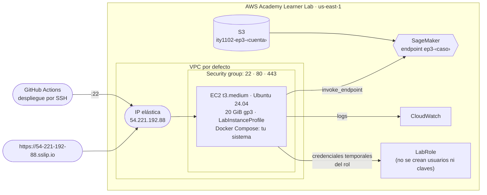
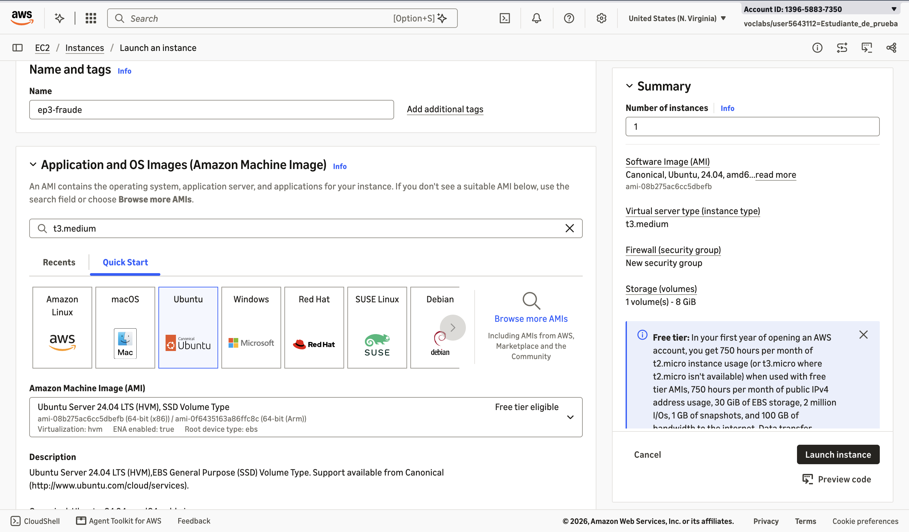
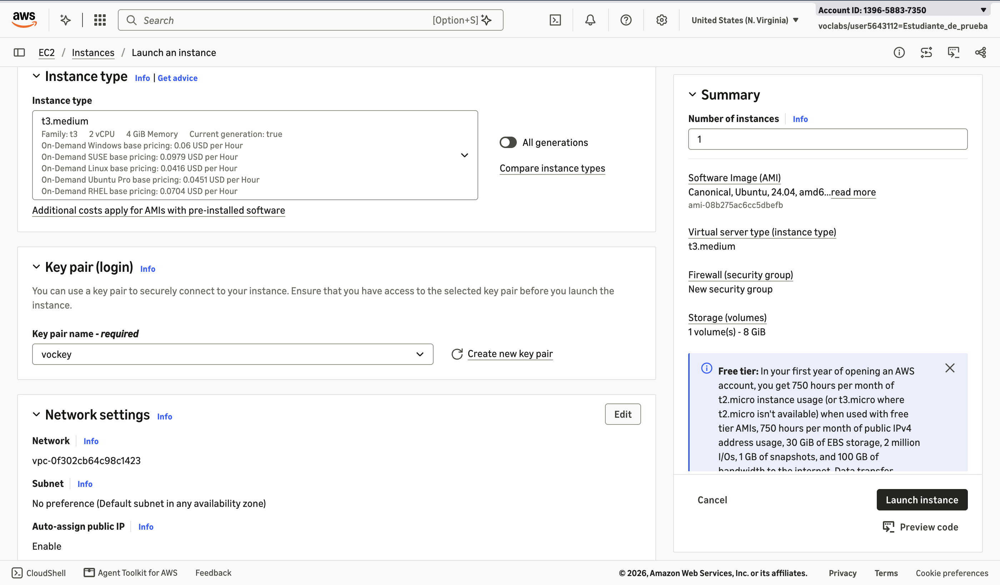
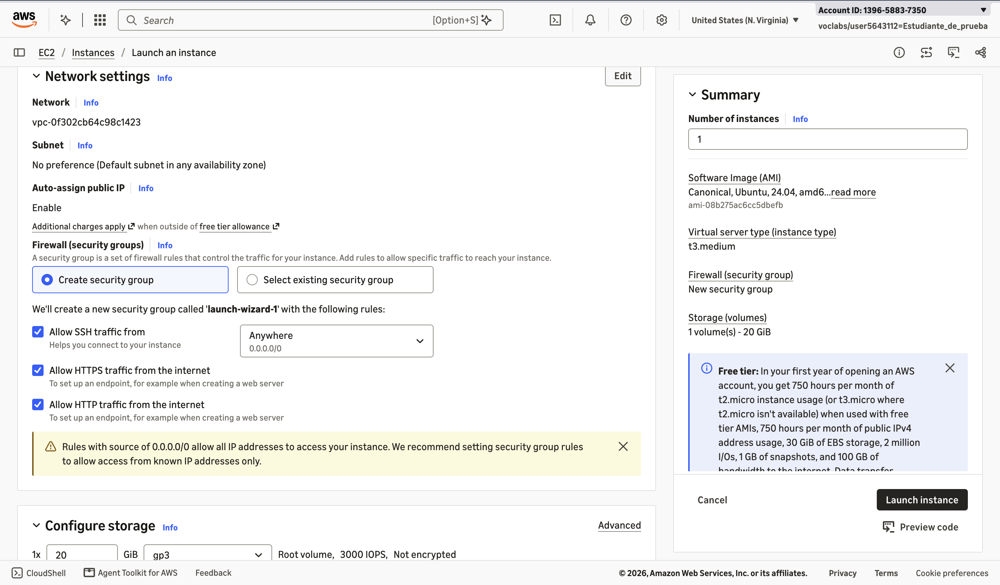
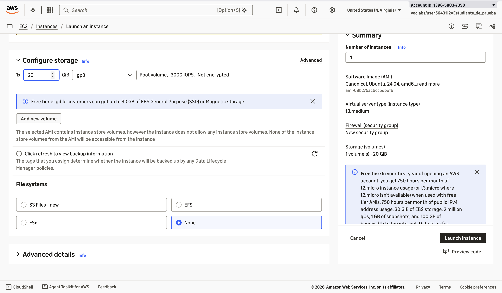
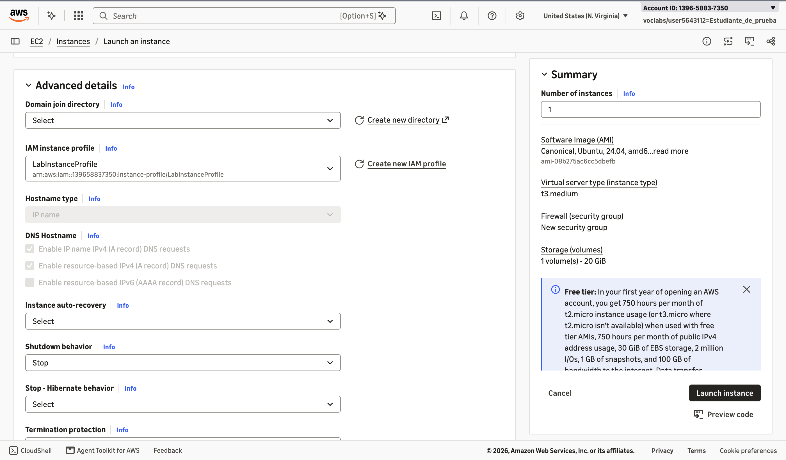
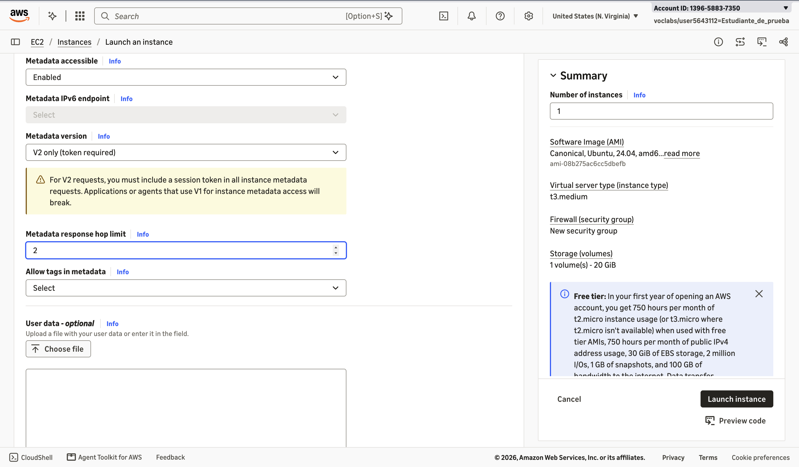
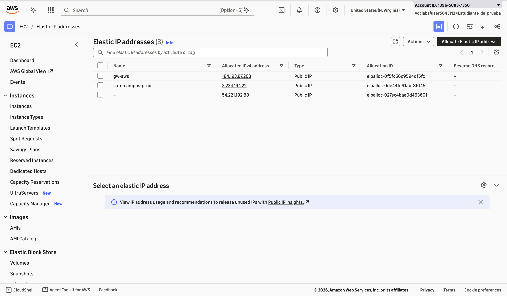
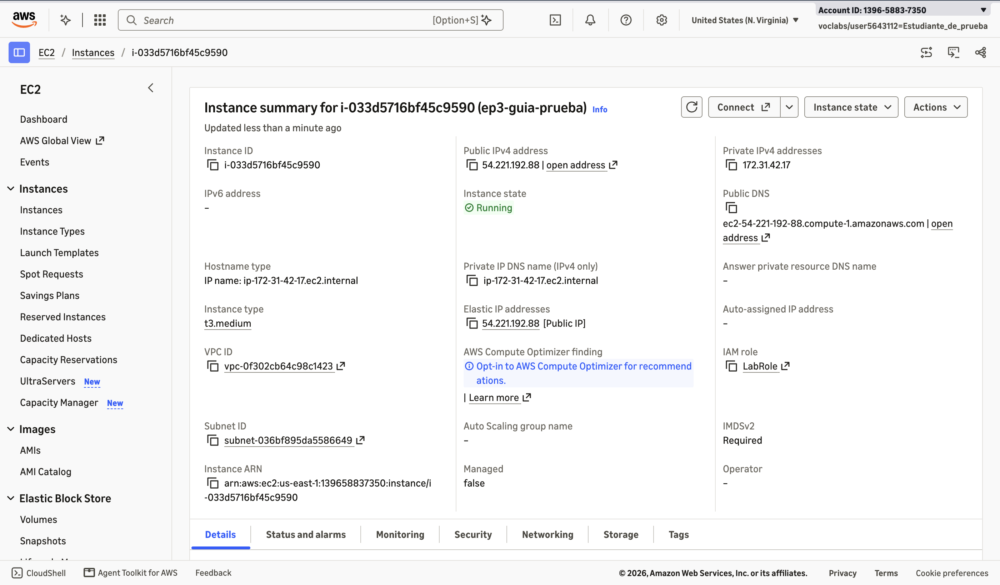
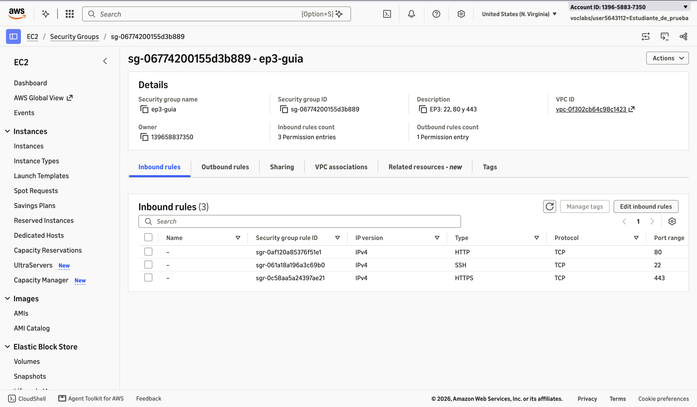

# 10 · AWS: la EC2

**Lo que vas a lograr:** una EC2 `t3.medium` del Learner Lab, con IP elástica, el rol `LabInstanceProfile`
(credenciales **sin claves**), Docker, tu repositorio clonado y el sistema de EP2 corriendo en ella. Es la
base de todo EP3.

[← 9 · Defensa EP2](09-defensa-ep2.md) · [Índice](../README.md) · [11 · SageMaker →](11-sagemaker.md)

**Ya lo tengo si…** tu EC2 tiene IP elástica, el comando de 10.6 responde `"Code" : "Success"` con
`LabInstanceProfile`, y `docker compose ps` muestra tu sistema.

> **Todo este capítulo se ejecutó en una cuenta de alumno del Learner Lab el 17-11-2026.** Las capturas
> son de esa ejecución.

---

## 10.1 Lo que vas a construir en AWS



## 10.2 Iniciar el laboratorio

AWS Academy → tu curso → **Modules → Learner Lab** → **Start Lab** → espera el punto verde → **AWS**.
Arriba a la derecha, región **N. Virginia (`us-east-1`)**. La sesión dura 4 horas; al terminar, **las
instancias se detienen** (las vuelves a encender en la próxima sesión; con IP elástica, la URL no cambia).

> **El Learner Lab permite como máximo 9 instancias por región, contando las detenidas.** Si ya tienes 9
> (de otros ramos o laboratorios), la instancia nueva se lanza y **en segundos pasa a *shutting-down***
> con el motivo `User initiated`. No es un error tuyo: **termina** (no basta con detener) alguna que no
> uses. Lo comprobamos: con 9 instancias, ni una `t3.micro` sobrevive.

## 10.3 Lanzar la instancia

**EC2 → Instances → Launch instances**. Paso a paso:

**1 · Nombre y sistema operativo.** Name: `ep3-<tu-caso>`. En *Quick Start* elige **Ubuntu** y, en la lista
de AMI, **Ubuntu Server 24.04 LTS** (la consola propone por defecto la 26.04; esta guía se probó con la
24.04). Si cambias la AMI después de configurar otras cosas, la consola avisa que se pierden algunos
ajustes: confirma y revísalos.



**2 · Tipo y llave.** Instance type: **`t3.medium`** (2 vCPU, 4 GiB). Key pair: **`vockey`**.



**3 · Red.** Deja *Create security group* y marca las tres casillas: **Allow SSH traffic from Anywhere**,
**Allow HTTPS traffic from the internet** y **Allow HTTP traffic from the internet**.



> **El 22 abierto a todo internet es una deuda que declaras** (EP3 §2.4): el runner de GitHub Actions que
> despliega por SSH no tiene IP fija. Te protege entrar solo con la llave `vockey` y que **ningún otro
> puerto** esté abierto: la base, RabbitMQ y los servicios no se publican. En el informe: la alternativa
> que lo cerraría (un runner propio dentro de la EC2, o AWS Systems Manager).

**4 · Disco.** Configure storage: **20** GiB **gp3**.



**5 · Rol de la instancia.** Despliega **Advanced details** → **IAM instance profile**: **`LabInstanceProfile`**.



**6 · Hop limit.** Más abajo en Advanced details: **Metadata response hop limit** = **`2`** (al 17-11-2026 la
consola ya lo proponía en 2 con *Metadata version: V2 only*; compruébalo igual).



**¿Por qué el hop limit en 2?** Tus contenedores obtienen las credenciales del rol pidiéndoselas al
servicio de metadatos de la EC2 (169.254.169.254). Desde un contenedor la respuesta da **dos saltos**
(EC2 → contenedor). Con el límite en 1 se pierde en el camino y `boto3` dice `NoCredentialsError`.

Y **Launch instance**. Si ya tenías la instancia o no encontraste el campo, desde **CloudShell**:

```bash
ID=$(aws ec2 describe-instances --filters Name=tag:Name,Values=ep3-<tu-caso> Name=instance-state-name,Values=running \
     --query 'Reservations[0].Instances[0].InstanceId' --output text)
aws ec2 modify-instance-metadata-options --instance-id "$ID" --http-put-response-hop-limit 2 --http-endpoint enabled
```

## 10.4 IP elástica

**EC2 → Elastic IPs → Allocate Elastic IP address → Allocate**. Selecciónala → **Actions → Associate
Elastic IP address** → tu instancia → **Associate**. Esa IP es tu `TU-IP` desde ahora. Sin ella, la IP
cambia cada vez que el laboratorio se reinicia, y con ella tu URL HTTPS y el secreto del pipeline.



Así debe verse tu instancia (IP elástica, `t3.medium`, rol `LabRole`, IMDSv2):



Y las reglas de entrada del security group, solo 22, 80 y 443:



## 10.5 Entrar e instalar Docker

En el Learner Lab, **AWS Details → SSH key → Download PEM** (descarga `labsuser.pem`). En tu terminal
(Git Bash en Windows):

```bash
chmod 400 labsuser.pem
ssh -i labsuser.pem ubuntu@TU-IP
```

En la EC2:

```bash
sudo apt-get update && sudo apt-get install -y docker.io docker-compose-v2 git python3-venv
sudo usermod -aG docker ubuntu
exit
```

**Lo visible (medido):** `Docker version 29.1.3` y `Docker Compose version 2.40.3`. Vuelve a entrar (el
grupo `docker` se aplica al iniciar sesión).

## 10.6 Comprobar el rol

```bash
curl -s http://169.254.169.254/latest/meta-data/iam/info \
  -H "X-aws-ec2-metadata-token: $(curl -s -X PUT http://169.254.169.254/latest/api/token -H 'X-aws-ec2-metadata-token-ttl-seconds: 60')"
```

**Lo visible:** `"Code" : "Success"` y `"InstanceProfileArn" : "arn:aws:iam::<cuenta>:instance-profile/LabInstanceProfile"`.
Si no sale nada: **Actions → Security → Modify IAM role** → `LabInstanceProfile`.

## 10.7 Tu sistema de EP2, en la EC2

```bash
git clone https://github.com/<tu-usuario>/<tu-repo>.git
cd <tu-repo>
docker compose pull          # las imágenes :ep2 de GHCR (públicas)
docker compose up -d
curl -s localhost:8080/api/health
```

**Lo visible:** el mismo sistema que en tu computador, ahora en AWS. Todavía sin HTTPS, sin SageMaker y
sin LLM: eso viene en los capítulos 11 a 13. El `.env` de la nube lo armas en el capítulo 13.

> Con el repositorio público, las imágenes se descargan sin sesión (capítulo 7.4). Si las dejaron privadas:
> `echo <PAT> | docker login ghcr.io -u <usuario> --password-stdin` con un token clásico con `read:packages`.

**Medido en la EC2, con todo EP3 corriendo** (los 9 contenedores): 1,1 GB de 3,8 GB de RAM usados y 4,8 GB de
19 GB de disco. La `t3.medium` alcanza con holgura.

## 10.8 Cuidar el crédito

| Recurso | Cobra… | Qué hacer |
|---|---|---|
| EC2 `t3.medium` | ~USD 0,042/h **encendida** | **Stop** al terminar cada sesión (el laboratorio la detiene solo al vencer) |
| IPv4 pública (IP elástica) | USD 0,005/h, asociada o no | **No la liberes** hasta después de la presentación |
| Disco 20 GiB gp3 | ~USD 1,6/mes, siempre | Nada |
| SageMaker serverless | Solo cuando se invoca | Nada; el de tiempo real (plan B) se borra cada día |
| Training Job | Los segundos que corre (medido: 124–129 s facturados) | Nada |

Revisa el gasto en el panel del Learner Lab. **Quedarse sin crédito antes de la presentación cuenta como
sistema no desplegado** (EP3 §6). Toda la verificación de esta guía en AWS (3 Training Jobs, 3 endpoints,
una EC2 durante ~1 hora, CloudWatch) cuesta, con los precios públicos, menos de USD 1.

## Al informe

**Apartado 3 (EP3):** la EC2 en el diagrama de despliegue, el security group y la deuda del puerto 22,
el rol sin claves (pega la salida de 10.6).

[Siguiente: 11 · SageMaker →](11-sagemaker.md)
