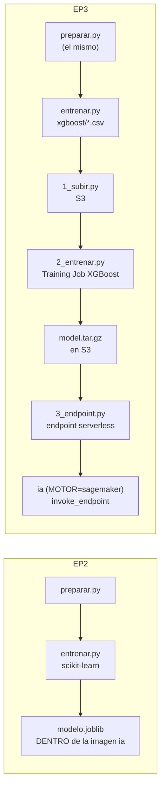
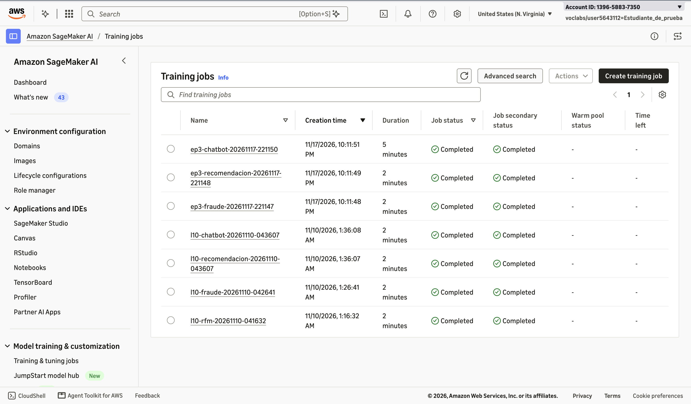
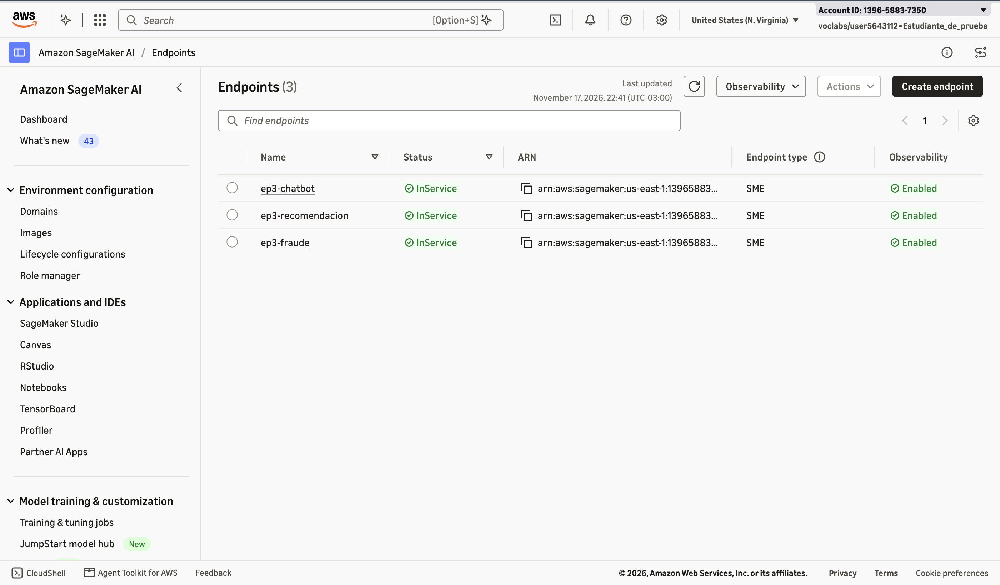
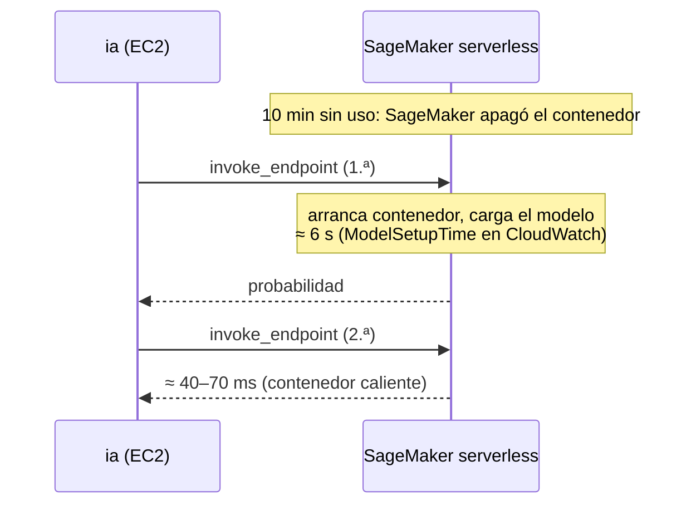
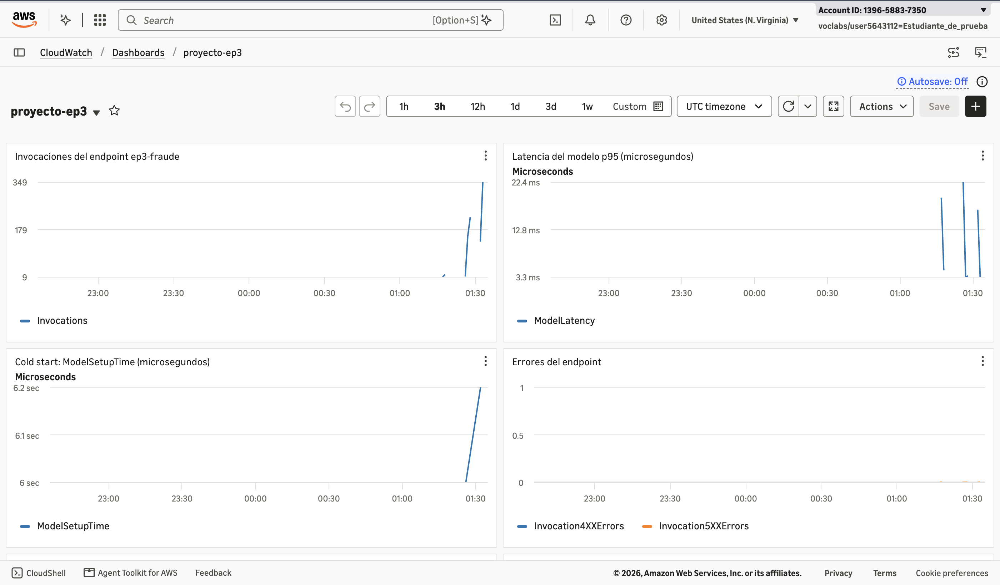
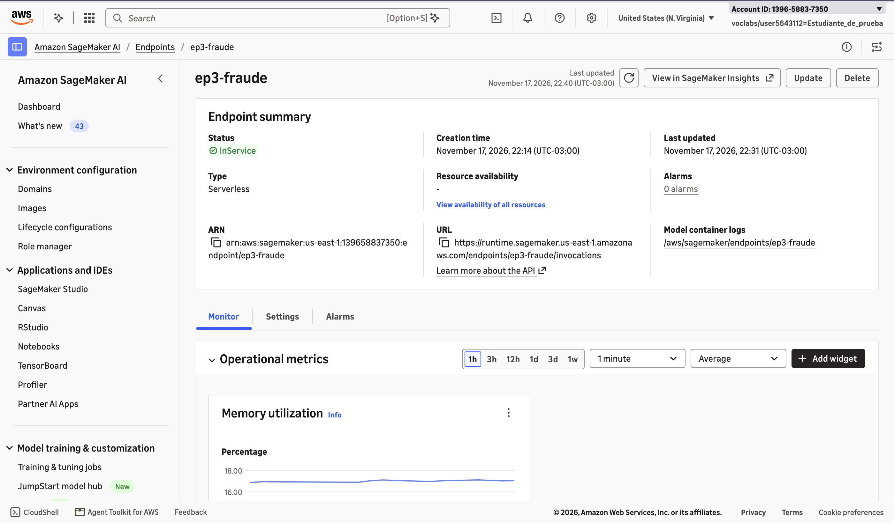

# 11 · SageMaker: tu modelo en un endpoint serverless

**Lo que vas a lograr:** entrenar **tu** modelo con **tus** datos tratados en un Training Job de
SageMaker, publicarlo en un endpoint serverless `ep3-<caso>`, medir su cold start y sus métricas, y que
el microservicio de IA de la EC2 lo invoque sin claves. Es el L10, pero con la salida de tu `preparar.py`.

[← 10 · EC2](10-aws-ec2.md) · [Índice](../README.md) · [12 · LLM y cola →](12-llm-cola.md)

**Ya lo tengo si…** `ep3-<caso>` está `InService`, `sagemaker/4_probar.py` te dio métricas parecidas a
las de `METRICAS.md`, y `/api/health` de la EC2 dice `"motor": "sagemaker"` y `"modelo": "InService"`.

---

## 11.1 Qué cambia respecto de EP2



**Lo que no cambia:** los datos tratados, las variables (`vectorizar()`), las columnas y su orden, el
contrato de la IA y todo el resto del sistema. Por eso el microservicio de IA tiene dos motores
(`servicios/ia/app/motores.py`) y se cambia con una variable: `MOTOR=sagemaker`.

## 11.2 Preparar los datos en CloudShell

Abre **CloudShell** (el ícono `>_` arriba en la consola, región `us-east-1`). Elige **una** de dos rutas:

**Ruta A · tratar y entrenar ahí mismo** (lo más simple):

```bash
git clone https://github.com/<tu-usuario>/<tu-repo>.git
cd <tu-repo>
pip install -q -r datos/requirements.txt          # pandas y scikit-learn (~2 min, una sola vez)
python3 datos/preparar.py
python3 modelo/entrenar.py
ls modelo/artefactos/xgboost/                      # train.csv validation.csv test.csv
```

**Ruta B · usar lo que ya generó el pipeline** (si CloudShell se queda sin espacio): en GitHub, **Actions
→** la última ejecución verde de `main` **→ Artifacts → artefactos** (descarga un zip). En CloudShell:
**Actions → Upload file** → el zip, y:

```bash
git clone https://github.com/<tu-usuario>/<tu-repo>.git && cd <tu-repo>
unzip -o ~/artefactos.zip -d .
```

## 11.3 Los cinco pasos

Los scripts solo usan `boto3` (CloudShell ya lo trae) y el rol `LabRole`. Cada uno anota lo que hizo en
`sagemaker/estado.json`: si la sesión se corta, vuelves a correr el mismo paso y retoma.

```bash
python3 sagemaker/1_subir.py         # train y validation a s3://ity1102-ep3-<cuenta>/<caso>/
python3 sagemaker/2_entrenar.py      # Training Job en ml.m5.large (2 a 5 min)
python3 sagemaker/3_endpoint.py      # endpoint serverless ep3-<caso> (≈ 3 min en Creating)
python3 sagemaker/4_probar.py        # cold start, latencia y métricas sobre la prueba
```

**Lo visible** (ejecución real del caso 3 en el Learner Lab, 17-11-2026):

```text
### 1_subir
Bucket creado: ity1102-ep3-139658837350
  s3://ity1102-ep3-139658837350/fraude/train/train.csv  ·  786 filas
  s3://ity1102-ep3-139658837350/fraude/validation/validation.csv  ·  139 filas
### 2_entrenar
Training Job ep3-fraude-20261117-221147 en ml.m5.large · binary:logistic. Se revisa cada 20 s.
     0 s · InProgress · Starting
    40 s · InProgress · Downloading
   161 s · InProgress · Uploading
   181 s · Completed · Completed
  validation:aucpr: 0.9893
  Tiempo facturado: 129 s
### 3_endpoint
Creando ep3-fraude (serverless · 2048 MB · concurrencia 2)
   184 s · InService
### 4_probar
  1.ª invocación:     497 ms
  2.ª invocación:     158 ms
  20 en caliente: p50 162 ms · p95 169 ms (medido desde donde corres el script)
  vp: 30 · fp: 5 · fn: 4 · vn: 269
  precision: 0.8571 · recall: 0.8824 · f1: 0.8696 · pr_auc: 0.9503 · linea_base_todo_0: 0.8896
```

Los tres casos, en la misma sesión:

| Caso | Objetivo XGBoost | Facturado | Endpoint `InService` en | Métrica en SageMaker (prueba) | El mismo modelo en EP2 (scikit-learn) |
|---|---|---|---|---|---|
| Fraude | `binary:logistic` | 129 s | 184 s | PR-AUC 0,950 · F1 0,870 | PR-AUC 0,969 |
| Recomendación | `binary:logistic` | 124 s | 169 s | PR-AUC 0,098 · recall 0,380 | ROC-AUC 0,746 · PR-AUC 0,150 |
| Chatbot | `multi:softprob`, 10 clases | (no se anotó) | (no se anotó) | F1 macro 0,9998 | F1 macro 1,0 |

Las latencias de `4_probar.py` (~160 ms) son desde un computador en Chile: incluyen el viaje a Virginia.
Desde la EC2, en la misma región, el modelo responde en 3 a 22 ms (`ModelLatency` p95 en el dashboard del capítulo 14.3).





| Paso | Qué hace en AWS | Qué mirar en la consola |
|---|---|---|
| 1 | Crea el bucket y sube los CSV (la prueba **no** sube) | S3 → `ity1102-ep3-…` |
| 2 | Lanza el XGBoost integrado con hiperparámetros según tu tipo de modelo: `binary:logistic` (casos 1 y 3) o `multi:softprob` con `num_class` (caso 2) | SageMaker → Training jobs |
| 3 | Crea modelo, configuración (memoria y concurrencia) y endpoint; si ya existe, **lo actualiza sin cambiarle el nombre** | SageMaker → Inference → Endpoints |
| 4 | Invoca con la prueba y calcula las métricas de tu caso | CloudWatch → métricas del endpoint |
| 5 | `5_borrar.py`: borra endpoint, configuraciones y modelos (`--todo`: también el bucket) | — |

**DESAFÍO S2 · hiperparámetros** (`sagemaker/2_entrenar.py`) y **S3 · memoria y concurrencia**
(`3_endpoint.py --memoria 3072 --concurrencia 5`): elígelos midiendo, no al azar. Son la pregunta del IE6.

## 11.4 Conectarlo a tu sistema en la EC2

En el `.env` de la EC2 (capítulo 13 lo arma completo): `MOTOR=sagemaker` y `ENDPOINT=ep3-<caso>`.

```bash
docker compose up -d ia
curl -s localhost:8080/api/health | python3 -m json.tool
```

**Lo visible:** `"motor": "sagemaker"`, `"modelo": "InService"`, `"version_modelo": "ep3-<caso>-2026…"`.
Si dice `error: NoCredentialsError`: hop limit en 1 o la EC2 sin `LabInstanceProfile` (capítulo 10.3).

Cada vez que publiques un modelo nuevo con `3_endpoint.py`, la versión cambia sola (la IA la vuelve a
leer del endpoint cada minuto) y cada predicción guardada registra cuál la hizo.

## 11.5 El cold start (la pregunta del IE6)



Para medirlo en vivo: espera 10 minutos sin usar el endpoint y corre `python3 sagemaker/4_probar.py`, o
haz una predicción desde el front y mira `latencia_ms`. AWS también lo mide: la métrica **`ModelSetupTime`**
del endpoint es el arranque del contenedor serverless.



## 11.6 Lo que pasó de verdad: cold start, throttling y concurrencia

Con el sistema completo en la EC2 (caso 3, `TIMEOUT_MODELO_MS=300`), esto es lo que se midió:

| Situación | Lo que pasó | Por qué |
|---|---|---|
| Primeras 2 predicciones después de horas sin uso | `origen: reserva` en ~305 ms. En el log de la IA: la predicción terminó en **6,2 y 6,6 s** | Cold start: el dominio no espera más de 300 ms y aplica la política de reserva (RNF3). La IA igual termina y el contenedor queda caliente |
| Tercera predicción, a la vez que las anteriores | `ThrottlingException` → 503 → reserva en 158 ms | Con **concurrencia máxima 2**, una tercera invocación simultánea se rechaza |
| Prueba de carga 1 min, 10 usuarios, **concurrencia 2** | 487 solicitudes, 0 errores HTTP, pero **~23% salieron por reserva** | El endpoint rechaza lo que pasa de 2 invocaciones simultáneas |
| La misma prueba con **concurrencia 10** (`3_endpoint.py --concurrencia 10`) | **1% por reserva**; predicción por el modelo en 59 ms promedio, p95 102 ms (medido en el dominio) | Ahora caben las invocaciones simultáneas |

Es exactamente la discusión del IE6 y del IE11: **la configuración del endpoint (memoria y concurrencia)
decide cuántas decisiones salen del modelo y cuántas de la reserva.** El usuario nunca vio un error (la
reserva respondió siempre), pero una decisión por reserva es una decisión peor. Y para el caso 3, p95 de
102 ms en el dominio **no cumple** RNF1 (p99 < 100 ms): se informa y se propone cómo cumplirlo (endpoint
de tiempo real, modelo dentro del contenedor, explicación solo cuando se decide revisar).

Cómo evitar el cold start, con su costo (va al informe): concurrencia provisionada en serverless
(cobra por hora), una invocación de calentamiento cada pocos minutos (casi gratis, pero es un parche), o un
endpoint de tiempo real (`herramientas/costos.py` compara los tres).



## 11.7 Plan B: si el Learner Lab rechaza el serverless

```bash
python3 sagemaker/3_endpoint.py --tiempo-real        # ml.t2.medium, COBRA CADA HORA
# ... trabajar / presentar ...
python3 sagemaker/5_borrar.py                        # SIEMPRE al terminar la sesión
```

Documenta el error con una captura (EP3 §2.2 regla 2). El modelo entrenado queda en S3: volver a crear el
endpoint toma minutos, sin reentrenar.

## 11.8 Costos del endpoint

Para el apartado 3 del informe, con la [calculadora de AWS](https://calculator.aws) → *Amazon SageMaker
→ Serverless Inference*: memoria elegida, invocaciones al mes **del volumen de tu caso** (no de tus
pruebas) y duración promedio medida (`ModelLatency`). Compáralo con al menos una alternativa (EP3 §1
sobre el IE6): un endpoint de tiempo real `ml.t2.medium` 730 h/mes, el modelo dentro del contenedor (su
costo es la CPU/RAM extra de la EC2) o un servicio administrado tipo Bedrock.

`herramientas/costos.py` hace la cuenta con los precios públicos de us-east-1 (lista de precios de AWS,
consultada el 17-11-2026) y el volumen de tu caso; cambia los supuestos con sus opciones y **cita la fecha
de los precios** en el informe:

```bash
python3 herramientas/costos.py                    # usa CASO del .env
python3 herramientas/costos.py --latencia-ms 60   # con tu ModelLatency promedio medido
```

## Al informe

**Apartado 1:** modelo, framework (XGBoost integrado de SageMaker), datos (los de `preparar.py`),
hiperparámetros (`estado.json`), separación, configuración del endpoint, capturas `InService` y de una
invocación. **Apartado 3:** cold start medido dos veces, costo mensual, `Invocations` y `ModelLatency`.
**Apartado 5:** las métricas de `4_probar.py` contra la línea base, según EP3 §3 para tu caso.

## En la presentación

**IE6 (18%):** *«Tu endpoint no se ha usado en 10 minutos. Invócalo y mide el tiempo. Ahora otra vez.
¿Por qué cambia? ¿Por qué serverless con esa memoria, y cuánto cuesta comparado con Bedrock o con el
modelo dentro del contenedor?»* — 11.5–11.6 en vivo y 11.8 con números.

[Siguiente: 12 · LLM, cola y worker →](12-llm-cola.md)
