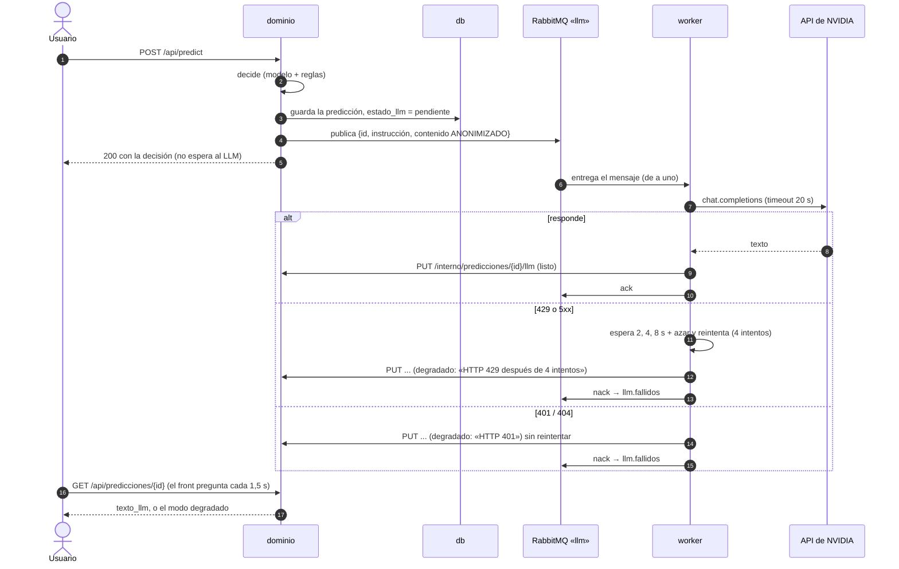
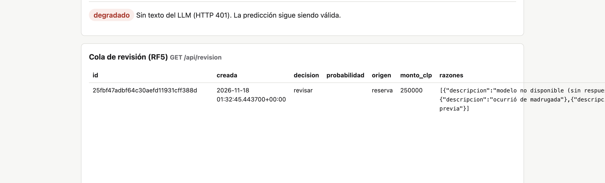
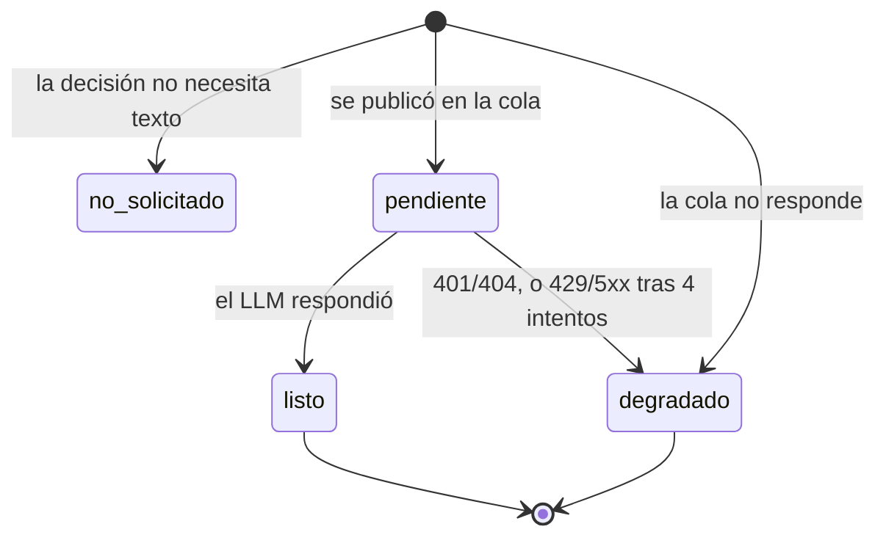

# 12 · LLM, cola y worker

**Lo que vas a lograr:** que el sistema use el modelo de lenguaje de NVIDIA para **redactar** (nunca para
decidir), por una cola, sin datos personales, y que **sobreviva** a que NVIDIA falle: clave inválida,
`429`, caída. Es el L11 aplicado a tu caso, y la pregunta del IE8 de EP3.

[← 11 · SageMaker](11-sagemaker.md) · [Índice](../README.md) · [13 · HTTPS y despliegue →](13-https-despliegue.md)

**Ya lo tengo si…** con la clave inválida tu sistema sigue prediciendo y muestra «modo degradado», y
puedes mostrar en el código el reintento y el tiempo máximo de espera.

---

## 12.1 Por qué por una cola

Un LLM tarda **segundos** y la capa gratuita de NVIDIA limita a unas 40 solicitudes por minuto por clave.
Si la predicción esperara al LLM, el caso 1 (p95 < 200 ms) y el caso 3 (p99 < 100 ms) serían imposibles,
y una caída de NVIDIA tumbaría todo. Por eso:



| Regla de EP3 §2.3 | Dónde está |
|---|---|
| 1 · Proveedor y modelo únicos, por variables | `NVIDIA_MODEL`, `NVIDIA_API_KEY` en el `.env` de la EC2; `servicios/worker/app/llm.py` |
| 2 · Una clave por equipo | build.nvidia.com (12.2) |
| 3 · La clave no está en el repo ni en las imágenes | Solo en el `.env` del servidor; GitHub no la conoce |
| 4 · El LLM va por la cola | `app/registro.py` publica; la respuesta no espera |
| 5 · El sistema sobrevive al LLM | Timeout, reintentos con espera creciente ante 429, modo degradado: `llm.py` y `worker.py` |
| 6 · Ningún dato personal sale hacia NVIDIA | `comun/anonimizar.py` se aplica al contenido **antes de publicarlo**; prueba 5 |

## 12.2 Tu clave de NVIDIA

En [build.nvidia.com](https://build.nvidia.com), busca **el modelo que publicó el docente en el foro** →
**Get API Key → Generate Key**. Empieza con `nvapi-` y **se muestra una vez**. Pruébala desde la EC2 sin
que quede en el historial:

```bash
read -s -p "Clave NVIDIA: " NVIDIA_API_KEY; echo
read -p "Modelo del foro: " NVIDIA_MODEL
curl -s https://integrate.api.nvidia.com/v1/chat/completions \
  -H "Authorization: Bearer $NVIDIA_API_KEY" -H 'content-type: application/json' \
  -d '{"model":"'"$NVIDIA_MODEL"'","messages":[{"role":"user","content":"Explica en una línea qué es un cold start"}],"max_tokens":120}' \
  -w '\nHTTP %{http_code} · %{time_total} s\n'
```

**Lo visible:** un JSON con `choices[0].message.content` y `HTTP 200 · 0.6 s`. `401` = clave mal copiada;
`404` = nombre del modelo mal escrito; **`410 Gone`** = NVIDIA retiró ese modelo del catálogo gratuito.
**Anota los tiempos:** son tu medición de la latencia del LLM.

**Qué se midió el 17-11-2026** (el catálogo de NVIDIA cambia; repite la prueba con el modelo del foro):

| Modelo | Resultado |
|---|---|
| `nvidia/nemotron-3.5-bolt-e4b` | **~0,5–0,6 s**, texto correcto en español. **El que usa esta guía** |
| `poolside/laguna-xs-2.1` | ~0,6 s, correcto |
| Gemma 4 31B (Google) | Correcto pero 21–37 s: supera el `NVIDIA_TIMEOUT` de 20 s del worker → degradado |
| Llama 3.1 8B (Meta), Mistral 7B | `410 Gone`: retirados del catálogo |
| `nvidia/nemotron-3.5-lightning` | `200` pero `content: null` (modelo de razonamiento): el worker recibe texto vacío |

**Elige un modelo que responda en pocos segundos.** El worker procesa los mensajes de a uno: con 0,6 s por
texto despacha ~1,6 textos por segundo; con 30 s, uno cada medio minuto y la cola crece sin parar.

> Si la clave llega a GitHub: **revócala** en build.nvidia.com y crea otra. Borrar el commit no sirve: queda
> en el historial.

## 12.3 Qué hace el LLM en tu caso

Lo define `servicios/dominio/app/casos/<caso>.py` (la clave `llm` que devuelve `predecir()`):

| Caso | Cuándo se encola | Qué recibe | Qué **nunca** recibe |
|---|---|---|---|
| 1 · Recomendación | `POST /api/campanas/{usuario}` | Categorías y productos recomendados | Correo, nombre, dirección, RUT, ni el `usuario_id` |
| 2 · Chatbot | Cada mensaje que **no** se deriva a humano | Mensaje anonimizado, intención y artículos de la FAQ | RUT, nombre, teléfono, correo, dirección, tarjeta |
| 3 · Fraude | Decisión `revisar` o `bloquear` | Decisión, probabilidad, razones, monto, canal, hora | Número de tarjeta, nombre, RUT |

En los tres, **el modelo de SageMaker decide y el LLM redacta**. Un LLM que toma la decisión es un error
de IE2 (EP3 §9).

## 12.4 Ensayarlo en tu computador, sin AWS ni clave

Antes de gastar crédito, levanta el sistema de la nube completo con SageMaker y NVIDIA simulados
(`pruebas/dobles/dobles.py` responde igual que ellos, con tu modelo local):

```bash
herramientas/levantar-local.sh           # una vez, para tener las imágenes y el modelo
herramientas/ensayo-nube.sh
```

```bash
B=https://localhost:8443; K="X-API-Key: clave-de-ensayo"
curl -sk $B/api/health
R=$(curl -sk -X POST $B/api/predict -H "$K" -H 'content-type: application/json' -d '<ejemplo que encola, ver tu ficha>')
echo $R
sleep 3; curl -sk $B/api/predicciones/$(echo $R | python3 -c "import json,sys;print(json.load(sys.stdin)['id'])") -H "$K"
```

**Lo visible:** la predicción vuelve al instante con `"estado_llm": "pendiente"`, y segundos después
`/api/predicciones/{id}` trae `"estado_llm": "listo"` y `texto_llm` (en el ensayo empieza con
`[ensayo]`). En el front, el texto aparece solo debajo del resultado.

## 12.5 Romperlo a propósito (la pregunta del IE8)

Las cuatro fallas, medidas en el ensayo:

| Falla | Cómo provocarla | Lo que pasa (medido) |
|---|---|---|
| **Clave inválida** | `NVIDIA_API_KEY=invalida` en el `.env` y `docker compose up -d worker` | Predicción `200`; `estado_llm: degradado`, `motivo_llm: HTTP 401`, **un solo intento**; `/api/health` → `llm: degradado: HTTP 401`, `cola.fallidos: 1` |
| **429 sostenido** | En el ensayo: `DOBLE_LLM=429 herramientas/ensayo-nube.sh` | 4 intentos con espera creciente en el log del worker; luego `degradado: HTTP 429 después de 4 intentos` |
| **Worker caído** | `docker compose stop worker` | Predicción `200`, `estado_llm: pendiente`, `cola.pendientes: 1`; al levantarlo, pasa a `listo` |
| **Cola caída** | `docker compose stop rabbitmq` | Predicción `200` con `estado_llm: degradado` (`motivo_llm: cola: AMQPConnectionError`) |

**Comprobado en la EC2 con NVIDIA real:** con la clave válida el texto llega en ~0,5 s (`estado_llm:
listo`); con una clave inválida, el front muestra esto y la predicción sigue valiendo:



> **La cola en la prueba de carga.** Si tu prueba de Locust usa un ejemplo que encola texto (fraude
> `revisar`, cada mensaje del chatbot, cada campaña), en un minuto publicas cientos de mensajes y el LLM
> despacha ~1,6 por segundo: medimos **871 pendientes** al terminar una prueba de 1 minuto. No es una
> falla (la cola es justamente para eso, y lo puedes contar en IE11), pero mientras se vacía, tus
> predicciones de la demo quedan `pendiente` minutos. Antes de la presentación, vacíala:
>
> ```bash
> docker compose exec -T rabbitmq rabbitmqctl purge_queue llm
> ```
>
> Los mensajes vaciados quedan `pendiente` para siempre en la base; si borras una predicción con mensaje
> en cola, el worker la descarta sin llamar al LLM.

```bash
docker compose logs worker --tail 10       # los reintentos, en JSON
grep -n "429\|TIMEOUT\|INTENTOS\|espera" servicios/worker/app/llm.py
```



## 12.6 La anonimización

`comun/anonimizar.py` reemplaza correo, tarjeta, RUT y teléfono por `[CORREO]`, `[TARJETA]`, `[RUT]` y
`[TELEFONO]`, en ese orden (el correo primero: si no, un correo con muchos dígitos quedaría a medias). No
detecta nombres ni direcciones: eso se resuelve **no mandando esos campos**. Su prueba (obligatoria 5)
está en `servicios/dominio/tests/test_api.py` y, en el caso 2, también se usa al entrenar.

## Al informe

**Apartado 2:** qué agrega el LLM y qué pasa cuando no está (modo degradado). **Apartado 4:** el diagrama
de 12.1 (síncrono + cola, con el camino de falla), anonimización y manejo de la clave. **Apartado 3:** el
costo del LLM en un proveedor pagado al volumen de tu caso (la capa gratuita no sirve para producción).

## En la presentación

**IE8 (9%):** *«Te cambio la `NVIDIA_API_KEY` por una inválida y reinicio el worker. Haz una predicción.
¿Qué ve el usuario, qué queda en la cola y qué se registra?»* — 12.5 fila 1, y muestra `llm.py`.

[Siguiente: 13 · HTTPS y despliegue continuo →](13-https-despliegue.md)
