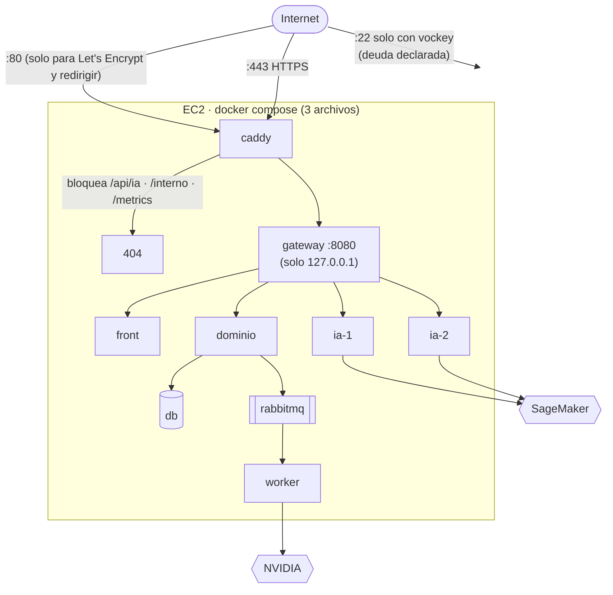
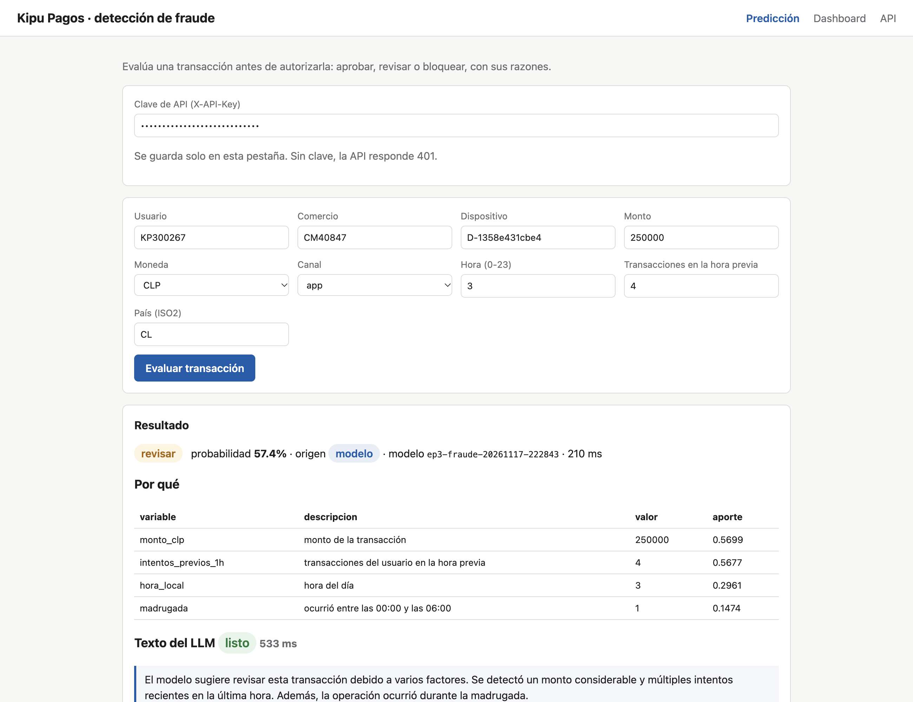
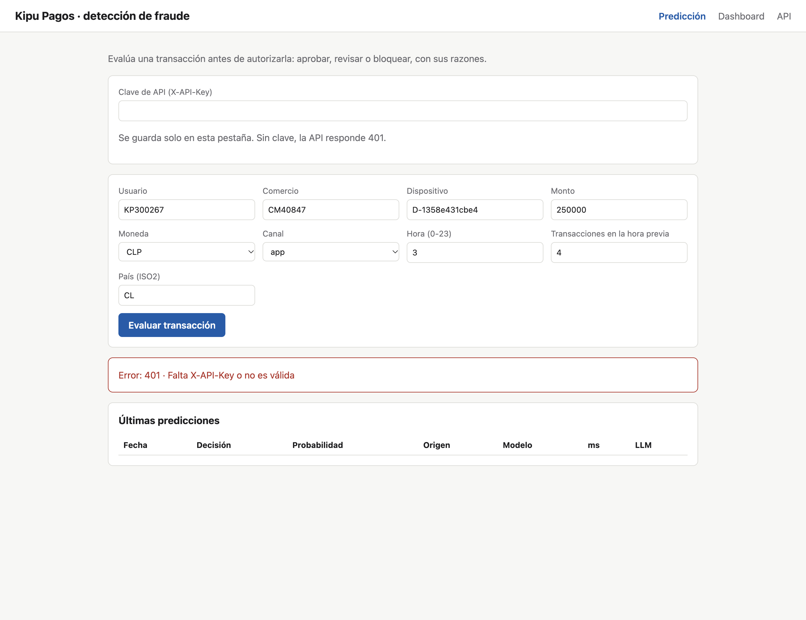
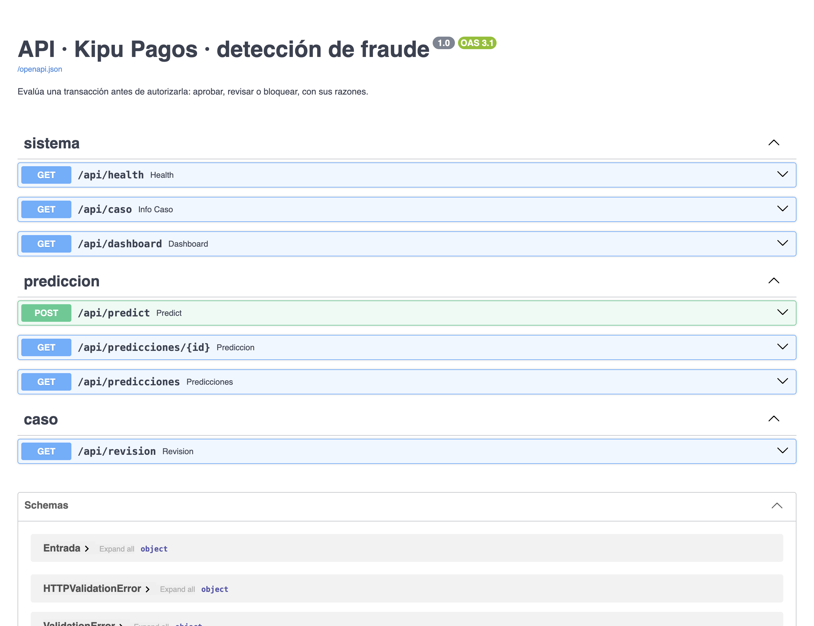
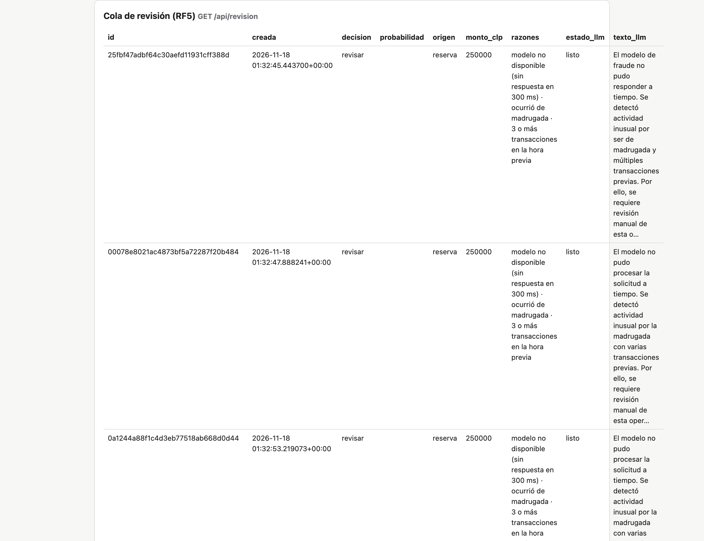
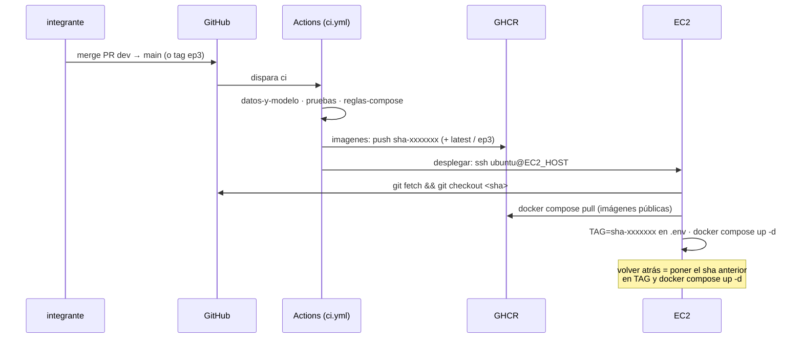
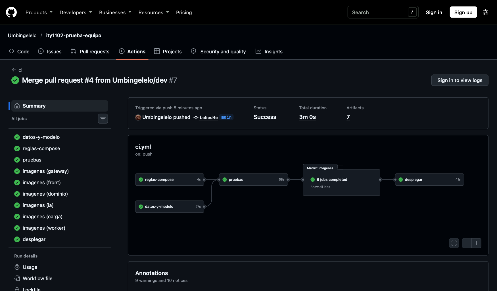

# 13 · HTTPS y despliegue continuo

**Lo que vas a lograr:** el sistema completo de EP3 corriendo en la EC2 detrás de
`https://<ip-con-guiones>.sslip.io` con certificado de Let's Encrypt, la API con clave, y el pipeline
desplegando solo en la EC2 cada vez que algo llega a `main` o se pone el tag `ep3`.

[← 12 · LLM y cola](12-llm-cola.md) · [Índice](../README.md) · [14 · Monitoreo →](14-monitoreo.md)

**Ya lo tengo si…** `https://<tu-nombre>.sslip.io/api/health` responde con candado, sin clave
`POST /api/predict` da `401`, y un merge a `main` termina con el job `desplegar` en verde.

---

## 13.1 Las piezas en la EC2



| Archivo | Qué agrega |
|---|---|
| `compose.yaml` | El sistema de EP2 (el mismo de la defensa) |
| `compose.nube.yaml` | `caddy` (80/443), `rabbitmq`, `worker`; conecta el dominio a la cola |
| `compose.cloudwatch.yaml` | Los logs de cada contenedor a CloudWatch (capítulo 14) |
| `Caddyfile` | HTTPS para tu nombre, bloquea lo interno, y todo lo demás al gateway |
| `.env` (solo en la EC2) | Secretos y configuración; la línea `COMPOSE_FILE` une los tres compose |

## 13.2 Tu nombre en sslip.io

`sslip.io` resuelve cualquier nombre con forma de IP: si tu IP elástica es `3.85.10.20`, el nombre
`3-85-10-20.sslip.io` apunta a ella. Compruébalo desde tu computador:

```bash
nslookup 3-85-10-20.sslip.io        # debe devolver 3.85.10.20
```

## 13.3 El `.env` de la EC2

En la EC2, dentro de tu repositorio:

```bash
cp .env.nube.example .env
python3 -c "import secrets; print(secrets.token_urlsafe(24))"     # tu API_KEY: cópiala
python3 -c "import secrets; print(secrets.token_urlsafe(18))"     # contraseña de PostgreSQL
nano .env
```

Completa: `DOMINIO=3-85-10-20.sslip.io`, `ENDPOINT=ep3-<caso>`, `API_KEYS=<la clave>`,
`POSTGRES_PASSWORD=<la contraseña>`, `NVIDIA_API_KEY=nvapi-…`, `NVIDIA_MODEL=<el del foro>`.

> **La contraseña de PostgreSQL se fija la primera vez que se crea el volumen.** Si ya habías levantado
> el sistema con la de ejemplo (`app`), bájalo con `docker compose down -v` antes de cambiarla (en EP3 la
> base se vuelve a cargar sola).

Y protégelo: `chmod 600 .env`. **Nunca** lo subas a Git (está en `.gitignore`).

## 13.4 Levantar el sistema de la nube

Mientras el pipeline no publique las imágenes `:ep3`, usa las de `main` (`latest`) o las de `ep2`:

```bash
sed -i 's/^TAG=.*/TAG=latest/' .env       # cuando exista el tag ep3: TAG=ep3
docker compose pull
docker compose up -d
docker compose ps
docker compose logs caddy --tail 20       # «certificate obtained successfully»
```

Desde tu navegador: `https://<tu-nombre>.sslip.io` (front), `/docs`, `/api/health`, `/dashboard.html`.

**Comprueba la seguridad (EP3 §2.5):**

```bash
B=https://<tu-nombre>.sslip.io; K="X-API-Key: <tu clave>"
curl -s -o /dev/null -w '%{http_code}\n' -X POST $B/api/predict -H 'content-type: application/json' -d '{}'    # 401
curl -s -o /dev/null -w '%{http_code}\n' -X POST $B/api/predict -H "$K" -H 'content-type: application/json' -d '{}'  # 422
curl -s -o /dev/null -w '%{http_code}\n' http://<tu-nombre>.sslip.io/          # 308 → https
curl -s -o /dev/null -w '%{http_code}\n' $B/api/ia/health                       # 404: la IA no se publica
for i in $(seq 70); do curl -s -o /dev/null -w '%{http_code} ' -X POST $B/api/predict -H "$K" -H 'content-type: application/json' -d '<ejemplo>'; done; echo   # al final, 429
```

**Comprobado en la EC2 del Learner Lab** (`https://54-221-192-88.sslip.io`, caso 3): Caddy obtuvo el
certificado de Let's Encrypt en segundos al primer arranque; `401`, `422`, `308` y `404` tal cual la
tabla. Así se ve el front por HTTPS con la predicción del modelo de SageMaker, sus razones y el texto del
LLM ya listo:



Sin la clave, el front muestra el `401` del gateway:



La documentación de la API, publicada por el mismo Caddy:



Y la cola de revisión, con decisiones de reserva (cold start) y el texto del LLM:



## 13.5 Los secretos del pipeline

En GitHub: **Settings → Secrets and variables → Actions**:

| Tipo | Nombre | Valor |
|---|---|---|
| Secret | `EC2_HOST` | Tu IP elástica |
| Secret | `EC2_SSH_KEY` | El contenido **completo** de `labsuser.pem`, desde `-----BEGIN` hasta `-----END … KEY-----` |
| **Variable** (pestaña *Variables*) | `DESPLEGAR` | `si` |
| Secret, **solo si tus paquetes son privados** | `GHCR_USUARIO` y `GHCR_PAT` | Tu usuario y un token clásico con `read:packages` (foto → Settings → Developer settings → Personal access tokens → Tokens (classic)). Con el repositorio público no hacen falta (capítulo 7.4) |

`NVIDIA_API_KEY` **no** va en GitHub: la imagen no la trae y el despliegue no toca el `.env` del servidor
(solo cambia la línea `TAG`). Cada secreto vive solo donde se usa.

> **Crea la variable `DESPLEGAR` cuando la EC2 ya tenga el repositorio clonado y su `.env`** (capítulos
> 10.7 y 13.3). Si existe antes, el primer merge a `main` intenta desplegar en una EC2 sin repositorio y
> el job queda en rojo.

## 13.6 El despliegue continuo



El job `desplegar` espera que el repositorio esté en `~/<nombre-del-repo>` en la EC2 (el `git clone` del
capítulo 10.7 lo deja ahí). Pruébalo con un cambio chico: un PR que cambie el `TITULO` de tu caso →
merge a `main` → mira el job → recarga `/docs`.

**Probado de punta a punta** el 17-11-2026, con un repositorio público de equipo simulado
([`Umbingelelo/ity1102-prueba-equipo`](https://github.com/Umbingelelo/ity1102-prueba-equipo), caso 3) y
una EC2 del Learner Lab: PR `feat/titulo-ep3` → `dev` → `main`; el pipeline completo tardó **3,0 min** y
el job `desplegar`, **41 s**. En la EC2 quedó `TAG=sha-ba5ed4e`, los contenedores con esa imagen, la
etiqueta `revision` con el commit completo, y `/docs` con el título nuevo. Una predicción después del
despliegue: decisión del modelo de SageMaker en 81 ms y texto del LLM en 650 ms.



Si falla, el log del job dice en qué paso: `Permission denied (publickey)` o `handshake failed` es la
llave mal copiada en `EC2_SSH_KEY`; `No such file or directory` es el repositorio en otra carpeta;
`denied` en el `pull` son paquetes privados sin `GHCR_PAT`.

**Volver atrás** (rollback), sin el pipeline (medido: **34 s** hasta que `/api/health` volvió a responder):

```bash
sed -i 's/^TAG=.*/TAG=sha-<anterior>/' .env && docker compose up -d
```

## 13.7 La entrega: tag `ep3`

```bash
git switch main && git pull && git tag ep3 && git push origin ep3
```

El pipeline publica `:ep3` y despliega (medido: 2,6 min; el job deja `TAG=sha-<commit del tag>`, que es
la misma imagen que `:ep3`). **Desde el cierre**, el código que corre tiene que ser el del tag `ep3`;
puedes corregir configuración (`.env`) hasta la presentación (EP3 §6). Para que el `.env` lo diga
explícitamente: `sed -i 's/^TAG=.*/TAG=ep3/' .env && docker compose pull && docker compose up -d`.

## Al informe

**Apartado 3:** diagrama de despliegue en AWS (13.1). **Apartado 4:** tabla de rutas (`/docs`),
autenticación, HTTPS, rate limiting, manejo de secretos (13.5), el 22 como deuda. **Anexo C:** URL HTTPS
del front, `/docs`, `/api/health`, una **clave de API de prueba para el docente**, nombre del endpoint,
repos, tag `ep3`, workflow verde, usuarios de GitHub.

## En la presentación

La demo (EP3 §5.3) paso 3: *«la misma predicción con `curl`, con la clave, y sin la clave (`401`)»* — 13.4.

[Siguiente: 14 · Monitoreo en la nube →](14-monitoreo.md)
