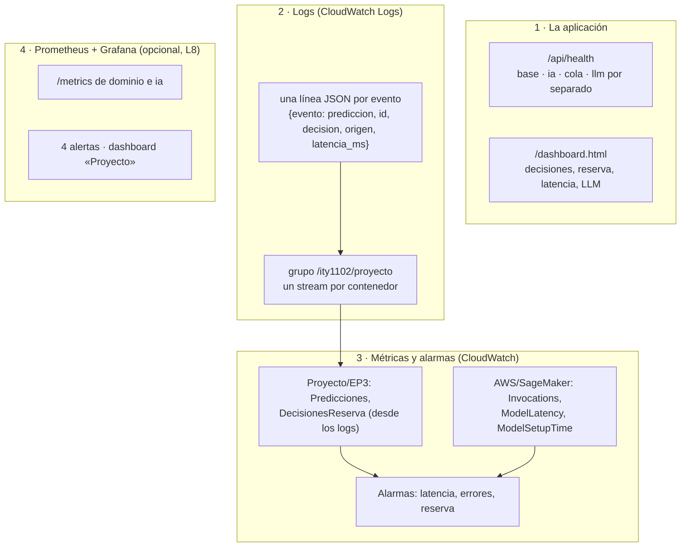
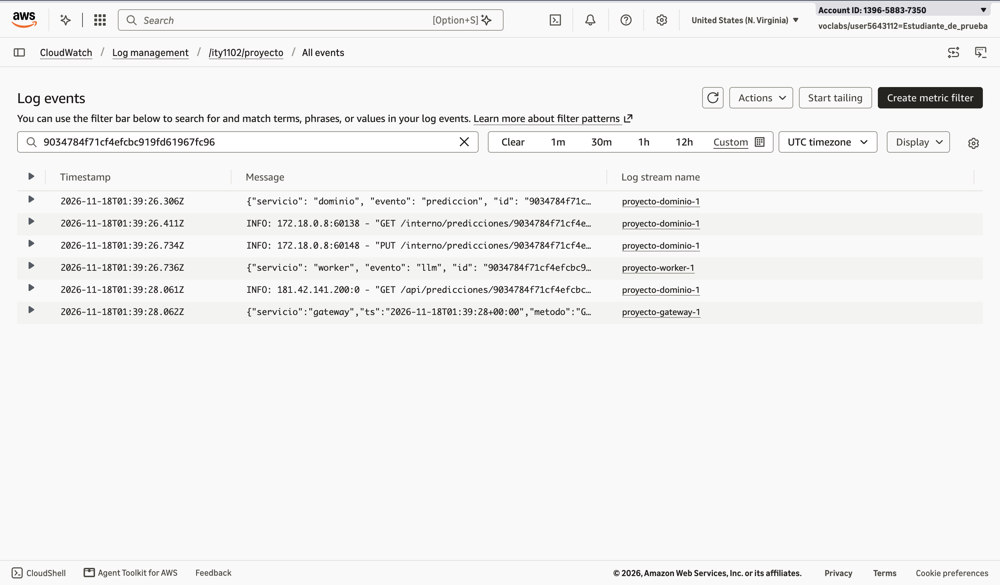
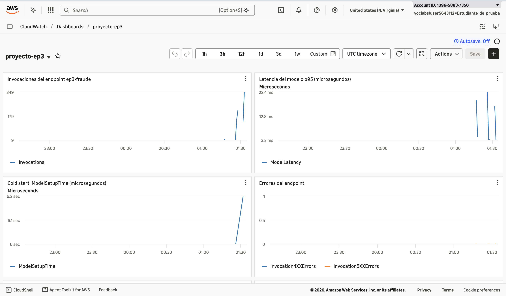
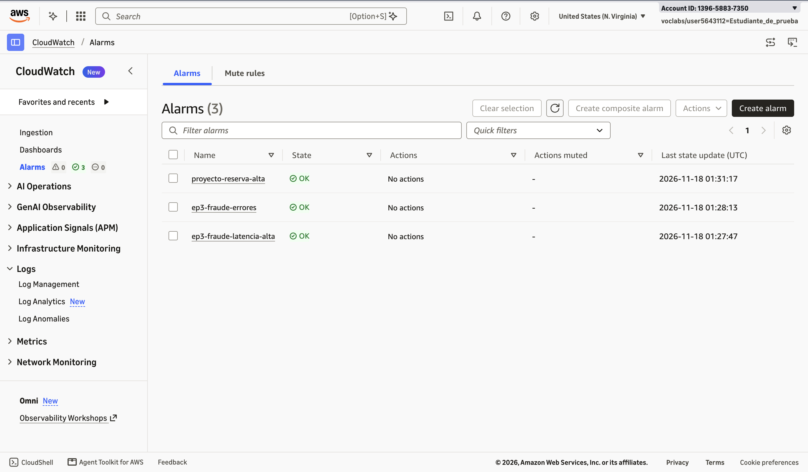
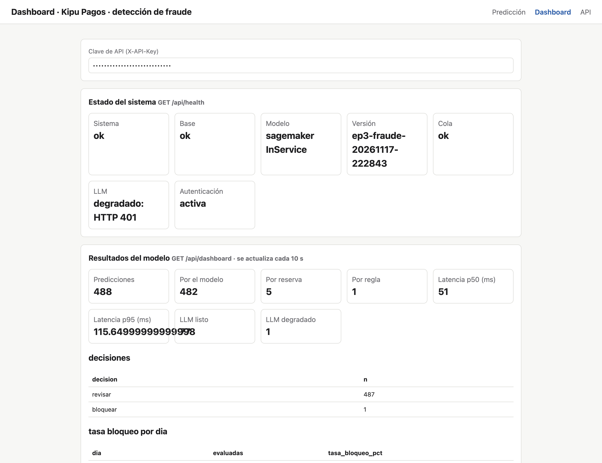

# 14 · Monitoreo en la nube

**Lo que vas a lograr:** ver tu sistema desde afuera: los logs de cada contenedor en **CloudWatch Logs**,
las métricas del endpoint de SageMaker, un **dashboard** y **alarmas** en CloudWatch, el dashboard propio
de la aplicación, y (opcional) Prometheus y Grafana por túnel SSH. Es la evidencia del apartado 3 del
informe y la respuesta a *«muéstrame en CloudWatch el log de la predicción que acabo de hacer»* (IE13).

[← 13 · HTTPS y despliegue](13-https-despliegue.md) · [Índice](../README.md) · [15 · Pruebas y carga →](15-pruebas-carga.md)

**Ya lo tengo si…** encuentras en CloudWatch, por su `id`, la línea de una predicción hecha hace un
minuto, y ves la invocación en la métrica `Invocations` del endpoint.

---

## 14.1 Cuatro niveles de monitoreo



## 14.2 Los logs a CloudWatch

`compose.cloudwatch.yaml` le dice a Docker que mande lo que cada contenedor escribe al grupo
`/ity1102/proyecto`, con un stream por contenedor (`proyecto-dominio-1`, `proyecto-ia-1`, …). Quien escribe
es Docker en la EC2, con el rol de la instancia: sin claves. Ya está en tu `COMPOSE_FILE` (capítulo 13.3).

Comprueba que el rol puede escribir:

```bash
docker compose up -d
docker compose ps          # si algo no queda Up y los logs hablan de awslogs/AccessDenied → ver nota
```

> **Comprobado en el Learner Lab (17-11-2026):** con `LabInstanceProfile` el driver `awslogs` crea el grupo
> y los streams sin problema. Si en tu sesión falla con `AccessDenied`: saca `:compose.cloudwatch.yaml` de
> `COMPOSE_FILE` en el `.env`, `docker compose up -d`, captura el error y avisa al docente. Los logs siguen
> disponibles con `docker compose logs`.

**Encontrar una predicción (IE13):**

1. Haz una predicción desde el front y copia su `id` (está en la respuesta y en el historial).
2. Consola → **CloudWatch → Log groups → `/ity1102/proyecto`** → **Search all log streams** → pega el `id`.

**Lo visible:** la línea `{"servicio": "dominio", "evento": "prediccion", "id": "…", "decision": "…",
"origen": "modelo", "version_modelo": "ep3-…", "latencia_ms": 87, …}` y, si pasó por el LLM, la del worker
con el mismo `id`.

Así se ve la búsqueda por `id` en *Search all log streams*: la misma predicción en el gateway, el dominio
y el worker:



Con **Logs Insights** (CloudWatch → Logs Insights → grupo `/ity1102/proyecto`):

```text
fields @timestamp, id, decision, origen, version_modelo, latencia_ms
| filter evento = "prediccion"
| sort @timestamp desc
| limit 20
```

```text
stats count(*) as n, avg(latencia_ms) as ms_promedio, pct(latencia_ms, 95) as p95 by origen
| filter evento = "prediccion"
```

## 14.3 Dashboard y alarmas, en un comando

Desde **CloudShell**, en tu repositorio (el mismo del capítulo 11):

```bash
git pull
python3 herramientas/cloudwatch.py
```

Si en la cuenta hay **varias EC2 corriendo** (otros ramos), el script toma la que se llama `ep3…` y tiene
`LabInstanceProfile`; para elegirla tú: `python3 herramientas/cloudwatch.py --instancia i-0abc…`.

| Crea | Qué es | Para |
|---|---|---|
| Dashboard `proyecto-ep3` | Invocaciones, `ModelLatency` p95, **`ModelSetupTime` (el cold start)**, errores del endpoint, CPU de la EC2, predicciones y reservas, y las últimas predicciones de los logs | Captura para el informe y la demo (EP3 §5.3 paso 5) |
| Filtros de métricas | Cada línea `evento = prediccion` suma 1 a `Proyecto/EP3 Predicciones`; las de `origen = reserva`, a `DecisionesReserva` | Convertir logs en números que se grafican y alarman |
| Alarmas | `ep3-<caso>-latencia-alta` (p95 > 500 ms), `ep3-<caso>-errores` (5XX > 0), `proyecto-reserva-alta` (> 5 reservas/min) | El capítulo de monitoreo con «umbral y acción» |

**DESAFÍO O2:** los umbrales de las alarmas salen del RNF de rendimiento **de tu caso**. Cámbialos en
`herramientas/cloudwatch.py` y vuelve a correrlo (es idempotente). Si algún paso dice `NO · … AccessDenied`,
créalo en la consola con los mismos valores: **CloudWatch → Dashboards → Create** /
**Alarms → Create alarm**. En la prueba, el Learner Lab dejó crear todo por API:





## 14.4 Las métricas del endpoint (la demo, paso 5)

Consola → **SageMaker → Inference → Endpoints → `ep3-<caso>` → Monitor** (o el dashboard de 14.3).

| Métrica | Qué es | Unidad | Para qué |
|---|---|---|---|
| `Invocations` | Llamadas al endpoint | cantidad | «La invocación recién hecha» en la demo |
| `ModelLatency` | Lo que tardó el modelo | microsegundos | Latencia real sin la red |
| `OverheadLatency` | Lo que agrega SageMaker | microsegundos | Diferencia con lo que mide tu IA |
| `ModelSetupTime` | Arranque del contenedor serverless | microsegundos | **El cold start**, medido por AWS |
| `Invocation4XXErrors` / `5XXErrors` | Errores | cantidad | Alarma |

Las métricas aparecen con 1 a 2 minutos de retraso: en la demo, haz la predicción al principio.

El dashboard propio del sistema (`/dashboard.html`, EP2) sigue funcionando en la nube y complementa a
CloudWatch con las decisiones por origen:



## 14.5 Prometheus y Grafana por túnel (opcional)

Si tu capítulo 8.1 de EP2 se basó en el L8, puedes llevarlo a la nube sin abrir puertos:

```bash
# en la EC2: agrega «:compose.monitoreo.yaml» al final de COMPOSE_FILE en el .env, y
echo "GRAFANA_PASSWORD=$(python3 -c 'import secrets;print(secrets.token_urlsafe(12))')" >> .env
docker compose up -d
# en tu computador: un túnel SSH para los dos puertos
ssh -i labsuser.pem -L 3000:localhost:3000 -L 9090:localhost:9090 ubuntu@TU-IP
```

Grafana en **http://localhost:3000** (usuario `admin`), carpeta **Proyecto**: latencia p95 por ruta,
solicitudes por código, decisiones por origen, latencia por réplica de IA, réplicas arriba. Prometheus
en **http://localhost:9090/alerts**: cuatro alertas de `monitoreo/alertas.yml`. Probado: con una réplica
de IA detenida, `ReplicaDeIACaida` pasa a *firing* en ~40 s.

## Al informe

**Apartado 3:** capturas de `Invocations` y `ModelLatency` del endpoint, de `ModelSetupTime` (cold start),
y de los logs del microservicio (14.2). Una tabla «métrica · umbral · acción · a quién avisaría en
producción» con las alarmas de 14.3.

## En la presentación

**IE13 (12%):** *«Muéstrame en CloudWatch los logs de la predicción que acabo de hacer»* — 14.2, sin ayuda
externa y explicando cada paso. **Demo, paso 5:** la invocación en las métricas del endpoint (14.4).

[Siguiente: 15 · Pruebas y carga →](15-pruebas-carga.md)
