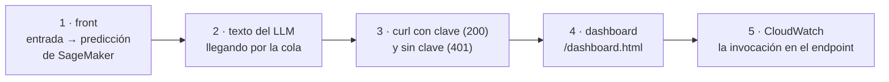

# 16 · Informe y presentación de EP3

**Lo que vas a lograr:** el informe de 10 páginas con sus cinco apartados y tres anexos, las 6 láminas,
una demo de 5 minutos ensayada y la respuesta preparada a cada pregunta. La presentación vale el **80%**.

[← 15 · Pruebas y carga](15-pruebas-carga.md) · [Índice](../README.md) · [Problemas frecuentes →](17-problemas-frecuentes.md) · [18 · Para un 7 →](18-respuestas-de-7.md)

---

## 16.1 El informe: qué va en cada apartado

| Apartado | Contenido | Evidencia que ya tienes | IE |
|---|---|---|---|
| **1 · Modelo y endpoint** | Tipo, framework, datos, hiperparámetros, separación; tipo de endpoint, memoria, concurrencia, versión | `sagemaker/estado.json`, `METRICAS.md`, capturas `InService` e invocación (cap. 11) | IE1 |
| **2 · Consumo e interpretabilidad** | Cómo usa la aplicación la salida para **la decisión del caso**; qué ve el usuario y cómo entiende el porqué; qué agrega el LLM y qué pasa sin él | Captura del front con razones / productos / artículos; modo degradado (cap. 12.5) | IE2 |
| **3 · Plataforma, infraestructura y costos** | Diagrama de despliegue en AWS; cold start medido 2 veces; costo mensual al volumen del caso desglosado (EC2, SageMaker, S3, LLM pagado); CloudWatch | Cap. 13.1, 11.5–11.6, 11.8 (`costos.py`), 14 | IE4, IE5 |
| **4 · Integración y seguridad** | Secuencia síncrona + cola con camino de falla; tabla de rutas; autenticación, HTTPS, rate limiting, secretos, anonimización; el puerto 22 como deuda | Cap. 12.1, `/docs`, cap. 13.4 y 13.5 | IE7 |
| **5 · Pruebas y calidad** | Casos de prueba y resultados; carga (p50/p95/p99, req/s, errores) contra el RNF; métricas del modelo vs línea base; 3 optimizaciones con su costo | Cap. 15 | IE10 |

**Anexos** (no cuentan en las 10 páginas): **A** referencias APA 7 (mín. 2, citadas) · **B** uso de IA
generativa, firmada, para informe **y código** (incluye que partieron de esta plantilla y qué cambiaron)
· **C** URLs HTTPS (front, `/docs`, `/api/health`), **una clave de API de prueba para el docente**,
nombre del endpoint, repositorios y tag `ep3`, último workflow verde, una fila por integrante con su
usuario de GitHub.

### El costo mensual (apartado 3), con la estructura correcta

| Componente | Volumen **del caso** | Supuesto | USD/mes |
|---|---|---|---|
| EC2 (o lo que la reemplace en producción) | — | `t3.medium` 730 h = 0,0416 × 730 | ≈ 30,4 |
| IP elástica | — | incluida con la instancia encendida | 0 |
| SageMaker serverless | invocaciones/mes del caso | memoria × duración medida (calculadora) | |
| S3 | GB de datos tratados + modelos | calculadora | |
| CloudWatch | GB/mes de logs | calculadora | |
| LLM en un proveedor pagado | textos/mes del caso × tokens | precio por millón de tokens del proveedor elegido | |
| **Total vs. presupuesto del caso** | | | |

> **Caso 3:** el volumen se calcula con 200.000 transacciones diarias (1.000.000 sin rediseño), y el LLM
> solo para las que van a revisión. **Caso 2:** 340.000 contactos al mes. **Caso 1:** 100.000 usuarios al
> mes y una campaña por cliente con consentimiento.

## 16.2 Las 6 láminas (4 minutos)

Sirven para el **IE3**: no repitan lo que van a mostrar en vivo.

| # | Lámina | Lo que tiene que decir |
|---|---|---|
| 1 | El caso | Empresa, el problema con su número (la pérdida, la espera, la conversión) |
| 2 | La decisión | **Quién** decide **qué** con la salida del modelo (el analista bloquea/aprueba, marketing envía la campaña, el bot responde o deriva) |
| 3 | El modelo | Qué predice, con qué datos, su métrica contra la línea base, qué cuesta un error (falso positivo vs falso negativo) |
| 4 | La arquitectura desplegada | El diagrama de 13.1, con SageMaker, la cola y el LLM |
| 5 | Por qué este diseño decide mejor | Reglas antes del modelo, reserva, explicación, LLM fuera del camino crítico, el RNF que cumple (o no) y su medición |
| 6 | Costo y lo que falta | Costo mensual vs presupuesto, deuda declarada (puerto 22, rate limit en memoria…) |

## 16.3 La demo (5 minutos), como guion



Ten **abiertas antes** estas pestañas: el front, `/dashboard.html`, `/docs`, CloudWatch (dashboard
`proyecto-ep3` o *SageMaker → Endpoints → Monitor*), Logs Insights con la consulta del capítulo 14.2, y
una terminal con estos comandos en un archivo:

```bash
B=https://<tu-nombre>.sslip.io; K="X-API-Key: <clave>"
curl -s -X POST $B/api/predict -H "$K" -H 'content-type: application/json' -d '<ejemplo>'          # 200
curl -s -o /dev/null -w '%{http_code}\n' -X POST $B/api/predict -H 'content-type: application/json' -d '<ejemplo>'   # 401
```

## 16.4 Las preguntas, con dónde está cada respuesta

La respuesta modelo de cada una, con números reales, repreguntas y lo que baja la nota: **[capítulo 18](18-respuestas-de-7.md)**.
Para escribir el informe: **[`entrega/informe-ep3.md`](../entrega/informe-ep3.md)** y `herramientas/evidencias.sh`; para las láminas: **[`entrega/laminas-ep3.md`](../entrega/laminas-ep3.md)**.

| IE | Pregunta (EP3 §5.4) | Respuesta en esta guía |
|---|---|---|
| **IE3** · 18% | ¿Qué decisión de la empresa cambia por este modelo? Muestra una predicción y di qué haría con ella quien la recibe | Ficha de tu caso, sección 1; lámina 2 |
| **IE6** · 18% | Invoca el endpoint frío y caliente, mide; ¿por qué serverless con esa memoria? ¿costo vs Bedrock o el modelo en el contenedor? | Cap. 11.5–11.6 y 11.8; respuesta modelo en 18.3 |
| **IE8** · 9% | Clave de NVIDIA inválida + reinicio del worker: ¿qué ve el usuario, qué queda en la cola, qué se registra? | Cap. 12.5 |
| **IE9** · 12% | La demo de 16.3 | Cap. 16.3 |
| **IE11** · 7% | Locust 1 minuto en vivo: p95, ¿cumple el RNF?, ¿qué cambiarías y cuánto cuesta? | Cap. 15.4 |
| **IE12** · 4% | Lenguaje: endpoint, cold start, concurrencia, percentil, rate limiting, modo degradado, interpretabilidad | Todo |
| **IE13** · 12% | Escribe una prueba del 422 y córrela, **o** encuentra en CloudWatch el log de la predicción | Cap. 15.3 y 14.2 |

## 16.5 Antes del turno

- [ ] **30 minutos antes:** Start Lab; la EC2 en *Running*; `curl -s https://<tu-nombre>.sslip.io/api/health`
      con `"estado": "ok"`. Si usan endpoint de tiempo real (plan B), créenlo ahora.
- [ ] Haz **una predicción de calentamiento** si no vas a mostrar el cold start (o espera 10 min si sí).
- [ ] `TAG=ep3` en el `.env` (el código que corre es el del tag) y `LIMITE_POR_MINUTO` de vuelta a su valor.
- [ ] Las láminas subidas a AVA antes del turno.
- [ ] Todos en la sala 10 minutos antes. Cada uno sabe responder IE6, IE8 e IE13 sobre el sistema.

**Si algo falla en vivo:** di qué falló, por qué y cómo se corrige (EP3 §5.5). Las herramientas:
`/api/health`, `docker compose ps`, `docker compose logs <servicio> --tail 30`, CloudWatch Logs.

[Problemas frecuentes →](17-problemas-frecuentes.md) · [18 · Para un 7 →](18-respuestas-de-7.md)
